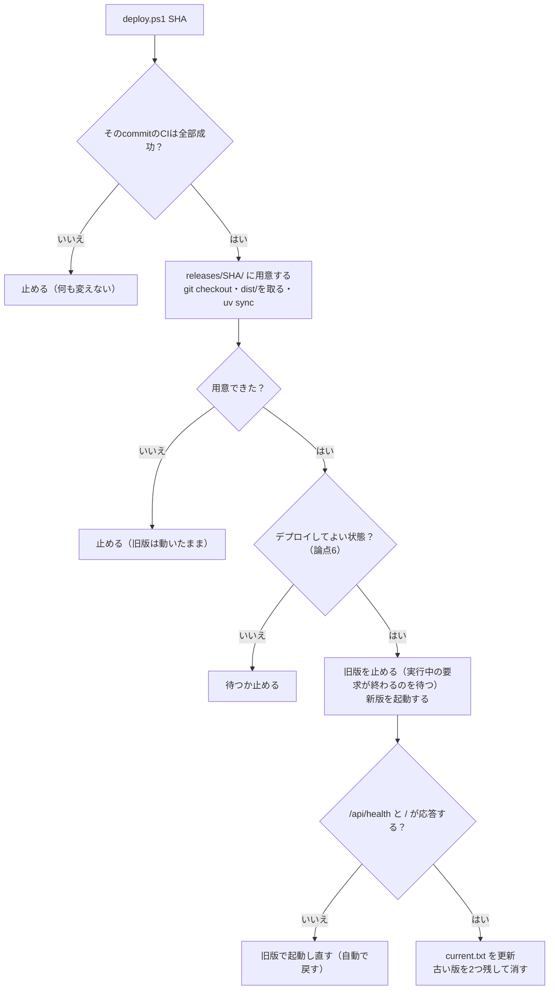
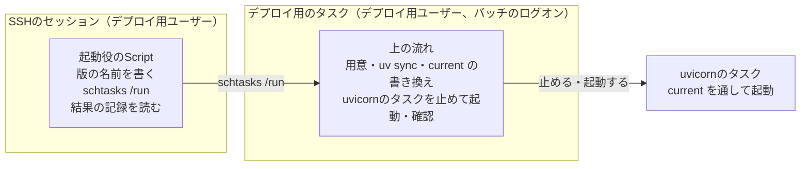
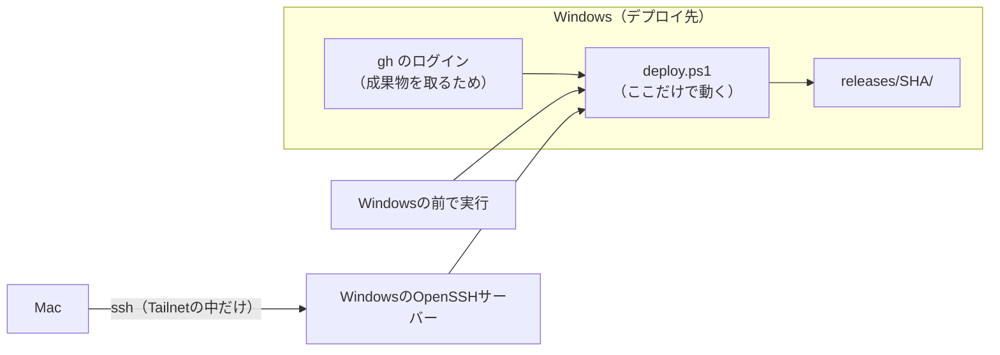

# ADR 0003 — 変更をデプロイ先へ反映する方法

| 項目 | 内容 |
|---|---|
| 状態 | **決定（2026-11-09）。2026-11-10に論点5を見直した。**論点1〜8すべて決定。論点3のうち「成果物のテスト」だけはADR 0002の論点1を待つ。論点8の「Windowsで確かめること」は2026-11-10に済んだ。論点5の見直し（デプロイの作業をタスクの中で行う）は、2026-11-10にWindowsで確かめた。**ADR 0002の論点1でCを選ぶ場合だけ、確かめることが1つ残る** |
| 決める人 | 利用者 |
| 前提 | [ADR 0001](0001-run-on-home-windows-via-tailscale.md)（家のWindowsで動かし、Tailscaleで繋ぐ）。[ADR 0002](0002-switch-deploy-target-by-configuration.md)（デプロイ先を設定だけで切り替えられる形にする） |
| 仕組みの説明 | [Pythonのバックエンドは、何をデプロイするのか](../questions/2026-11-09-what-a-python-backend-deploys.md)、[ジャンクションとは何か](../questions/2026-11-10-what-a-junction-is.md)、[`current`は何を切り替えるのか](../questions/2026-11-10-why-switch-releases-through-current.md) |
| Windowsで確かめた結果 | [デプロイの前に、家のWindowsで確かめる手順](../development/windows-deploy-checks.md)（2026-11-10に実行） |

## 背景

最初に利用者が出したデプロイ要件の2つ目は、次のとおりである。

> コードの変更を容易に取り込められる。変更に対して安全にデプロイできる。

ADR 0001・0002で「どこで・どう動かすか」は決まりつつある。**このADRは「変更をどう届けるか」を扱う。**
利用者はインフラエンジニアを目指しており、**可用性を保ちながら安全にデプロイする方法**を重視している。

### この構成ならではの制約

| # | 制約 | 効くところ |
|---|---|---|
| 1 | **Windowsは家のRouterの内側にあり、外から接続を受けられない** | GitHubからWindowsへ押し込めない。**Windows側から取りに行く**しかない |
| 2 | **リポジトリは公開（PUBLIC）である**（2026-11-09に`gh repo view`で確認） | 他人が出したPRのコードが自宅で実行されうる仕組みは使えない（論点1） |
| 3 | **uvicornは1 Processだけ**（間隔・同時実行・安全停止は`MarketplaceAccess`が1 Processの中で数える） | 新旧2つのProcessを並べる切り替え（Blue-Green）が使えない（論点5） |
| 4 | **安全停止の状態はProcessのメモリにしかない** | 安全停止の最中に再起動すると、停止が解除される（論点6） |
| 5 | [ci-policy §7](../development/ci-policy.md#7-やらないこと)が「Deploy / Release Pipeline」「定期実行」「Secretsを要するJob」をやらないとしている | 論点2で一部を開き直す |

## 論点と状態

| # | 論点 | 状態 | 結論・推奨 |
|---|---|---|---|
| 1 | [きっかけ](#論点1--きっかけ) | **決定** | 手で実行する（コマンド1つ） |
| 2 | [成果物](#論点2--成果物) | **決定** | FrontendはCIで1回だけビルドしたものを持ってくる。Backendはcommit SHAのソース＋`uv.lock`。コンテナは今は使わない |
| 3 | [CIでの検査](#論点3--ciでの検査) | **決定**（成果物のテストは保留） | 同じテストを2つのOSで流す。BackendのpytestをWindowsでも流す |
| 4 | [可用性の目標](#論点4--可用性の目標) | **決定** | Backendを含む変更では数秒止まってよい。Mercariへの約束を優先する |
| 5 | [切り替え方](#論点5--切り替え方) | **決定**（2026-11-10に見直し、Windowsで確かめた） | 版ごとのフォルダー、確認、失敗したら自動で戻す。Blue-Greenは採らない。**準備と切り替えはタスクの中で行い、SSHからはそのタスクを起動するだけにする** |
| 6 | [デプロイ前に確かめること](#論点6--デプロイ前に確かめること) | **決定** | CIが緑、安全停止中でない、実行中の検索が無い。`/api/health`に状態を足す（`src/`の小さな変更） |
| 7 | [細部](#論点7--細部) | **決定** | CIで1つのファイルにまとめる、`uv sync --locked`、出所証明は慣れてから、WindowsからもMacからも実行する |
| 8 | [デプロイを動かすアカウント](#論点8--デプロイを動かすアカウント) | **決定**（2026-11-10に確かめた） | **デプロイ専用の一般ユーザー**で動かす。管理者は踏み台として鍵だけで残し、後で踏み台だけに絞る。デプロイ用ユーザーに「バッチ ジョブとしてログオン」の権利を与え、TailscaleのRun unattendedを有効にした |

## 論点1 — きっかけ

### 決定（2026-11-09）— 手で実行する

**利用者が決めた。**デプロイScriptを1回実行する。Windowsの前で実行してもよいし、Tailnet経由で
遠隔から実行してもよい（[論点7](#論点7--細部)）。

| | ① 手で実行（**採用**） | ② Windowsが定期的に確認 | ③ GitHub Actionsのself-hosted runner |
|---|---|---|---|
| 中身 | Scriptを1回実行する | タスクスケジューラーが数分おきにmainを見て、新しければデプロイ | Windowsに置いたrunnerが、mainへのpushを受けてデプロイを実行 |
| 手間 | コマンド1つ | 無し | 無し |
| 人が判断するか | **する** | しない | しない |
| ci-policy §7との関係 | 「取り込みは手動のScript」と合う | 「定期実行」「無人実行を常態化させない」と緊張する | 「Deploy Pipeline」をやらない、を開き直す |
| リスク | 忘れる | 壊れた版も無人で入る | **公開リポジトリでは危険。**他人のPRのコードが自宅のWindowsで実行されうる。GitHub自身が、公開リポジトリでのself-hosted runnerを推奨していない |

**選ばなかった理由。**②は判断を機械へ委ねる（ci-policy §7の「CIからの自動Merge」を避けた理由と同じ）。
③は制約2（公開リポジトリ）のために避ける。利用者1人で、デプロイしたい時は自分で分かっている。

## 論点2 — 成果物

### 決定（2026-11-09）

**利用者が決めた。**判断の軸は「**一度だけビルドし、同じものをどこへでも持っていく（Build once, deploy many）**」
である。利用者の言葉では、「Windowsでビルドすると、GitHubのコードと動いているコードが違うことになる」。

| もの | 決定 | 「CIで確かめたものと同じ」を保証する方法 |
|---|---|---|
| **Frontend**（`dist/`） | **CIがLinuxで1回だけビルドし、保存する。Windowsはそれを持ってくる**（ビルドしない） | CIが保存した実物そのもの。`dist/`はGitに入っていないのでcommit SHAでは取れない |
| **Backendのソース**（`.py`、`uv.lock`） | **CIで確かめたcommit SHAを`checkout`する** | commit SHAは全ファイルの中身から計算した指紋 |
| **Backendの依存パッケージ** | **`uv sync`で、`uv.lock`のとおりに入れる** | `uv.lock`がOSごとのファイルをsha256付きで記録している。1バイトでも違えば入れない |
| コンテナ | **今は使わない** | — |

**Backendにはビルドが無い。**Pythonはソースのまま実行する言語で、デプロイする成果物はソースそのものである。

### 選ばなかったもの

| | Windowsでビルドする | **コンテナ**（CIでLinuxのイメージを作り、Windowsでも動かす） |
|---|---|---|
| メリット | 部品が最も少ない | インタプリタまで含めて**完全に**同じものになる。Windows固有の問題が消える |
| デメリット | **CIで確かめたものとは別の成果物になる** | Docker Desktop（WSL2）の導入・常駐・メモリ。起動時に自動で上げる設定 |
| 選ばなかった理由 | Build once, deploy manyに反する | `uv.lock`の指紋と、CIのWindows Job（論点3）で、パッケージまでは揃えられる。残るのはPythonインタプリタだけで、手間に見合わない |

**コンテナを使わないことで残るもの。**Pythonインタプリタと、機械語を含むパッケージは、OSごとに別物である。
LinuxのCIで確かめたものをWindowsへは持っていけない。**そこは論点3のWindows Jobで埋める。**

### 実装に要るもの

- CIで`dist/`を保存する（GitHub Actionsのartifact）。[ci-policy §7](../development/ci-policy.md#7-やらないこと)の
  「Deploy / Release Pipeline」の行を書き直す
- Windowsが保存された`dist/`を取るために`gh`へログインする。**CI側にSecretsは要らない**

## 論点3 — CIでの検査

### 決定（2026-11-09）— 同じテストを2つのOSで流す

**テストを分けるのではなく、同じテストを2つのOSで流す。**OSで結果が変わりうるものだけをWindowsでも流す。

| Job | Linux | Windows | 理由 |
|---|---|---|---|
| Backendのテスト（pytest） | 流す | **流す（新規）** | サーバーのOSの上で動き、OS専用のパッケージを含み、OSの機能を呼ぶ |
| Frontendの型検査・テスト・ビルド | 流す | 流さない | 出力はOSに依存しない。ビルドは1回だけ |
| E2E、文書、PoC | 流す | 流さない | デプロイ先のOSに関係が薄い、またはデプロイしない |

**判断の基準は3つの問い**（どこで動くか、OS専用のバイナリを含むか、OSの機能を呼ぶか）である。
最終的な証拠は、その環境でテストを流した結果だけである。

### 既に分かっているWindowsの問題

| 問題 | 場所 | 内容 |
|---|---|---|
| **`time.tzset()`はUnixにしか無い** | `src/backend/tests/unit/test_normalization.py` | タイムゾーンを切り替えるテストが、Windowsではエラーになる見込み（2026-11-09時点で未実行）。**Windows Jobを足すときに手当てが要る** |

### 保留 — 成果物のテスト

「ソース → ビルド → 成果物」の検査のうち、**成果物のテストが無い。**E2EはViteの開発サーバー（ソース）で
動き、ビルドした`dist/`を通らない。保存した`dist/`をデプロイ先と同じ形で配ってE2Eを流すかは、
ADR 0002の論点1（画面を誰が配るか）が決まってから決める。

## 論点4 — 可用性の目標

### 決定（2026-11-09）

**利用者が決めた。**「Backendを含む変更では数秒止まってよい。Mercariへの約束を優先する」。

| 項目 | 目標 |
|---|---|
| Frontendだけの変更 | **止まらない**（画面の配り手がuvicornと別なら。ADR 0002の論点1による） |
| Backendを含む変更 | **止まるのは数秒以内。**初回のデプロイで実測して記録する |
| 壊れた版 | **利用者に見せない。**確認に失敗したら自動で旧版に戻す |
| 戻す時間 | 1コマンド、数秒 |
| 約束 | Mercariへの「1 Process」と安全停止を、**デプロイ中も破らない** |

**取引。**完全に止まらない形（Blue-Green）は、Mercariへの約束（制約3）を緩めない限り作れない
（[論点5](#論点5--切り替え方)）。数秒止まることを受け入れて、約束を守る。

## 論点5 — 切り替え方

### 決定（2026-11-09）— 版ごとのフォルダー、確認、自動で戻す

**利用者が決めた**（提案者の推奨どおり）。

**Windowsの事情。**動いているPythonの環境（`.venv`）のファイルは、実行中に上書きできないことがある。
また、Card Digger自身は`.venv`から**ソースの場所を指して**入っている（editableインストール）ので、
ソースのフォルダーを書き換えると動いている版に響く。**その場で上書きせず、版ごとにフォルダーを分ける。**

```text
C:\card-digger\
├── releases\
│   ├── 8eda89c\      ← 1つ前（戻す先として残す）
│   └── b8da86c\      ← 新しい版。ここで用意する
│       ├── src\backend\.venv    ← 版ごとに作る。この版のソースを指す
│       └── dist\               ← CIが作ったもの
└── current  ──(ジャンクション)──> releases\b8da86c\   ← 今動いている版。入口とuvicornはここを指す
```

**`current`は、版のフォルダーを指す別名（ジャンクション）である。**入口（`tailscale serve`）やuvicornの起動は
常に`current`を指し、デプロイは`current`の指し先を替えるだけにする。毎回の切り替えで入口の設定を変えずに済み、
**管理者の権限が要らない**（[論点8](#論点8--デプロイを動かすアカウント)）。



| 安全のための仕掛け | 守るもの |
|---|---|
| CIが緑のcommitだけ | 壊れたコードを入れない |
| 用意が終わるまで旧版を止めない | 用意の失敗で使えない時間を作らない。**止まる時間を起動の数秒だけにする** |
| 起動後に`/api/health`と`/`を確かめる | 起動したのに動かない版を残さない。`/api/health`はMercariへ問い合わせない |
| 失敗したら自動で旧版へ戻す | 壊れたまま放置しない |
| 版ごとのフォルダー、前の版を残す | 手で戻すのも、フォルダーを指し直すだけ |
| 動いている版を記録する | 今どの版が動いているか分かる |

**Frontendだけの変更**で、画面の配り手がuvicornと別なら（ADR 0002のC）、uvicornを止めずに`dist/`の
指し先だけを替える。止まる時間は0になる。デプロイ後は、各端末で開いたままのタブを再読み込みする
（古いJSがメモリに残るため）。

### 2026-11-10の見直し — 準備と切り替えはタスクの中で行う

**利用者が決めた**（提案者の推奨どおり）。上の流れ（用意・`uv sync`・`current`の書き換え・止めて起動・確認）は変えない。
変えるのは**誰がそれを動かすか**である。

**きっかけ。**家のWindowsで確かめたところ（[確かめの手順書](../development/windows-deploy-checks.md#わかったこと2026-11-10時点)）、
デプロイ用ユーザーが**SSHから入ったセッションの中では、ジャンクションをたどれなかった**（`os error 448`）。
`current`もジャンクションで、uvが作る`.venv`も内部でジャンクションを通る（`3.11`という札が実際の版を指す）。
SSHから`uv venv`は失敗し、uvで作った`.venv`のPythonも起動できなかった。**一方、タスクから起動したプロセスはたどれた**
（`.venv`のPythonが動き、`200`を返した）。仕組みは[ジャンクションの問答 Q6](../questions/2026-11-10-what-a-junction-is.md#q6-なぜsshからはたどれなかったのか管理者でもだめなのか)にある。

**決定。**管理者が最初の1回だけ「**デプロイ用のタスク**」を登録する（デプロイ用ユーザーとして、ログインしていなくても動く）。
SSHからは、版の名前を渡してそのタスクを起動し、結果の記録を読むだけにする。上の流れは、すべてそのタスクの中で動く。



| SSHのセッションで行うこと | 2026-11-10に確かめたか |
|---|---|
| タスクを起動する（`schtasks /run`）、状態を見る（`schtasks /query`） | **できた** |
| 8000番に問い合わせる（`curl.exe`） | **できた** |
| デプロイ用ユーザーのフォルダーのファイルを読む・書く | **できた**（`C:\card-digger-check\`） |
| ジャンクションをたどる、uvの`.venv`を作る・使う | **できなかった。だからタスクへ預ける** |

| 選択肢 | 中身 | 判定 |
|---|---|---|
| **案1：準備と切り替えをタスクの中で行う（採用）** | 上のとおり | SSHで行うのは確かめた操作だけになる。ファイルの作業は、本番のuvicornと同じ「バッチ」のログオンで行うので、確かめた結果がそのまま当てはまる。論点8の「管理者は最初の1回だけ」も保てる |
| 案2：ジャンクションを使わない | `current`をやめ、版の名前をファイルに書いて起動用Scriptが読む（[`current`の問答 Q4のE](../questions/2026-11-10-why-switch-releases-through-current.md#q4-ほかにどんなやり方がありそれぞれ何が起きるか)） | **uvの`.venv`が内部でジャンクションを通るので、SSHのセッションで`.venv`を扱えない問題は残る。**uvの作りに左右される |

#### Windowsで確かめたこと（2026-11-10）

手順と記録は[タスクの中で確かめる手順書](../development/windows-deploy-task-checks.md)にある。本物のソースを公開リポジトリから取り、
Mercariへ通信しない受入用のアプリを`current`を通して起動した。デプロイを2回行い、2回目は動いているuvicornから始めた。

| 確かめたこと | 結果 |
|---|---|
| タスクの中で`uv venv`・`uv sync --locked`が通るか | **通った。**`.venv`を作り、`mercapi`を`git`で取り、27個のパッケージを入れた。デプロイ用ユーザーのタスクから`git`もGitHubも使えた |
| デプロイ用のタスクから、uvicornのタスクを止めて起動できるか | **できた。**uvicornのタスクの`前回の実行時刻`が、1回目の起動から2回目の起動へ変わった |
| 版の名前をどうタスクに渡すか | **ファイルで渡せた。**SSHから書いた`request.txt`（40文字のcommit SHA）を、タスクが読んだ |
| タスクが作った`current`を、別のタスク（uvicorn）がたどれるか | **たどれた。**`current`を通して起動し、`/api/health`が`200`を返した |

**デプロイScriptに持ち込むこと。**

| 分かったこと | Scriptでどうするか |
|---|---|
| **`schtasks /end`は、動いていないタスクにも`exit 0`を返す** | 止めたことを`exit`の値で判断しない。`schtasks /query`の状態や、8000番が空いたかで確かめる |
| `schtasks /run`の「成功」は、頼めたという意味で、動いたという意味ではない（[前回](../development/windows-deploy-checks.md#わかったこと2026-11-10時点)） | 起動したことは`/api/health`で確かめる |
| 依存の`mercapi`はGitHubのリポジトリから入るので、`uv sync`に`git`が要る | Windowsに`git`が要る（2026-11-10時点で入っていた）。デプロイ前の確かめに加える |
| 止めてから応答が戻るまで4秒以内だった（受入用のアプリ） | 本番の停止時間は、論点4のとおり初回のデプロイで測る |

#### まだ確かめていないこと

| 確かめること | 分からないと困ること |
|---|---|
| ADR 0002の論点1でCを選ぶなら、`tailscale serve`が`current\dist`をたどれるか | `tailscale serve`は管理者のものとして動く（論点8）。デプロイ用ユーザーが作ったジャンクションを、Tailscaleのサービスがたどれるかは分からない |

### 選ばなかったもの

| | その場で上書き | 版ごとのフォルダー（**推奨**） | Blue-Green |
|---|---|---|---|
| 中身 | 1つのフォルダーを`git pull`で書き換え、再起動 | 新しい版を別のフォルダーに用意し、止めて起動 | 新版を旧版と**並べて**起動し、確かめてから入口を切り替える |
| 止まる時間 | 用意の時間＋起動 | 起動の数秒 | 0 |
| 戻しやすさ | 悪い（旧版が消えている） | 良い | 良い |
| **Mercariへの約束** | 守れる | **守れる** | **破れる**（下） |

**Blue-Greenを採らない理由。**新旧を並べると、切り替えの前後に**2つのProcessが同時にMercariへアクセスしうる**
時間ができる。旧版で切り替え直前に始まった検索は、最大30秒（収集の上限）続く。

```text
時刻 →        切り替え
旧版   ███████████│███████   ← 切り替え直前に始まった検索が、まだMercariへ問い合わせ中
新版          ████│█████████ ← 切り替え後の新しい検索がMercariへ
                  └─ この重なりで「同時実行1」が破れる
```

## 論点6 — デプロイ前に確かめること

### 決定（2026-11-09）— `/api/health`に状態を足す

**利用者が決めた**（提案者の推奨どおり）。

| # | 確かめること | 理由 | 今できるか |
|---|---|---|---|
| 1 | **そのcommitのCIが全部成功している** | 壊れたコードを入れない | できる（`gh run list`など） |
| 2 | **安全停止中ではない** | 再起動すると停止が解除され、Mercariに拒否された直後に問い合わせを再開してしまう（制約4） | **できない** |
| 3 | **実行中の検索が無い** | 止めると検索が途中で切れる | **できない**（旧版を止めるときに終わるのを待つことはできる） |

**2と3は、今のAPIでは外から知る手段が無い。**`/api/health`は「起きているか」しか返さない。
（**2026-11-10に足した。**`safetyStop`と`collectionsInFlight`を返す。形は[MVP仕様](../product/mvp-spec.md#get-apihealth)にある。）
`/api/health`に安全停止と実行中の収集の状態を足すなど、**`src/`の小さな変更が要る。**
これはデプロイ先固有の値ではなく、アプリの状態を外へ見せる変更なので、「デプロイ先を`src/`に持たない」
方針には反しない。

**選ばなかった方（今は足さない）。**CIが緑かだけを確かめ、安全停止中かは人が画面で確かめる。`src/`は変えずに済むが、
確かめ忘れると停止が解除されうる。

## 論点7 — 細部

### 決定（2026-11-09）

**利用者が決めた**（すべて提案者の推奨どおり）。

| 細部 | 選択肢 | 決定 |
|---|---|---|
| 成果物の取り方 | 3つを別々に取る（`dist/`はActions、ソースはリポジトリ、パッケージはPyPI）／CIで`dist/`とソースを**1つのファイル**にまとめる | **CIで1つのファイルにまとめる。**デプロイの単位が1つになり、ハッシュ1つで同じものだと確かめられる。依存パッケージはどちらでもPyPIから入れる |
| `uv sync`の指定 | `--frozen`（`uv.lock`をそのまま使う）／`--locked`（`uv.lock`が`pyproject.toml`と食い違っていたらエラー） | **`--locked`。**デプロイでは食い違いを見逃さない |
| 成果物の出所の証明 | 使わない／GitHubのartifact attestation（「このリポジトリのこのWorkflowが、このcommitから作った」をWindowsで`gh attestation verify`で確かめる） | **慣れてから足す。**最初はハッシュの照合だけで始める（インフラの練習の題材として残す） |
| 遠隔実行 | Windowsの前で実行／MacからTailnet経由でWindowsのOpenSSHへ入って実行 | **決定（下）** |

### 決定（2026-11-09）— WindowsからもMacからも実行する

**利用者が決めた。**「デプロイはWindowsでもMacでも実行したい」。

**Scriptが動くのは、どちらの場合もWindowsである。**Macは、Tailnet経由でWindowsに入って
同じScriptを実行させるだけで、Mac自身はデプロイの中身を何も持たない。



| 決めたこと | 理由 |
|---|---|
| **Scriptは1つで、Windowsにだけ置く** | どこから実行しても同じ手順になる。Macに別の手順を持たせると、2つが食い違う |
| **GitHubへのログイン（`gh`）はWindowsだけが持つ** | 成果物を取るのはWindowsである。認証情報を置く場所を1つにする |
| **MacからはSSHで入る** | 下の「入り方」 |

#### Macからの入り方（推奨。保留）

| 選択肢 | 内容 | 判定 |
|---|---|---|
| Tailscale SSH | Tailscaleが自分のSSHサーバーを持つ機能 | **Windowsでは使えない見込み。**第三者の記述では「Windowsはサーバーとして非対応」。**公式ドキュメントでは確かめられていない**（2026-11-09） |
| **Windows標準のOpenSSHサーバー** | Windowsの機能として入れられるSSHサーバー | **推奨** |

**2026-11-09時点で、MacからWindowsへはSSHで入れる**（利用者の申告。どのSSHサーバーか、どのアドレスで入っているかは未確認）。

SSHサーバーは**Windowsのもう1つの入口**である。uvicornを`127.0.0.1`に閉じたのと同じ考えで、
次の3つで絞れているかを確かめる（**2026-11-09に確かめた結果と決定は下**）。

| # | 絞り方 | 理由 |
|---|---|---|
| 1 | **Windowsファイアウォールで、受け付ける相手をTailnetのアドレス（`100.64.0.0/10`）だけにする** | 家のLANから入れないようにする（[0.0.0.0の問答](../questions/2026-11-08-what-binding-to-0000-means.md)のQ3、2枚の扉） |
| 2 | **鍵認証だけにし、パスワード認証を切る** | パスワードを当てられて入られる道を無くす |
| 3 | 入れる利用者を、デプロイに使う1人に限る | 入った後にできることを狭める（[論点8](#論点8--デプロイを動かすアカウント)で`AllowUsers`に決めた） |

#### 確かめた結果と、SSHの入口の決定（2026-11-09）

| 確かめたこと | 結果 |
|---|---|
| Macからどう入っているか | ホスト名で入っている。MagicDNSでTailscaleの住所に解決され、**Tailnetを通っていた** |
| SSHサーバーが待つ口 | **すべての口**（`netstat`で`[::]:22 LISTENING`） |
| 家のLANから届くか | **届いた**（MacからWindowsの家のLANの住所の22番へ、TCPで接続できた。ログインはしていない） |
| 認証 | **Windowsのパスワード**で入っていた（利用者の申告） |

つまり、**家のLANの誰でも、Windowsのパスワードを当てれば入れる状態だった。**
仕組みと危険は[SSHの問答](../questions/2026-11-09-why-ssh-on-all-addresses-is-risky.md)にある。
鍵認証の仕組みは[南京錠の問答](../questions/2026-11-09-how-ssh-keys-prove-who-you-are.md)にある。

**決定（利用者）：B — 家のLANからも入れるままにし、鍵認証だけにする（パスワードを切る）。**

| | A. このまま | **B. LANも許すが、鍵だけ（採用）** | C. Tailnetだけ＋鍵だけ |
|---|---|---|---|
| 家のLANの住所で直接入る | できる | **できる（鍵があれば）** | できない（Tailscale経由ならできる） |
| 家のLANの他人が入れるか | パスワードを当てれば入れる | **入れない** | 入口すら見えない |
| Tailscaleが壊れたとき | LANから入れる | **LANから入れる（鍵で）** | Windowsの前で作業する |

**選んだ理由。**利用者は「家のLANからもSSHで繋ぎたい時が来る可能性がある」とした。危険の大きい方
（パスワードを当てられること）はBで無くなる。**選ばなかった理由。**Aはパスワードを当てられる。
Cは入口が最も小さいが、Tailscaleが動かないときにLANから入る道が無くなる。

**切り替えの順番。**鍵で入れることを確かめてから、パスワードを切る（逆にすると締め出される）。
Windowsのアカウントが管理者なら、公開鍵は`C:\ProgramData\ssh\administrators_authorized_keys`に置く。

**WindowsのOpenSSHは、SSHで入った先がcmdである。**MacからScriptを動かすときは
`ssh <ホスト名> "powershell -NoProfile -File …"`のようにPowerShellを明示する。

#### 2か所から実行できるので、同時に走らせない

WindowsとMacの両方から実行できると、**2つのデプロイが同時に走る**ことがありうる。片方が旧版を止め、
もう片方が別の版を起動する、といった壊れ方をする。

| 仕掛け | 内容 |
|---|---|
| **デプロイの鍵（lock）** | Scriptは始めに`C:\card-digger\deploy.lock`を作る。既にあれば、誰がいつ始めたかを表示して**止まる** |
| 鍵の後始末 | 終わったら（失敗しても）鍵を消す。異常終了で残った鍵は、表示を見て手で消す |

出所：[Tailscale Setup（第三者。Windowsのサーバー非対応の記述）](https://ac-training-lab.readthedocs.io/en/latest/tailscale-setup.html)、
[Supported Windows versions（公式。クライアントの要件）](https://tailscale.com/docs/reference/troubleshooting/windows/supported-windows-versions.md)。

## 論点8 — デプロイを動かすアカウント

### 決定（2026-11-09）— デプロイ専用の一般ユーザー

**利用者が決めた。**SSHの鍵を設定する途中で、SSHで入るWindowsのアカウントが**管理者**だと分かった
（`net localgroup administrators`）。利用者は「一般ユーザーを作成した方が良い」とした。

判断の軸は**最小権限（必要な権限だけを与える）**である。SSHの鍵が盗まれたとき、入られたアカウントにできることが、
そのまま被害の大きさになる。

| SSHで入るアカウント | 鍵を盗まれたら、入った人ができること |
|---|---|
| 管理者 | **Windowsのすべて。**ソフトを入れる、ファイアウォールを変える、ほかのユーザーのファイルを読む、Tailscaleの設定を変える |
| **一般ユーザー（採用）** | そのユーザーのファイルと、そのユーザーで動かしているもの（Card Digger）の範囲 |

### アカウントを役割で分ける

| アカウント | 種類 | 役割 | SSHの鍵の置き場所 |
|---|---|---|---|
| **`<デプロイ用ユーザー>`（新規）** | **一般ユーザー** | Card Diggerを動かす。デプロイScriptを実行する。`C:\card-digger\`を持つ | `C:\Users\<デプロイ用ユーザー>\.ssh\authorized_keys` |
| 今の利用者のアカウント | 管理者 | **踏み台**（別のプロジェクトで、Windowsの先の仮想マシンへ通り抜ける）。Windowsの管理（ファイアウォール、`sshd_config`、`tailscale serve`とタスクの最初の設定）は**Windowsの前で行う** | `C:\ProgramData\ssh\administrators_authorized_keys`（[下](#管理者は踏み台として鍵だけで残す)） |

**実際のユーザー名は文書に書かない**（公開リポジトリ）。

**Macの鍵は役割ごとに別のペアにする**（デプロイ用と踏み台用）。片方が盗まれても、もう片方には入れない。

### 管理者が要る操作を「最初の1回」に寄せる

| 操作 | いつ | 誰が |
|---|---|---|
| デプロイ用ユーザーを作る、ファイアウォール、`sshd_config` | 最初の1回 | 管理者（Windowsの前で） |
| `tailscale serve`の設定 | 最初の1回 | **管理者**（2026-11-10、デプロイ用ユーザーは設定を読むことも断られた。下） |
| TailscaleのRun unattendedを有効にする | 最初の1回 | 管理者（2026-11-10に有効にした） |
| デプロイ用ユーザーに「バッチ ジョブとしてログオン」の権利を与える | 最初の1回 | 管理者（2026-11-10に与えた。下） |
| uvicornを起動時に動かすタスク（デプロイ用ユーザーで動く）をタスクスケジューラーに登録する | 最初の1回 | 管理者 |
| デプロイ用のタスク（[論点5の見直し](#2026-11-10の見直し--準備と切り替えはタスクの中で行う)）を登録する | 最初の1回 | 管理者 |
| 新しい版を置く、`current`の指し先を替える、uvicornを止めて起動する | **毎回** | **デプロイ用ユーザー**（デプロイ用のタスクの中で） |

Windowsのジャンクション（`mklink /J`）は、管理者でなくても作れる。**これで毎回のデプロイに管理者が要らなくなる見込み**である。

### 管理者は踏み台として鍵だけで残す

**決定（2026-11-10、利用者）：管理者も鍵だけで入れるようにする。後で「踏み台だけ」に絞る。**

#### 決定の移り変わり

| 日付 | 決定 | 理由 |
|---|---|---|
| 2026-11-09 | 管理者は鍵だけで残す（提案者の推奨） | 遠隔で管理したい場面がありうる |
| 2026-11-09 | **管理者用の鍵は作らず、管理者ではSSHで入れない**（`AllowUsers <デプロイ用ユーザー>`） | 利用者：「直接Windowsを触れるので、鍵を作らなくて良いのであれば作らない方が良い。漏れたら嫌なので」 |
| **2026-11-10** | **管理者も鍵だけで残す。後で踏み台だけに絞る** | パスワードを閉じる直前に、**別のプロジェクト（ルーターの自作）で、管理者の入り口をWindowsの先の仮想マシンへの踏み台（`ProxyJump`）に使っている**と分かった。管理者で入れなくすると、仮想マシンにも入れなくなる。利用者：「面倒ですが、winも鍵にします」 |

**見落としの教訓。**`sshd_config`は1つで、そのWindowsに入る**すべての使い道**に効く。Card Diggerのデプロイのことだけを
考えて設定すると、同じWindowsを使う別の用途を止めてしまう。**入り口を閉じる前に、Macの`~/.ssh/config`で、
そのWindowsを使っている`Host`（`ProxyJump`を含む）をすべて洗い出す。**

#### 形

| | 管理者（踏み台） | デプロイ用 |
|---|---|---|
| 認証 | **鍵だけ** | 鍵だけ |
| 鍵の置き場所 | `C:\ProgramData\ssh\administrators_authorized_keys`（管理者の棚） | `C:\Users\<デプロイ用ユーザー>\.ssh\authorized_keys` |
| 使い道 | 通り抜け（`ProxyJump`）。Windowsでコマンドは打たない | Windowsでコマンドを打つ（デプロイ） |

```text
# C:\ProgramData\ssh\sshd_config
PasswordAuthentication no
KbdInteractiveAuthentication no
AllowUsers <デプロイ用ユーザー> <管理者ユーザー>
```

**`password`を閉じるだけでは足りない。**`PasswordAuthentication no`だけでは、受け付ける入り方の一覧に
`keyboard-interactive`（パスワードの別の窓口になりうる）が残った。`KbdInteractiveAuthentication no`も書き、
**2026-11-10に、一覧が`publickey`だけになったことを確かめた。**デプロイ用・管理者（踏み台）とも鍵で入れ、
踏み台の先の仮想マシンへも入れた。

**仮想マシンへの入り方は、この変更に影響されない。**`ProxyJump`では、①MacからWindowsへの認証と、②Windowsを通り抜けた
Macから仮想マシンへの認証が、別々に行われる。変わるのは①だけである。

#### 後で行う：踏み台だけに絞る

踏み台に要るのは**通り抜けること**だけである。`ProxyJump`は通信の転送（SSHの`direct-tcpip`）だけを使うので、
Windowsでのコマンド実行を禁じても踏み台は動く。`sshd_config`の最後に`Match User <管理者ユーザー>`の段落を足し、
`PermitTTY no`・`ForceCommand`・`AllowTcpForwarding local`・`PermitOpen <踏み台の先>:22`で絞る。

| | 今 | 絞った後 |
|---|---|---|
| 管理者の鍵を盗まれたら | **Windowsのすべて** | 踏み台の先の22番へ通り抜けられるだけ |

**一度に変えるものを少なくするため、鍵にすることと絞ることを分ける。**鍵にして、デプロイと踏み台の両方が動くのを確かめてから絞る。
手順は[SSHの手順書](../development/ssh-key-setup.md#8-管理者を踏み台だけに絞る後で行う)の8にある。

**`Administrator`アカウントも確かめる。**管理者の棚は**管理者グループ全員で共有される。**2026-11-09時点の管理者グループには、
利用者のアカウントのほかにWindowsに最初から入っている`Administrator`アカウントがいる。有効だと、管理者の棚の鍵でそちらにも
入れてしまう。**2026-11-10に無効であることを確かめた**（有効なのは利用者のアカウントとデプロイ用ユーザーの2つだけ）。

### Windowsで確かめたこと（2026-11-10）

手順と、打ったコマンド・出た文は[確かめの手順書](../development/windows-deploy-checks.md)にある。

| 確かめたこと | 結果 | そのために行ったこと |
|---|---|---|
| デプロイ用ユーザーが、SSHからタスクを止めて起動できるか | **できた**。止めると8000番が空き、`.venv`の中継役の子も残らなかった | 下の「バッチ ジョブとしてログオン」の権利を与えた |
| 誰もログインしていなくても、uvicornが動き、Tailscaleから届くか | **できた**（再起動してログイン画面のまま、タスクが`200`を返し、Tailscaleでつながった） | TailscaleのRun unattendedを有効にした（既定は無効） |
| 一般ユーザーで`tailscale serve`の設定を読み書きできるか | **できない**。読むことも断られた（`Tailscale running in server mode`） | 想定どおり、最初の1回は管理者が設定する |
| `Administrator`アカウントが無効か | 無効 | — |
| パスワードを閉じた後も、管理者の鍵で踏み台の先の仮想マシンへ入れるか | 入れた | — |
| （想定外）SSHのセッションでジャンクションをたどれるか | **できない**（`os error 448`）。タスクの中ではたどれた | [論点5を見直した](#2026-11-10の見直し--準備と切り替えはタスクの中で行う) |

#### バッチ ジョブとしてログオンの権利

**決定（2026-11-10、利用者）：デプロイ用ユーザーにだけ与える。**

登録したタスクは、起動の依頼は受け付けられた（記録の110）が、一度も起動しなかった（記録の104・101、`0x80070569`）。
**ログインしていなくても動くタスクは、Windowsが「バッチ」の種類でその人としてログオンする。その権利（`SeBatchLogonRight`）が
一般ユーザーには無く、`Register-ScheduledTask`も与えなかった。**既定で持っているのはAdministrators、Backup Operators、
Performance Log Usersだけだった。

| 選択肢 | 判定 |
|---|---|
| **デプロイ用ユーザーにだけ与える（採用）** | 増えるのは「タスクとしてログオンできる」ことだけ。ファイルや他のユーザーへの権限は増えない。この論点の形（ログインしていなくても、一般ユーザーとして動く）そのもの |
| ログインしているときだけ動くタスクにする | 再起動のたびに止まる |
| タスクをSYSTEMで動かす | SYSTEMは管理者より強い。最小権限に反する |

Windows Homeには「ローカル セキュリティ ポリシー」の画面が無いので、`secedit`で与えた。手順と元に戻し方は
[確かめの手順書](../development/windows-deploy-checks.md#バッチ-ジョブとしてログオンの権利)にある。

#### SSHで入ると「ネットワーク越しにログインした人」になる

SSHで入ったデプロイ用ユーザーは`NT AUTHORITY\NETWORK`として扱われ、`INTERACTIVE`（Windowsの前でログインした人）ではない。
ジャンクションのほか、CIMの窓口（`Get-ScheduledTask`など）と`C:\Users\Public`も断られた。**デプロイScriptのうちSSHから動く部分は、
`schtasks`・`netstat`・`curl.exe`などCIMを通らないコマンドで書く。**

## 決めた後・実装するときに直すもの

| 文書・ファイル | 直すこと | いつ |
|---|---|---|
| [ci-policy §2](../development/ci-policy.md#2-ciで実行する範囲) | BackendのテストをWindowsでも流すこと | 論点3を実装するPR |
| [ci-policy §7](../development/ci-policy.md#7-やらないこと) | 「Deploy / Release Pipeline」の行を、`dist/`を保存することに合わせて書き直す | 論点2を実装するPR |
| [ci-policy §4](../development/ci-policy.md#4-pr運用)、`CLAUDE.md` | `deploy/`もPRを経由する | **ADR 0002の論点4で決め、PR #42で直した** |
| `src/backend/tests/unit/test_normalization.py` | `time.tzset()`をWindowsで手当てする | 論点3を実装するPR |
| [todo](../planning/todo.md#自宅windowsで使う2026-11-08決定) | 実装の項目 | このADRと同じPR |
| `src/backend/card_digger/api/`（`/api/health`） | 安全停止と実行中の収集の状態を返す（論点6） | **2026-11-10に実装した。**応答の形は[MVP仕様](../product/mvp-spec.md#get-apihealth)が持つ |
| [SSHの鍵の手順書](../development/ssh-key-setup.md) | デプロイ用の一般ユーザーを作り、その人の棚に鍵を置く手順 | **PR #51で直した** |
| [タスクの中で確かめる手順書](../development/windows-deploy-task-checks.md) | 論点5の見直しで確かめること（タスクの中の`uv sync`など）の手順 | **2026-11-10に作り、実行した** |
| このADR | 初回デプロイで実測した停止時間、成果物のテストの決定 | 測った時・ADR 0002の論点1が決まった時 |
