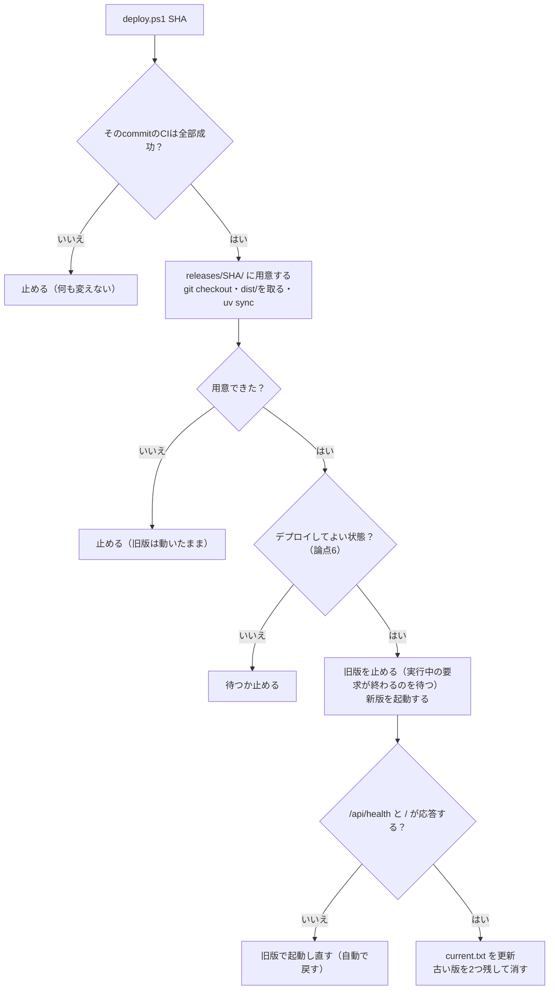
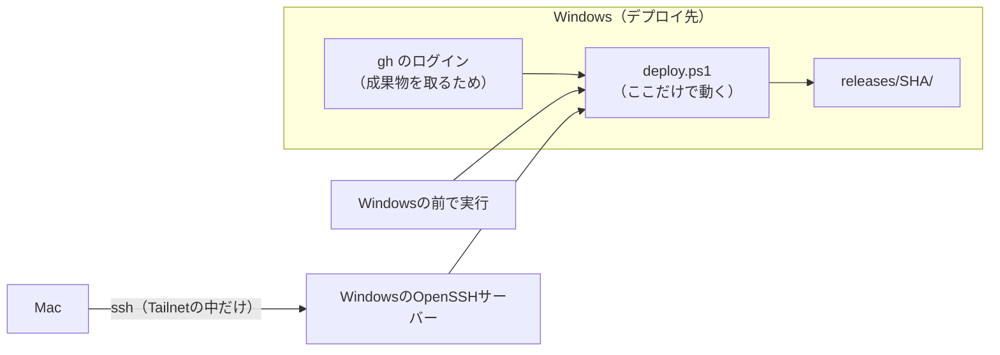

# ADR 0003 — 変更をデプロイ先へ反映する方法

| 項目 | 内容 |
|---|---|
| 状態 | **一部決定（2026-11-09）。**論点1〜4と論点7の遠隔実行は決定、論点5・6と論点7の残りは保留（提案者の推奨あり） |
| 決める人 | 利用者 |
| 前提 | [ADR 0001](0001-run-on-home-windows-via-tailscale.md)（家のWindowsで動かし、Tailscaleで繋ぐ）。ADR 0002（デプロイ先を設定だけで切り替えられる形にする。PR #42でレビュー中） |
| 仕組みの説明 | [Pythonのバックエンドは、何をデプロイするのか](../questions/2026-11-09-what-a-python-backend-deploys.md) |

## 背景

最初に利用者が出したデプロイ要件の2つ目は、次のとおりである。

> コードの変更を容易に取り込められる。変更に対して安全にデプロイできる。

ADR 0001・0002で「どこで・どう動かすか」は決まりつつある。**このADRは「変更をどう届けるか」を扱う。**
利用者はインフラエンジニアを目指しており、**可用性を保ちながら安全にデプロイする方法**を重視している。

### この構成ならではの制約

| # | 制約 | 効くところ |
|---|---|---|
| 1 | **Windowsは家のRouterの内側にあり、外から接続を受けられない** | GitHubからWindowsへ押し込めない。**Windows側から取りに行く**しかない |
| 2 | **リポジトリは公開（PUBLIC）である**（2026-11-09に`gh repo view`で確認） | 他人が出したPRのコードが自宅で実行されうる仕組みは使えない（論点1） |
| 3 | **uvicornは1 Processだけ**（間隔・同時実行・安全停止は`MarketplaceAccess`が1 Processの中で数える） | 新旧2つのProcessを並べる切り替え（Blue-Green）が使えない（論点5） |
| 4 | **安全停止の状態はProcessのメモリにしかない** | 安全停止の最中に再起動すると、停止が解除される（論点6） |
| 5 | [ci-policy §7](../development/ci-policy.md#7-やらないこと)が「Deploy / Release Pipeline」「定期実行」「Secretsを要するJob」をやらないとしている | 論点2で一部を開き直す |

## 論点と状態

| # | 論点 | 状態 | 結論・推奨 |
|---|---|---|---|
| 1 | [きっかけ](#論点1--きっかけ) | **決定** | 手で実行する（コマンド1つ） |
| 2 | [成果物](#論点2--成果物) | **決定** | FrontendはCIで1回だけビルドしたものを持ってくる。Backendはcommit SHAのソース＋`uv.lock`。コンテナは今は使わない |
| 3 | [CIでの検査](#論点3--ciでの検査) | **決定**（成果物のテストは保留） | 同じテストを2つのOSで流す。BackendのpytestをWindowsでも流す |
| 4 | [可用性の目標](#論点4--可用性の目標) | **決定** | Backendを含む変更では数秒止まってよい。Mercariへの約束を優先する |
| 5 | [切り替え方](#論点5--切り替え方) | 保留 | 版ごとのフォルダー、確認、失敗したら自動で戻す。Blue-Greenは採らない |
| 6 | [デプロイ前に確かめること](#論点6--デプロイ前に確かめること) | 保留 | CIが緑、安全停止中でない、実行中の検索が無い。**`src/`の小さな変更が要る** |
| 7 | [細部](#論点7--細部) | **一部決定** | **WindowsからもMacからも実行する（決定）。**1つのファイルにまとめるか、`--frozen`か`--locked`か、出所証明は保留 |

## 論点1 — きっかけ

### 決定（2026-11-09）— 手で実行する

**利用者が決めた。**デプロイScriptを1回実行する。Windowsの前で実行してもよいし、Tailnet経由で
遠隔から実行してもよい（[論点7](#論点7--細部)）。

| | ① 手で実行（**採用**） | ② Windowsが定期的に確認 | ③ GitHub Actionsのself-hosted runner |
|---|---|---|---|
| 中身 | Scriptを1回実行する | タスクスケジューラーが数分おきにmainを見て、新しければデプロイ | Windowsに置いたrunnerが、mainへのpushを受けてデプロイを実行 |
| 手間 | コマンド1つ | 無し | 無し |
| 人が判断するか | **する** | しない | しない |
| ci-policy §7との関係 | 「取り込みは手動のScript」と合う | 「定期実行」「無人実行を常態化させない」と緊張する | 「Deploy Pipeline」をやらない、を開き直す |
| リスク | 忘れる | 壊れた版も無人で入る | **公開リポジトリでは危険。**他人のPRのコードが自宅のWindowsで実行されうる。GitHub自身が、公開リポジトリでのself-hosted runnerを推奨していない |

**選ばなかった理由。**②は判断を機械へ委ねる（ci-policy §7の「CIからの自動Merge」を避けた理由と同じ）。
③は制約2（公開リポジトリ）のために避ける。利用者1人で、デプロイしたい時は自分で分かっている。

## 論点2 — 成果物

### 決定（2026-11-09）

**利用者が決めた。**判断の軸は「**一度だけビルドし、同じものをどこへでも持っていく（Build once, deploy many）**」
である。利用者の言葉では、「Windowsでビルドすると、GitHubのコードと動いているコードが違うことになる」。

| もの | 決定 | 「CIで確かめたものと同じ」を保証する方法 |
|---|---|---|
| **Frontend**（`dist/`） | **CIがLinuxで1回だけビルドし、保存する。Windowsはそれを持ってくる**（ビルドしない） | CIが保存した実物そのもの。`dist/`はGitに入っていないのでcommit SHAでは取れない |
| **Backendのソース**（`.py`、`uv.lock`） | **CIで確かめたcommit SHAを`checkout`する** | commit SHAは全ファイルの中身から計算した指紋 |
| **Backendの依存パッケージ** | **`uv sync`で、`uv.lock`のとおりに入れる** | `uv.lock`がOSごとのファイルをsha256付きで記録している。1バイトでも違えば入れない |
| コンテナ | **今は使わない** | — |

**Backendにはビルドが無い。**Pythonはソースのまま実行する言語で、デプロイする成果物はソースそのものである。

### 選ばなかったもの

| | Windowsでビルドする | **コンテナ**（CIでLinuxのイメージを作り、Windowsでも動かす） |
|---|---|---|
| メリット | 部品が最も少ない | インタプリタまで含めて**完全に**同じものになる。Windows固有の問題が消える |
| デメリット | **CIで確かめたものとは別の成果物になる** | Docker Desktop（WSL2）の導入・常駐・メモリ。起動時に自動で上げる設定 |
| 選ばなかった理由 | Build once, deploy manyに反する | `uv.lock`の指紋と、CIのWindows Job（論点3）で、パッケージまでは揃えられる。残るのはPythonインタプリタだけで、手間に見合わない |

**コンテナを使わないことで残るもの。**Pythonインタプリタと、機械語を含むパッケージは、OSごとに別物である。
LinuxのCIで確かめたものをWindowsへは持っていけない。**そこは論点3のWindows Jobで埋める。**

### 実装に要るもの

- CIで`dist/`を保存する（GitHub Actionsのartifact）。[ci-policy §7](../development/ci-policy.md#7-やらないこと)の
  「Deploy / Release Pipeline」の行を書き直す
- Windowsが保存された`dist/`を取るために`gh`へログインする。**CI側にSecretsは要らない**

## 論点3 — CIでの検査

### 決定（2026-11-09）— 同じテストを2つのOSで流す

**テストを分けるのではなく、同じテストを2つのOSで流す。**OSで結果が変わりうるものだけをWindowsでも流す。

| Job | Linux | Windows | 理由 |
|---|---|---|---|
| Backendのテスト（pytest） | 流す | **流す（新規）** | サーバーのOSの上で動き、OS専用のパッケージを含み、OSの機能を呼ぶ |
| Frontendの型検査・テスト・ビルド | 流す | 流さない | 出力はOSに依存しない。ビルドは1回だけ |
| E2E、文書、PoC | 流す | 流さない | デプロイ先のOSに関係が薄い、またはデプロイしない |

**判断の基準は3つの問い**（どこで動くか、OS専用のバイナリを含むか、OSの機能を呼ぶか）である。
最終的な証拠は、その環境でテストを流した結果だけである。

### 既に分かっているWindowsの問題

| 問題 | 場所 | 内容 |
|---|---|---|
| **`time.tzset()`はUnixにしか無い** | `src/backend/tests/unit/test_normalization.py` | タイムゾーンを切り替えるテストが、Windowsではエラーになる見込み（2026-11-09時点で未実行）。**Windows Jobを足すときに手当てが要る** |

### 保留 — 成果物のテスト

「ソース → ビルド → 成果物」の検査のうち、**成果物のテストが無い。**E2EはViteの開発サーバー（ソース）で
動き、ビルドした`dist/`を通らない。保存した`dist/`をデプロイ先と同じ形で配ってE2Eを流すかは、
ADR 0002の論点1（画面を誰が配るか）が決まってから決める。

## 論点4 — 可用性の目標

### 決定（2026-11-09）

**利用者が決めた。**「Backendを含む変更では数秒止まってよい。Mercariへの約束を優先する」。

| 項目 | 目標 |
|---|---|
| Frontendだけの変更 | **止まらない**（画面の配り手がuvicornと別なら。ADR 0002の論点1による） |
| Backendを含む変更 | **止まるのは数秒以内。**初回のデプロイで実測して記録する |
| 壊れた版 | **利用者に見せない。**確認に失敗したら自動で旧版に戻す |
| 戻す時間 | 1コマンド、数秒 |
| 約束 | Mercariへの「1 Process」と安全停止を、**デプロイ中も破らない** |

**取引。**完全に止まらない形（Blue-Green）は、Mercariへの約束（制約3）を緩めない限り作れない
（[論点5](#論点5--切り替え方)）。数秒止まることを受け入れて、約束を守る。

## 論点5 — 切り替え方

### 推奨（保留）— 版ごとのフォルダー、確認、自動で戻す

**Windowsの事情。**動いているPythonの環境（`.venv`）のファイルは、実行中に上書きできないことがある。
また、Card Digger自身は`.venv`から**ソースの場所を指して**入っている（editableインストール）ので、
ソースのフォルダーを書き換えると動いている版に響く。**その場で上書きせず、版ごとにフォルダーを分ける。**

```text
C:\card-digger\
├── releases\
│   ├── 8eda89c\      ← 1つ前（戻す先として残す）
│   └── b8da86c\      ← 新しい版。ここで用意する
│       ├── src\backend\.venv    ← 版ごとに作る。この版のソースを指す
│       └── dist\               ← CIが作ったもの
└── current.txt       ← 今動いている版
```



| 安全のための仕掛け | 守るもの |
|---|---|
| CIが緑のcommitだけ | 壊れたコードを入れない |
| 用意が終わるまで旧版を止めない | 用意の失敗で使えない時間を作らない。**止まる時間を起動の数秒だけにする** |
| 起動後に`/api/health`と`/`を確かめる | 起動したのに動かない版を残さない。`/api/health`はMercariへ問い合わせない |
| 失敗したら自動で旧版へ戻す | 壊れたまま放置しない |
| 版ごとのフォルダー、前の版を残す | 手で戻すのも、フォルダーを指し直すだけ |
| 動いている版を記録する | 今どの版が動いているか分かる |

**Frontendだけの変更**で、画面の配り手がuvicornと別なら（ADR 0002のC）、uvicornを止めずに`dist/`の
指し先だけを替える。止まる時間は0になる。デプロイ後は、各端末で開いたままのタブを再読み込みする
（古いJSがメモリに残るため）。

### 選ばなかったもの

| | その場で上書き | 版ごとのフォルダー（**推奨**） | Blue-Green |
|---|---|---|---|
| 中身 | 1つのフォルダーを`git pull`で書き換え、再起動 | 新しい版を別のフォルダーに用意し、止めて起動 | 新版を旧版と**並べて**起動し、確かめてから入口を切り替える |
| 止まる時間 | 用意の時間＋起動 | 起動の数秒 | 0 |
| 戻しやすさ | 悪い（旧版が消えている） | 良い | 良い |
| **Mercariへの約束** | 守れる | **守れる** | **破れる**（下） |

**Blue-Greenを採らない理由。**新旧を並べると、切り替えの前後に**2つのProcessが同時にMercariへアクセスしうる**
時間ができる。旧版で切り替え直前に始まった検索は、最大30秒（収集の上限）続く。

```text
時刻 →        切り替え
旧版   ███████████│███████   ← 切り替え直前に始まった検索が、まだMercariへ問い合わせ中
新版          ████│█████████ ← 切り替え後の新しい検索がMercariへ
                  └─ この重なりで「同時実行1」が破れる
```

## 論点6 — デプロイ前に確かめること

### 推奨（保留）

| # | 確かめること | 理由 | 今できるか |
|---|---|---|---|
| 1 | **そのcommitのCIが全部成功している** | 壊れたコードを入れない | できる（`gh run list`など） |
| 2 | **安全停止中ではない** | 再起動すると停止が解除され、Mercariに拒否された直後に問い合わせを再開してしまう（制約4） | **できない** |
| 3 | **実行中の検索が無い** | 止めると検索が途中で切れる | **できない**（旧版を止めるときに終わるのを待つことはできる） |

**2と3は、今のAPIでは外から知る手段が無い。**`/api/health`は「起きているか」しか返さない。
`/api/health`に安全停止と実行中の収集の状態を足すなど、**`src/`の小さな変更が要る。**
これはデプロイ先固有の値ではなく、アプリの状態を外へ見せる変更なので、「デプロイ先を`src/`に持たない」
方針には反しない。

## 論点7 — 細部

### 推奨（保留）

| 細部 | 選択肢 | 推奨 |
|---|---|---|
| 成果物の取り方 | 3つを別々に取る（`dist/`はActions、ソースはリポジトリ、パッケージはPyPI）／CIで`dist/`とソースを**1つのファイル**にまとめる | **1つのファイルにまとめる。**デプロイの単位が1つになり、インフラとして分かりやすい。依存パッケージはどちらでもPyPIから入れる |
| `uv sync`の指定 | `--frozen`（`uv.lock`をそのまま使う）／`--locked`（`uv.lock`が`pyproject.toml`と食い違っていたらエラー） | **`--locked`。**デプロイでは食い違いを見逃さない方が安全 |
| 成果物の出所の証明 | 使わない／GitHubのartifact attestation（「このリポジトリのこのWorkflowが、このcommitから作った」をWindowsで`gh attestation verify`で確かめる） | 最初は使わない。**慣れてから足す**（インフラの練習として価値がある） |
| 遠隔実行 | Windowsの前で実行／MacからTailnet経由でWindowsのOpenSSHへ入って実行 | **決定（下）** |

### 決定（2026-11-09）— WindowsからもMacからも実行する

**利用者が決めた。**「デプロイはWindowsでもMacでも実行したい」。

**Scriptが動くのは、どちらの場合もWindowsである。**Macは、Tailnet経由でWindowsに入って
同じScriptを実行させるだけで、Mac自身はデプロイの中身を何も持たない。



| 決めたこと | 理由 |
|---|---|
| **Scriptは1つで、Windowsにだけ置く** | どこから実行しても同じ手順になる。Macに別の手順を持たせると、2つが食い違う |
| **GitHubへのログイン（`gh`）はWindowsだけが持つ** | 成果物を取るのはWindowsである。認証情報を置く場所を1つにする |
| **MacからはSSHで入る** | 下の「入り方」 |

#### Macからの入り方（推奨。保留）

| 選択肢 | 内容 | 判定 |
|---|---|---|
| Tailscale SSH | Tailscaleが自分のSSHサーバーを持つ機能 | **Windowsでは使えない見込み。**第三者の記述では「Windowsはサーバーとして非対応」。**公式ドキュメントでは確かめられていない**（2026-11-09） |
| **Windows標準のOpenSSHサーバー** | Windowsの機能として入れられるSSHサーバー | **推奨** |

**2026-11-09時点で、MacからWindowsへはSSHで入れる**（利用者の申告。どのSSHサーバーか、どのアドレスで入っているかは未確認）。

SSHサーバーは**Windowsのもう1つの入口**である。uvicornを`127.0.0.1`に閉じたのと同じ考えで、
次の3つで絞れているかを確かめる（**2026-11-09に確かめた結果と決定は下**）。

| # | 絞り方 | 理由 |
|---|---|---|
| 1 | **Windowsファイアウォールで、受け付ける相手をTailnetのアドレス（`100.64.0.0/10`）だけにする** | 家のLANから入れないようにする（[0.0.0.0の問答](../questions/2026-11-08-what-binding-to-0000-means.md)のQ3、2枚の扉） |
| 2 | **鍵認証だけにし、パスワード認証を切る** | パスワードを当てられて入られる道を無くす |
| 3 | 入れる利用者を、デプロイに使う1人に限る | 入った後にできることを狭める |

#### 確かめた結果と、SSHの入口の決定（2026-11-09）

| 確かめたこと | 結果 |
|---|---|
| Macからどう入っているか | ホスト名で入っている。MagicDNSでTailscaleの住所に解決され、**Tailnetを通っていた** |
| SSHサーバーが待つ口 | **すべての口**（`netstat`で`[::]:22 LISTENING`） |
| 家のLANから届くか | **届いた**（MacからWindowsの家のLANの住所の22番へ、TCPで接続できた。ログインはしていない） |
| 認証 | **Windowsのパスワード**で入っていた（利用者の申告） |

つまり、**家のLANの誰でも、Windowsのパスワードを当てれば入れる状態だった。**
仕組みと危険は問答「SSHサーバーが`0.0.0.0:22`で待つと、なぜ家のLANから入れて、なぜ危ないのか」（PR #49）にある。

**決定（利用者）：B — 家のLANからも入れるままにし、鍵認証だけにする（パスワードを切る）。**

| | A. このまま | **B. LANも許すが、鍵だけ（採用）** | C. Tailnetだけ＋鍵だけ |
|---|---|---|---|
| 家のLANの住所で直接入る | できる | **できる（鍵があれば）** | できない（Tailscale経由ならできる） |
| 家のLANの他人が入れるか | パスワードを当てれば入れる | **入れない** | 入口すら見えない |
| Tailscaleが壊れたとき | LANから入れる | **LANから入れる（鍵で）** | Windowsの前で作業する |

**選んだ理由。**利用者は「家のLANからもSSHで繋ぎたい時が来る可能性がある」とした。危険の大きい方
（パスワードを当てられること）はBで無くなる。**選ばなかった理由。**Aはパスワードを当てられる。
Cは入口が最も小さいが、Tailscaleが動かないときにLANから入る道が無くなる。

**切り替えの順番。**鍵で入れることを確かめてから、パスワードを切る（逆にすると締め出される）。
Windowsのアカウントが管理者なら、公開鍵は`C:\ProgramData\ssh\administrators_authorized_keys`に置く。

**WindowsのOpenSSHは、SSHで入った先がcmdである。**MacからScriptを動かすときは
`ssh <ホスト名> "powershell -NoProfile -File …"`のようにPowerShellを明示する。

#### 2か所から実行できるので、同時に走らせない

WindowsとMacの両方から実行できると、**2つのデプロイが同時に走る**ことがありうる。片方が旧版を止め、
もう片方が別の版を起動する、といった壊れ方をする。

| 仕掛け | 内容 |
|---|---|
| **デプロイの鍵（lock）** | Scriptは始めに`C:\card-digger\deploy.lock`を作る。既にあれば、誰がいつ始めたかを表示して**止まる** |
| 鍵の後始末 | 終わったら（失敗しても）鍵を消す。異常終了で残った鍵は、表示を見て手で消す |

出所：[Tailscale Setup（第三者。Windowsのサーバー非対応の記述）](https://ac-training-lab.readthedocs.io/en/latest/tailscale-setup.html)、
[Supported Windows versions（公式。クライアントの要件）](https://tailscale.com/docs/reference/troubleshooting/windows/supported-windows-versions.md)。

## 決めた後・実装するときに直すもの

| 文書・ファイル | 直すこと | いつ |
|---|---|---|
| [ci-policy §2](../development/ci-policy.md#2-ciで実行する範囲) | BackendのテストをWindowsでも流すこと | 論点3を実装するPR |
| [ci-policy §7](../development/ci-policy.md#7-やらないこと) | 「Deploy / Release Pipeline」の行を、`dist/`を保存することに合わせて書き直す | 論点2を実装するPR |
| [ci-policy §4](../development/ci-policy.md#4-pr運用)、`CLAUDE.md` | `deploy/`もPRを経由する（ADR 0002の論点4で`deploy/`を選んだ場合） | Scriptを置くPR |
| `src/backend/tests/unit/test_normalization.py` | `time.tzset()`をWindowsで手当てする | 論点3を実装するPR |
| [todo](../planning/todo.md#自宅windowsで使う2026-11-08決定) | 実装の項目 | このADRと同じPR |
| このADR | 論点5・6と論点7の残りの決定、初回デプロイで実測した停止時間 | 決めた時・測った時 |
