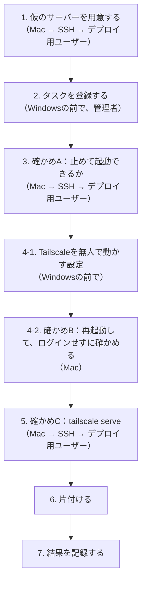

# デプロイの前に、家のWindowsで確かめる手順

## 文書ステータス

- 作成日: **2026-11-10**
- 対象: 家のWindows（デプロイ先）と、Mac（SSHで入る側）
- 目的: ADR 0003（PR #48）の決定が、**実際のWindowsで成り立つか**を、デプロイScriptを書く前に確かめる
- 根拠: ADR 0003の論点8「Windowsで確かめること」。論点4（可用性）・論点5（切り替え方）は、ここの結果を前提にしている
- 前提: [SSHの鍵の手順書](ssh-key-setup.md)の1〜7が済んでいる（デプロイ用ユーザーへ、Macから鍵で入れる）
- 状態: **まだ実行していない**

**本物のCard Diggerは使わない。**動かすのは、Card Diggerと同じ形で起動する**仮のサーバー**である（[1](#1-仮のサーバーを用意するmac--sshデプロイ用ユーザー)）。
確かめたいのは「Windowsが、一般ユーザーにそれを許すか」であり、動かす中身は何でもよい。
CIの成果物やデプロイScriptができるのを待たずに済む。

## この手順書に書かないもの

[SSHの手順書](ssh-key-setup.md#この手順書に書かないもの)と同じ。`<ホスト名>`・`<デプロイ用ユーザー>`・`<管理者ユーザー>`で書く。
**結果を記録するときも、実際の名前やIPアドレスは書かない。**

## 0. 何を確かめるか

| # | 確かめること | できなかったら | ADR 0003で変わるところ |
|---|---|---|---|
| **A** | **デプロイ用ユーザーが、SSHから、uvicornのタスクを止めて起動できるか。止めたら8000番が空くか** | デプロイScriptが「旧版を止めて新版を起動する」をできない | **論点5・8**（止め方・起動の仕方を変える） |
| **B** | **Windowsを再起動して誰もログインしていないとき、uvicornが動き、Tailscaleから届くか** | 再起動のたび（Windows Updateを含む）にCard Diggerが止まる | **論点4・8**（タスクの登録の仕方、Tailscaleの設定） |
| C | デプロイ用ユーザーが`tailscale serve`の設定を変えられるか | 最初の1回は管理者が設定する | **変わらない**（ADRに既に書いてある） |

**AとBは、できなかったらADRを直す。Cは、どちらの結果でも記録するだけ。**
だからA・Bを先に行う。

### なぜ「タスク」で動かすのか

SSHで入って`uvicorn`を直接起動すると、**SSHを切ったときにuvicornも止まる**。SSHのセッションの中で
起動したものは、セッションと一緒に片付けられるからである。

デプロイ用ユーザーが居ない間も動かし続けるには、**Windowsに「この人として、これを動かしておいて」と預ける**必要がある。
その預け先が**タスクスケジューラー**で、預けたもの1件を**タスク**と呼ぶ。

| | 起動する人 | 止まるとき |
|---|---|---|
| SSHで直接起動 | SSHのセッション | **SSHを切ったとき** |
| **タスク** | **タスクスケジューラー（Windowsのサービス）** | タスクを止めたとき、Windowsを止めたとき |

タスクは**管理者が登録し**（最初の1回）、**デプロイ用ユーザーとして動く**。デプロイのたびに止めて起動するのは
デプロイ用ユーザー自身である（ADR 0003 論点8「管理者が要る操作を最初の1回に寄せる」）。
**このとき、登録していない人が止められるか**がAである。

## 全体の流れ



### どこで、誰として打つか

**管理者の操作はWindowsの前で行い、SSHでは行わない**（ADR 0003 論点8。管理者の鍵は踏み台のためだけに使う）。
SSHで入るのはデプロイ用ユーザーだけである。

| 節 | どこで | 誰として |
|---|---|---|
| 1. 仮のサーバーを用意する | Mac → SSH | デプロイ用ユーザー |
| 1-3-1. Windowsの前で同じことをする | Windowsの前（`runas`） | デプロイ用ユーザー |
| **2. タスクを登録する** | **Windowsの前** | **管理者**（「管理者として実行」で開いたPowerShell） |
| 3. 確かめA | Mac → SSH | デプロイ用ユーザー |
| 4-1. Tailscaleを無人で動かす設定 | Windowsの前 | 管理者 |
| 4-2〜4-4. 再起動して確かめる | Windowsの前（再起動だけ）→ Mac | 管理者 → デプロイ用ユーザー |
| 5. 確かめC | Mac → SSH | デプロイ用ユーザー |

**SSHのPowerShellは、Windowsの前で操作している間も切らずに残しておく。**

### コマンドの貼り方

- **枠の中は、そのままコピーして貼れる。**`<…>`がある枠だけ、書き換えてから貼る
- **長いコマンドも1行で書く。**行の最後に`` ` ``を付けて折り返す書き方は、貼ると途中で切れることがあるので使わない
- 複数行の枠は、まとめて貼ってよい（1行ずつ順に実行される）。`#`より右は説明で、実行されない

**Aが失敗しても、BとCは続けてよい。**それぞれ独立に答えが出る。失敗したところは[トラブルシュート](#トラブルシュート)を見る。
直せなかったら、**直さずに「できなかった」と記録する**。それが答えである。

## 1. 仮のサーバーを用意する（Mac → SSH、デプロイ用ユーザー）

**Macから、デプロイ用ユーザーとしてSSHで入って**行う。本番のデプロイも同じ入り方なので、そのまま練習になる。

```bash
ssh <ホスト名>-deploy
```

Windowsの標準のSSHサーバーで入ると、最初は**コマンドプロンプト**（`C:\Users\<デプロイ用ユーザー>>`）になる。
以下はPowerShellのコマンドなので、先にPowerShellへ切り替える。

```bat
powershell
```

プロンプトが`PS C:\Users\<デプロイ用ユーザー>>`になればよい。

### 1-1. 8000番が空いているか

```powershell
netstat -ano | findstr ":8000"
```

| 部分 | 何をしているか |
|---|---|
| `netstat -ano` | このWindowsで開いている口の一覧を、番号（`-n`）とプロセスの番号（`-o`）つきで出す |
| `findstr ":8000"` | そのうち8000番の行だけを残す |

| 結果 | 意味 |
|---|---|
| **何も出ない** | 空いている。次へ |
| `127.0.0.1:8000`や`0.0.0.0:8000`の行に`LISTENING`がある | 何か（開発中のuvicornなど）が8000番で待っている。**止めてから**進む。止めないと、仮のサーバーが起動できず、Aの結果が分からなくなる |

#### `Get-NetTCPConnection`などを使わない理由（2026-11-10に起きた）

最初は`Get-NetTCPConnection`で調べる手順だったが、デプロイ用ユーザーでSSHから実行すると
**`CIM サーバーに接続できません。アクセスは拒否されました`**で失敗した。

`Get-NetTCPConnection`や`Get-ScheduledTask`の仲間は、**CIM（WMI）**というWindowsの管理情報の窓口を通して動く。
**デプロイ用ユーザーがSSHから入ったときは、この窓口を使わせてもらえない。**
`Get-ScheduledTask`の仲間は試していないが、同じ窓口を通るので、同じく断られる見込みである。
そこで、この手順書でデプロイ用ユーザーが打つコマンドは、窓口を通らない昔からのコマンドにする。

| やりたいこと | 窓口を通る（使わない） | 窓口を通らない（使う） |
|---|---|---|
| 8000番が使われているか | `Get-NetTCPConnection` | `netstat -ano` |
| タスクを見る・起動する・止める | `Get-ScheduledTask`、`Start-ScheduledTask`、`Stop-ScheduledTask`、`Get-ScheduledTaskInfo` | `schtasks` |
| Pythonが残っているか | `Get-CimInstance Win32_Process` | `Get-Process` |

**デプロイScriptも同じ制約を受ける。**Scriptはデプロイ用ユーザーがSSHから動かすので、同じコマンドを使う。

### 1-2. uvを入れる

**本番のデプロイでも要る**（ADR 0003 論点5の`uv sync`）。確かめた後も残す。

**まず、既に入っているかを確かめる。**見るのは「デプロイ用ユーザーから見えるか」である。
管理者のアカウントに入っているuvは管理者のフォルダーにあることが多く、デプロイ用ユーザーからは読めない。

```powershell
Get-Command uv -ErrorAction SilentlyContinue | Select-Object Source
Test-Path "$env:USERPROFILE\.local\bin\uv.exe"
```

| 部分 | 何をしているか |
|---|---|
| `Get-Command uv` | PATHの通っている場所からuvを探す。全員向けに入っているuvなら、ここに場所が出る |
| `Test-Path …\.local\bin\uv.exe` | 下の導入Scriptが入れる場所に、デプロイ用ユーザー向けのuvが既にあるか |

| 結果 | 次 |
|---|---|
| `Source`に場所が出た | 入れない。`uv --version`で版を確かめ、1-3では`uv`とだけ書けばよい |
| 何も出ず、`True` | 入れない。下の2行目（`--version`）だけ実行する |
| **何も出ず、`False`** | **無い。下で入れる**（2026-11-10はこれだった） |


```powershell
powershell -ExecutionPolicy ByPass -c "irm https://astral.sh/uv/install.ps1 | iex"
& "$env:USERPROFILE\.local\bin\uv.exe" --version
```

| 部分 | 意味 |
|---|---|
| `irm … \| iex` | uvの配布元（Astral社）の導入Scriptを取ってきて実行する。uvの公式の入れ方 |
| `-ExecutionPolicy ByPass` | この1回だけ、Scriptの実行制限を外す。Windowsの設定は変えない |
| `$env:USERPROFILE\.local\bin\` | uvが入る場所。**デプロイ用ユーザーのフォルダーの中**なので、管理者の権限は要らない |
| フルパスで呼ぶ | 入れた直後のこのセッションでは、`uv`だけでは見つからないことがある（PATHの更新が次のログインから効く） |

`uv 0.x.x`のように版が出ればよい。

### 1-3. 仮のサーバーのフォルダーを作る

```powershell
New-Item -ItemType Directory C:\card-digger-check | Out-Null
& "$env:USERPROFILE\.local\bin\uv.exe" venv --python 3.11 C:\card-digger-check\.venv
```

| 部分 | 意味 |
|---|---|
| `C:\card-digger-check\` | 確かめるためだけのフォルダー。**本番の`C:\card-digger\`とは分ける**。最後に消す |
| `uv venv --python 3.11` | Pythonの環境（`.venv`）を作る。Card Diggerと同じ3.11（`src/backend/.python-version`）。無ければuvがPythonを取ってくる |

**2026-11-10、SSHから実行すると`uv venv`が失敗した。**

```text
error: Failed to create Python minor version link directory
  cause: 信頼されていないマウントポイントが含まれているため、パスをスキャンできません。 (os error 448)
```

uvはPythonを入れるとき、`3.11`という名前で実際の版のフォルダーを指すジャンクションを作る。そこで、Windowsがジャンクションをたどるのを断った。
同じSSHのセッションで、**自分で作ったジャンクションも、作れたがたどれなかった。**

```powershell
cmd /c mklink /J C:\card-digger-check\link C:\card-digger-check   # 「ジャンクションが作成されました」
Get-ChildItem C:\card-digger-check\link                             # 同じ448のエラー
```

**SSHから入ったときだけ起きるかは、まだ確かめていない**（下の1-3-1で確かめる）。
論点5の`current`もジャンクションなので、原因が分かるまで先へ進まない。

#### 1-3-1. Windowsの前で、同じことをする

**SSHのセッションだけで断られるのか、デプロイ用ユーザーがどこで動いても断られるのかを分ける。**
答えによって、直すところが違う（下の表）。

Windowsの前で、PowerShell（管理者でなくてよい）を開き、**デプロイ用ユーザーとして**もう1つPowerShellを開く。

```powershell
runas /user:<デプロイ用ユーザー> powershell
```

| 部分 | 何をしているか |
|---|---|
| `runas /user:…` | 別のユーザーとしてプログラムを起動する。デプロイ用ユーザーのパスワードを聞かれる（[SSHの手順書 4-1](ssh-key-setup.md#4-1-デプロイ用ユーザーとしてpowershellを開く)と同じ） |
| `powershell` | 起動するもの。**Windowsの前でログインしたのと同じ扱いのPowerShell**が開く。SSHを通らない |

開いたウィンドウで、SSHで失敗した2つを同じように打つ。

```powershell
whoami                                                                       # <ホスト名>\<デプロイ用ユーザー> と出ることを確かめる
Get-ChildItem C:\card-digger-check\link                                      # SSHから作ったジャンクションをたどれるか
& "$env:USERPROFILE\.local\bin\uv.exe" venv --python 3.11 C:\card-digger-check\.venv   # uvが通るか
```

| 行 | 何をしているか |
|---|---|
| `whoami` | このウィンドウがデプロイ用ユーザーとして動いているか。**管理者と出たら、比べる意味が無い** |
| `Get-ChildItem …\link` | SSHでたどれなかったジャンクションを、Windowsの前でたどる。**作った人は同じで、たどる場所だけが違う** |
| `uv venv` | SSHで448になったコマンド。uvが自分で作るジャンクションも、Windowsの前ならたどれるか |

| 結果 | 意味 | 直すところ |
|---|---|---|
| **2つとも通る**（`.venv`などが表示され、`Activate with: …`と出る） | **SSHのセッションだけで断られる** | デプロイScriptをSSHからどう動かすか（ADR 0003 論点5・7） |
| 2つとも448 | デプロイ用ユーザーがどこで動いても断られる | 論点5のジャンクションの設計そのもの。uvの`.venv`の作り方も |
| 片方だけ通る | ジャンクションの作られ方で扱いが違う | 結果をそのまま記録し、原因を調べる |

**2026-11-10の結果。Windowsの前では`uv venv`が通った**（`Activate with: …`）。同じユーザー・同じコマンドが、SSHからだけ448で失敗した。
**SSHのセッションだけで断られる。**

できた`.venv`の`pyvenv.cfg`は、**uvが作ったジャンクションを通って**本物のPythonを指していた。

```text
home = C:\Users\<デプロイ用ユーザー>\AppData\Roaming\uv\python\cpython-3.11-windows-x86_64-none
```

`cpython-3.11-…`は版の番号が`3.11`で止まっている。これがジャンクションで、実際の版（`3.11.x`）のフォルダーを指す。
**`.venv`のPythonを起動するたびに、このジャンクションをたどる。**

**SSHから1-4を打つと、起動できなかった**（448ではなく「見つからない」の形で出た）。

```text
error: uv trampoline failed to spawn Python child process
  Caused by: entity not found (os error 2)
```

uvが作る`.venv\Scripts\python.exe`は**trampoline**（中継役）で、`home`の本物のPythonを子として起動する。
その`home`へジャンクションをたどれず、本物のPythonが見つからなかった。
**SSHからは、uvで作った`.venv`のPythonを起動できない。**タスクから起動できるかは、節2・3で確かめる。

**どの結果でも、エラーの文と一緒にそのまま記録する。**1-4へ進むのは、結果を見て、直し方の見当をつけてからにする。
本番のデプロイはSSHから動かすので、確かめたいのは**SSHからの動き**である。Windowsの前で通っただけでは、先へ進む理由にならない。

**なぜ`.venv`のPythonで動かすのか。**本番のuvicornは、版ごとのフォルダーの`.venv`のPythonで動く（ADR 0003 論点5）。
**Windowsの`.venv\Scripts\python.exe`は、本物のPythonを子として起動する中継役である。**
タスクを止めたとき、中継役だけが止まって**子（本物のPython）が8000番を握ったまま残る**ことがありうる。
これを本番と同じ形で確かめるため、`.venv`のPythonを使う（[3-3](#3-3-止める)）。

### 1-4. 手で動かしてみる

タスクに預ける前に、コマンドそのものが動くかを確かめる。

```powershell
C:\card-digger-check\.venv\Scripts\python.exe -m http.server 8000 --bind 127.0.0.1 --directory C:\card-digger-check
```

| 部分 | 意味 |
|---|---|
| `-m http.server` | Pythonに最初から入っている、ファイルを配るだけのサーバー。**uvicornの代わり** |
| `--bind 127.0.0.1` | 本番のuvicornと同じく、**このWindowsの中からしか届かない**口で待つ（[CLAUDE.md](../../CLAUDE.md)の「`--host 0.0.0.0`を付けない」と同じ理由） |

`Serving HTTP on 127.0.0.1 port 8000`と出たら、`Ctrl+C`で止める。SSHはまだ切らない。

## 2. タスクを登録する（Windowsの前で、管理者のPowerShell）

**管理者が行う最初の1回の操作。**スタートメニューで「PowerShell」を右クリックし、「管理者として実行」で開く。
**下の枠を、上から順に1つずつコピーして貼る。**書き換えるのは2-1の1か所だけである。

### 2-1. タスクを動かすユーザーを決める（ここだけ書き換える）

`<デプロイ用ユーザー>`を実際の名前に書き換えてから貼る。

```powershell
$deployUser = "$env:COMPUTERNAME\<デプロイ用ユーザー>"
```

正しい名前は、**SSHのPowerShell（デプロイ用ユーザー）で`whoami`を打つと出る**（`<ホスト名>\<デプロイ用ユーザー>`の形）。
そのまま`$deployUser = "…"`の中に入れてもよい。**管理者の名前を入れない。**管理者として動くタスクになってしまう。

### 2-2. パスワードを預ける

```powershell
$cred = Get-Credential -UserName $deployUser -Message "デプロイ用ユーザーのパスワード"
```

パスワードを聞く小さな窓が出る。**デプロイ用ユーザーの**パスワードを、パスワード管理ツールから貼る
（[SSHの手順書 3](ssh-key-setup.md#3-デプロイ用の一般ユーザーを作るwindowsの前で管理者のpowershell)で作ったもの）。管理者のパスワードではない。

```powershell
$cred.UserName
```

2-1で決めた名前が出ればよい。

### 2-3. 何を・いつ・どう動かすかを決める

3つを順に貼る。何も表示されないのが正常である。

```powershell
$action = New-ScheduledTaskAction -Execute "C:\card-digger-check\.venv\Scripts\python.exe" -Argument "-m http.server 8000 --bind 127.0.0.1 --directory C:\card-digger-check" -WorkingDirectory "C:\card-digger-check"
```

```powershell
$trigger = New-ScheduledTaskTrigger -AtStartup
```

```powershell
$settings = New-ScheduledTaskSettingsSet -ExecutionTimeLimit (New-TimeSpan) -MultipleInstances IgnoreNew
```

| 部分 | 何をしているか |
|---|---|
| `New-ScheduledTaskAction` | **何を動かすか。**1-4と同じコマンド |
| `-AtStartup` | **いつ動かすか。Windowsが起動したとき。**誰かのログインを待たない |
| `-ExecutionTimeLimit (New-TimeSpan)` | **時間切れで止めない。**長さ0は「制限なし」の意味。**既定は72時間で、付けないと3日ごとに止まる** |
| `-MultipleInstances IgnoreNew` | 動いている最中にもう一度起動しようとしても、2つ目を立てない。8000番の取り合いを防ぐ |

### 2-4. 登録する

```powershell
Register-ScheduledTask -TaskName "card-digger-check" -Action $action -Trigger $trigger -Settings $settings -User $cred.UserName -Password $cred.GetNetworkCredential().Password
```

| 部分 | 何をしているか |
|---|---|
| `-Action`・`-Trigger`・`-Settings` | 2-3で決めた3つを組み合わせる |
| `-User … -Password …` | **誰として動かすか。デプロイ用ユーザーとして、ログインしていなくても動かす。**パスワードはWindowsが預かる |

| 結果 | 意味 |
|---|---|
| `card-digger-check  Ready` | 登録できた（2026-11-10はこれだった）。**まだ起動はしない**（Aで、デプロイ用ユーザーが起動する） |
| `アカウント名とセキュリティID間のマッピングは実行されませんでした` | **名前のユーザーが見つからない。**2-1で`<デプロイ用ユーザー>`を書き換え忘れたか、綴りが違う（2026-11-10に起きた）。`$cred.UserName`を見て、2-1からやり直す |
| `$action`などが無いというエラー | ウィンドウを開き直して、2-3の値が消えた。2-1から順に貼り直す |

### 2-5. デプロイ用ユーザーとして動くか確かめる

```powershell
(Get-ScheduledTask card-digger-check).Principal | Format-List UserId, LogonType, RunLevel
```

| 項目 | 期待する値 | 意味 |
|---|---|---|
| `UserId` | デプロイ用ユーザーの名前 | **デプロイ用ユーザーとして動く** |
| `LogonType` | `Password` | パスワードを預けて、ログインしていなくても動く |
| `RunLevel` | `Limited` | **管理者の権限を使わない。**`Highest`なら管理者の権限で動けてしまう |

3つとも期待どおりなら、管理者のPowerShellは閉じてよい。

**`UserId`が管理者の名前なら、登録し直す**（2026-11-10に起きた）。2-2の窓でユーザー名の欄が管理者の名前になっていた、
または2-1に管理者の名前を入れた。**そのままでは、タスクが管理者として動き、管理者のパスワードがWindowsに預けられている。**
消してから、2-1から貼り直す。

```powershell
Unregister-ScheduledTask -TaskName card-digger-check -Confirm:$false
```

| 部分 | 何をしているか |
|---|---|
| `Unregister-ScheduledTask` | タスクを消す。**預けたパスワードも一緒に消える** |
| `-Confirm:$false` | 「本当に消しますか」と聞かずに消す |

2-2の窓では、**ユーザー名の欄を書き換えず**、デプロイ用ユーザーのパスワードだけを入れる。

### 管理者で登録してよいのか

**よい。この操作だけは管理者で行う前提である**（ADR 0003 論点8「管理者が要る操作を最初の1回に寄せる」）。

**別のユーザーを指定して、ログインしていなくても動くタスクを登録するには、管理者の権限が要る。**
デプロイ用ユーザーは一般ユーザーなので、自分では登録できない。

| 操作 | いつ | 誰が |
|---|---|---|
| タスクを登録する（この節） | **最初の1回だけ** | **管理者（Windowsの前で）** |
| タスクを止める・起動する | デプロイのたび | **デプロイ用ユーザー（SSHから）** |

**登録した人と、タスクが動くときの身分は別である。**2-4で`-User`にデプロイ用ユーザーを指定したので、タスクで動くPythonは
デプロイ用ユーザーの権限しか持たない。2-5の`UserId`と`RunLevel`がその確かめである。

### なぜパスワードを預けるのか

**「ログインしていなくても動かす」には、Windowsがその人として入る手段が要る。**パスワードを預けるのは、そのためである。
SSHのパスワードを閉じたこと（[SSHの手順書 6](ssh-key-setup.md)）とは関係ない。閉じたのは「SSHでパスワードを使う入り方」で、
Windowsのアカウントのパスワードは残っている。

| 預け方 | 預けるもの | 選ばなかった理由・選んだ理由 |
|---|---|---|
| **パスワードを保存する（採用）** | パスワード | **最も一般的で、確実に動く。**預かったパスワードを読めるのは管理者とWindows自身だけで、管理者を取られたらどのみちすべて取られる |
| パスワードを保存しない（S4U） | 何も預けない | 預けずに済むが、使える機能に制限がある。**最初の確かめで変わり種を選ばない。**Bが通った後に試す余地はある |

## 3. 確かめA：デプロイ用ユーザーが止めて起動できるか（Mac → SSH、デプロイ用ユーザー）

**1で開いたSSHのPowerShell（デプロイ用ユーザー）に戻って**行う。切っていたら、1の最初と同じく入り直す。

```powershell
whoami      # <ホスト名>\<デプロイ用ユーザー> と出ることを確かめる。管理者と出たら、確かめにならない
```

### 3-1. タスクが見えるか

```powershell
schtasks /query /tn card-digger-check
```

| 結果 | 意味 |
|---|---|
| `card-digger-check`の行に`準備完了`（`Ready`） | 見えている。次へ |
| 「見つからない」というエラー | **登録した管理者のタスクが、デプロイ用ユーザーから見えていない。**記録して、[トラブルシュート](#aが失敗したとき)へ |

### 3-2. 起動する

```powershell
schtasks /run /tn card-digger-check
Start-Sleep 3
curl.exe -s -o NUL -w "%{http_code}`n" http://127.0.0.1:8000/
```

| 部分 | 何をしているか |
|---|---|
| `schtasks /run` | タスクスケジューラーに「今すぐ動かして」と頼む。**本番のデプロイで新しい版を起動するときと同じ操作** |
| `curl.exe … -w "%{http_code}"` | 8000番に問い合わせ、応答の番号だけを出す。**本番の「起動後に`/api/health`を確かめる」と同じ形**（ADR 0003 論点5） |
| `curl.exe`と`.exe`まで書く | PowerShellの`curl`は別物（`Invoke-WebRequest`の別名）なので、Windows付属の本物を呼ぶ |

| 結果 | 意味 |
|---|---|
| **`200`** | **起動できた。**次へ |
| `000` | 8000番で誰も待っていない。3秒で足りなかったかもしれないので、もう一度`curl.exe`だけを試す。それでも`000`なら、[トラブルシュート](#aが失敗したとき) |
| 「アクセスが拒否されました」 | **デプロイ用ユーザーには起動が許されていない。**記録して、トラブルシュートへ |

#### 2026-11-10の結果 — 「試行されました」と出たが、一度も動いていなかった

3-1は通った（デプロイ用ユーザーから`準備完了`で見えた）。3-2の`schtasks /run`は`成功: … の実行が試行されました`と出たが、
`curl.exe`は`000`で、Pythonのプロセスも無かった。詳しい情報を見ると、**タスクは一度も動いていなかった。**

```powershell
schtasks /query /tn card-digger-check /v /fo list
```

| 項目 | 値 | 意味 |
|---|---|---|
| `前回の実行時刻` | `1999/11/30 0:00:00` | 一度も動いていないときに出る値 |
| `前回の結果` | `267011`（`0x41303`） | 「まだ一度も動いていない」 |
| `電源管理` | `バッテリ モードで停止, バッテリで開始しない` | 2で指定しなかったので既定のまま |

**`schtasks /run`の「成功」は、頼むことができたという意味で、動いたという意味ではない。**
起動を確かめるには、この後の`curl.exe`か`前回の実行時刻`を見る。

`findstr "前回 状態"`で絞り込むと、SSH越しでは何も出なかった（文字コードの違いで日本語の照合が外れたと見ている）。
**SSH越しでは`findstr`に日本語を渡さず、全部出して目で見る。**

原因は調べている途中（下の3-2-1）。

#### 3-2-1. 管理者が起動しても動かないかを分ける（Windowsの前で、管理者のPowerShell）

**デプロイ用ユーザーが頼んだから動かないのか、タスクそのものが動かないのかを分ける。**

```powershell
Start-ScheduledTask -TaskName card-digger-check
Start-Sleep 3
Get-ScheduledTaskInfo -TaskName card-digger-check | Format-List LastRunTime, LastTaskResult
curl.exe -s -o NUL -w "%{http_code}`n" http://127.0.0.1:8000/
```

| 結果 | 意味 |
|---|---|
| `LastRunTime`が今の時刻で、`200` | **タスクそのものは動く。デプロイ用ユーザーからの起動だけが効かない**（論点5・8を直す） |
| `LastRunTime`が今の時刻で、`000` | 起動したがPythonが終わった。`LastTaskResult`の番号を見る |
| `LastRunTime`が`1999/11/30`のまま | **管理者が頼んでも動かない。**タスクの設定か、Windows側の条件の問題 |

**2026-11-10の結果：`LastRunTime`は`1999/11/30`のまま、`curl.exe`は`000`。管理者が頼んでも動かなかった。**
デプロイ用ユーザーの権限の問題ではなく、**タスクそのものが起動されていない。**

#### 3-2-2. Windowsに理由を聞く（Windowsの前で、管理者のPowerShell）

**推測で設定を変える前に、タスクスケジューラーの記録から理由を読む。**記録（履歴）は既定で止まっているので、先に有効にする。

```powershell
wevtutil set-log Microsoft-Windows-TaskScheduler/Operational /enabled:true
```

| 部分 | 何をしているか |
|---|---|
| `wevtutil set-log … /enabled:true` | タスクスケジューラーの記録を有効にする。**記録を残し始めるだけ**で、タスクの動きは変えない。タスクスケジューラーの画面の「すべてのタスク履歴を有効にする」と同じ |

もう一度起動を頼み、記録を読む。

```powershell
Start-ScheduledTask -TaskName card-digger-check
Start-Sleep 3
Get-WinEvent -LogName Microsoft-Windows-TaskScheduler/Operational -MaxEvents 10 | Format-List TimeCreated, Id, Message
```

| 部分 | 何をしているか |
|---|---|
| `Get-WinEvent … -MaxEvents 10` | 記録の新しいものから10件を、時刻・番号・文で出す |

**同時に、電池で動いていると見なされていないかを見る。**2で電源の条件を指定しなかったので、既定の「電池では開始しない」が残っている。

```powershell
Get-CimInstance Win32_Battery | Format-List Name, BatteryStatus
(Get-ScheduledTask card-digger-check).Settings | Format-List DisallowStartIfOnBatteries, StopIfGoingOnBatteries
```

| 部分 | 何をしているか |
|---|---|
| `Win32_Battery` | Windowsが電池（UPSを含む）を認識しているか。**何も出なければ電池は無い** |
| `DisallowStartIfOnBatteries` | `True`なら、電池で動いているときは開始しない |

### 3-3. 止める

```powershell
schtasks /end /tn card-digger-check
Start-Sleep 2
netstat -ano | findstr ":8000"
Get-Process python -ErrorAction SilentlyContinue | Select-Object Id, Path
```

| 部分 | 何をしているか |
|---|---|
| `schtasks /end` | タスクスケジューラーに「止めて」と頼む。**本番のデプロイで旧版を止めるときと同じ操作** |
| `netstat -ano` | **8000番が空いたか。**空いていないと、次に起動する新しい版が8000番を使えない |
| `Get-Process python` | Pythonが残っていないか。`Path`（どのPythonか）は、**デプロイ用ユーザー自身のプロセスにだけ出る** |

| 結果 | 意味 |
|---|---|
| **`netstat`に`LISTENING`の行が無く、`Path`が出るPythonも無い** | **止めて、8000番も空いた。Aは成功** |
| `netstat`に`LISTENING`の行が出る、または`Path`が出るPython（デプロイ用ユーザーのもの）が残る | **タスクは止まったが、子のPythonが残った**（[1-3](#1-3-仮のサーバーのフォルダーを作る)で心配したこと）。記録する。片付けは[トラブルシュート](#止めた後も8000番が空かない) |
| 「アクセスが拒否されました」 | **デプロイ用ユーザーには停止が許されていない。**記録して、トラブルシュートへ |

**止めたまま4へ進む。**Bは、再起動したときにタスクが自分で起動するかを見る。

## 4. 確かめB：誰もログインしていなくても動くか

### 4-1. Tailscaleを無人で動かす設定（Windowsの前で、管理者）

**WindowsのTailscaleは、既定では、ログインしている人が居るときだけつながる。**誰もログインしていないと、
uvicornが動いていても、iPhoneやMacから届かない。**「無人で動かす」（Run unattended）**を有効にする。

まず今の設定を見る（管理者のPowerShellで）。

```powershell
& "C:\Program Files\Tailscale\tailscale.exe" debug prefs | Select-String ForceDaemon
```

| 結果 | 意味 |
|---|---|
| `"ForceDaemon": true` | 既に無人で動く設定。4-2へ |
| `"ForceDaemon": false` | 無人で動かない。下で有効にする |

**有効にする。**タスクバーの右のTailscaleのアイコンを右クリックし、**Preferences**（または「設定」）の中の
**Run unattended**にチェックを入れる。もう一度上のコマンドで`true`になったことを確かめる。

| 何が変わるか | |
|---|---|
| 変わる | 誰もログインしていなくても、Windowsがtailnetにつながったままになる |
| 変わらない | 届く相手。**tailnetに入っている自分の端末からだけ**届くのは同じ（[ADR 0001 決定2](../adr/0001-run-on-home-windows-via-tailscale.md#決定2--端末からはtailscaleで繋ぐ)） |

### 4-2. 再起動する

**自動ログインになっていないことを先に確かめる。**自動でログインすると、「誰もログインしていない」状態にならず、確かめにならない。
再起動した後、**ログイン画面（パスワードやPINを聞く画面）で止まっていればよい。**

管理者のPowerShellで再起動する。

```powershell
Restart-Computer
```

**再起動したら、Windowsには触らない。ログインしない。**2〜3分待ち、以下を**Mac**で行う。

### 4-3. Tailscaleでつながっているか（Mac）

```bash
tailscale status | grep <ホスト名>
```

Macのターミナルで`tailscale`が見つからないときは、`/Applications/Tailscale.app/Contents/MacOS/Tailscale status`で呼ぶ。

| 結果 | 意味 |
|---|---|
| `<ホスト名>`の行に`offline`が**無い** | **ログインしていなくても、Tailscaleでつながっている** |
| `offline`と出る | つながっていない。4-1の設定が効いていない。**記録する**（uvicornが動いても、端末からは届かない） |

### 4-4. uvicornの代わりが動いているか（Mac → SSH）

```bash
ssh <ホスト名>-deploy
```

```bat
powershell
```

```powershell
curl.exe -s -o NUL -w "%{http_code}`n" http://127.0.0.1:8000/
schtasks /query /tn card-digger-check /v /fo list | findstr "前回"
```

| 部分 | 何をしているか |
|---|---|
| `curl.exe` | 3-2と同じ。8000番が応答するか |
| `schtasks /query … /v` | タスクの詳しい情報。そのうち`前回の実行時刻`（いつ動いたか）と`前回の結果`（結果の番号）だけを残す。`前回の実行時刻`が再起動した時刻なら、起動時に動いた |

| 結果 | 意味 |
|---|---|
| **`200`、`前回の実行時刻`が再起動の時刻、`前回の結果`が`267009`** | **Bは成功。**`267009`は「今動いている」の番号（16進数で`0x41301`） |
| `000`、`前回の結果`が別の番号 | 起動しなかった。**番号を記録して**[トラブルシュート](#bが失敗したとき)へ |
| `000`、`前回の実行時刻`が古い | タスクが起動時に呼ばれていない。記録して、トラブルシュートへ |

**SSHで入れた時点で、Windowsは誰もログインしていなくても外から操作できる**ことも分かる（SSHサーバーはWindowsのサービスとして動く）。

## 5. 確かめC：デプロイ用ユーザーが`tailscale serve`を変えられるか（Mac → SSH、デプロイ用ユーザー）

**4-4のSSHのPowerShell（デプロイ用ユーザー）のまま**行う。仮のサーバーは4で起動したまま動いている。

### 5-1. 今の設定を見る

```powershell
$ts = "C:\Program Files\Tailscale\tailscale.exe"
& $ts serve status
```

| 結果 | 意味 |
|---|---|
| `No serve config` | 何も設定されていない。次へ |
| 設定が表示される | **既に何かが設定されている。**別の用途かもしれないので、**メモしておき、触らない。**5-2では別の番号（8080番）を使うので、ぶつからない |

### 5-2. 設定してみる

```powershell
& $ts serve --bg --http=8080 8000
```

| 部分 | 何をしているか |
|---|---|
| `serve … 8000` | tailnetから来た要求を、このWindowsの8000番（`127.0.0.1`）へ中継する（[リバースプロキシの問答](../questions/2026-11-09-what-a-reverse-proxy-is.md)） |
| `--http=8080` | **tailnetの8080番で、HTTPSでなくHTTPで受ける。**本番はHTTPSだが、HTTPSはTailscaleの管理画面で証明書を有効にする必要があり、それは[todo](../planning/todo.md#自宅windowsで使う2026-11-08決定)の別の項目である。**確かめたいのは「設定を変える権限があるか」で、HTTPでもHTTPSでも同じ権限が要る見込み**なので、準備の要らないHTTPで試す |
| `--bg` | 設定を残したまま、コマンドを終える。本番も`--bg`で設定する |

**tailnetの外からは届かない。**HTTPでも、tailnetの中はWireGuardで暗号化されている
（[WireGuardとTLSの問答](../questions/2026-11-08-what-wireguard-and-tls-protect.md)）。

| 結果 | 意味 |
|---|---|
| 中継先と`http://<ホスト名>…:8080`が表示される | **設定できた。**5-3へ |
| 「Access denied」「permission」などのエラー | **デプロイ用ユーザーには設定が許されていない。エラーの文をそのまま記録する。**ADRの想定どおり、最初の1回は管理者が設定する。5-3は飛ばして6へ |

### 5-3. Macから届くか（Mac）

別のターミナルで。

```bash
curl -s -o /dev/null -w "%{http_code}\n" http://<ホスト名>:8080/
```

`200`ならCは成功。`<ホスト名>`で届かないときは、`tailscale status`に出るWindowsの名前で試す。

### 5-4. 設定を戻す（SSHのPowerShell）

```powershell
& $ts serve --http=8080 off
& $ts serve status
```

5-1で見たのと同じ表示に戻ればよい。**`tailscale serve reset`は使わない。**5-1で別の設定があったときに、それも消してしまう。

## 6. 片付ける

| 何を | どこで | コマンド |
|---|---|---|
| 仮のサーバーを止める | SSHのPowerShell（デプロイ用ユーザー） | `schtasks /end /tn card-digger-check` |
| タスクを消す | **Windowsの前で、管理者のPowerShell** | `Unregister-ScheduledTask -TaskName card-digger-check -Confirm:$false` |
| ジャンクションを消す（作っていたら） | SSHのPowerShell（デプロイ用ユーザー） | `cmd /c rmdir C:\card-digger-check\link`。**フォルダーより先に消す。**`rmdir`はジャンクションだけを消し、指す先の中身は消さない |
| フォルダーを消す | SSHのPowerShell（デプロイ用ユーザー） | `Remove-Item -Recurse -Force C:\card-digger-check` |

**残すもの。**uv（本番のデプロイで使う）と、Tailscaleの「無人で動かす」設定（本番で要る）。

## 7. 結果を記録する

**ADR 0003の「Windowsで確かめること」の表に書く。**この手順書には、実行した日付と、手順どおりに行かなかったところだけを書く
（[SSHの手順書](ssh-key-setup.md)が「2026-11-10に起きた」と書いているのと同じ）。

| 確かめ | 記録すること |
|---|---|
| A | 3-1・3-2・3-3それぞれ、できたか。**3-3で子のPythonが残ったか** |
| B | 4-1の`ForceDaemon`の最初の値。4-3の`offline`の有無。4-4の`前回の結果`の番号 |
| C | 5-2が通ったか。通らなかったら**エラーの文** |

結果でADRのどこを直すか。

| 結果 | 直すところ |
|---|---|
| **A・B・Cすべて成功** | ADR 0003の状態から「論点8にはWindowsで確かめることが残る」を消す。PR #48を閉じてよい |
| Aの起動・停止が拒否された | 論点5・8。止め方・起動の仕方を変える（例：デプロイ用ユーザーに、このタスクだけを動かす権限を与える） |
| Aで子のPythonが残った | 論点5。デプロイScriptで、止めた後に8000番が空くまで待ち、残ったものを止める手順を足す |
| Bで起動しなかった | 論点4・8。タスクの登録の仕方を変える |
| BでTailscaleが`offline` | ADR 0001の決定2。Tailscaleの設定を変える |
| Cが拒否された | 変えない。ADRの想定どおり（最初の1回は管理者） |

## トラブルシュート

### Aが失敗したとき

**直そうとする前に、エラーの文をそのまま記録する。**それがAの答えである。

| エラー | 考えられる原因 | 確かめ方 |
|---|---|---|
| 「見つからない」（3-1） | タスクを読む権限がデプロイ用ユーザーに無い | 管理者のPowerShellで`schtasks /query /tn card-digger-check`が見えるか |
| 「アクセスが拒否されました」（3-2・3-3） | 起動・停止の権限がデプロイ用ユーザーに無い | 同上。管理者からは起動・停止できるか |
| `000`のまま、`前回の結果`が`0`や`1` | タスクは起動したが、Pythonがすぐ終わった | 1-4のコマンドをSSHで手で動かし、エラーが出ないか |

**権限を広げる操作（タスクの権限の書き換え）は、この手順書では行わない。**ADRで方法を決めてから行う。

### 止めた後も8000番が空かない

残ったプロセスの番号を見て、止める。デプロイ用ユーザーは、**自分のプロセスなら**止められる。

```powershell
netstat -ano | findstr ":8000"          # LISTENINGの行の、いちばん右の数字がプロセスの番号
Get-Process -Id <番号> | Select-Object Id, Path
Stop-Process -Id <番号>
```

### Bが失敗したとき

`前回の結果`の番号で見当をつける。

| 番号 | 意味 | 対処 |
|---|---|---|
| `2147943785`（`0x80070569`） | 「このユーザーには、この種類のログオンが許されていない」。ログインせずに動かすには「**バッチ ジョブとしてログオン**」の権利が要る | 記録する。Windowsは登録時にこの権利を与えるはずだが、与えられていない。与えるかはADRで決める |
| `2147942402`（`0x80070002`） | 動かすファイルが見つからない | 2の`-Execute`のパスが正しいか |
| `267011`（`0x41303`） | 一度も動いていない | 起動時のきっかけ（`-AtStartup`）が登録されているか。管理者のPowerShellで`(Get-ScheduledTask card-digger-check).Triggers` |

**デプロイ用ユーザーのパスワードを変えたら、タスクのパスワードも登録し直す**（2をやり直す）。変えないと、次の再起動で動かなくなる。
