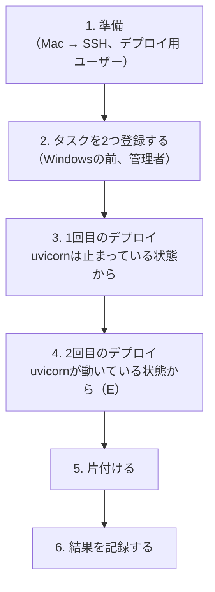

# デプロイの作業をタスクの中で行えるかを、家のWindowsで確かめる手順

## 文書ステータス

- 作成日: **2026-11-10**
- 対象: 家のWindows（デプロイ先）と、Mac（SSHで入る側）
- 目的: ADR 0003の[論点5の見直し](../adr/0003-deploy-changes-to-the-target.md#2026-11-10の見直し--準備と切り替えはタスクの中で行う)
  （準備と切り替えはタスクの中で行い、SSHからはそのタスクを起動するだけにする）が、実際のWindowsで成り立つかを、デプロイScriptを書く前に確かめる
- 根拠: ADR 0003 論点5の「まだ確かめていないこと」
- 前提: [前回の確かめの手順書](windows-deploy-checks.md)が済んでいる（デプロイ用ユーザーに「バッチ ジョブとしてログオン」の権利があり、uvが入り、Run unattendedが有効）
- 状態: **2026-11-10に実行中。**1-1は済んだ（`git`はあった）

**前回の手順書の書き方をそのまま使う。**伏せ字（`<デプロイ用ユーザー>`など）、[どこで誰として打つか](windows-deploy-checks.md#どこで誰として打つか)、
[コマンドの貼り方](windows-deploy-checks.md#コマンドの貼り方)、[長い結果をMacへ送る方法](windows-deploy-checks.md#結果が長いとき--ファイルにしてmacへ送る)は、前回の手順書にある。

## 0. 何を確かめるか

| # | 確かめること | できなかったら |
|---|---|---|
| **D** | **タスクの中で、版のソースを取ってきて`uv sync --locked`が通るか** | `.venv`の作り方を変える。SSHのセッションでは`uv venv`が失敗した（前回） |
| **E** | **デプロイ用のタスクから、uvicornのタスクを止めて起動できるか** | 止め方・起動の仕方を変える。SSHからはできた（前回） |
| **F** | **版の名前を、ファイルでデプロイ用のタスクへ渡せるか** | 渡し方を変える |

あわせて、次のことも同じ流れの中で分かる。

| 分かること | なぜ要るか |
|---|---|
| デプロイ用ユーザーのタスクから`git`が使えるか | Card Diggerの依存`mercapi`は、GitHubのリポジトリから入る（`src/backend/pyproject.toml`）。uvはそのために`git`を使う |
| タスクの中からGitHubへ取りに行けるか | 本番も、版の中身をGitHubから取る（ADR 0003 論点2） |
| **タスクが作った`current`（ジャンクション）を、別のタスク（uvicorn）がたどれるか** | 本番のuvicornは`current`を通して起動する。前回確かめたのは、uvが作ったジャンクションだけ |
| 本物のCard Digger（受入用のアプリ）が、`current`を通して起動するか | 仮のサーバーではなく、本番に近い形で確かめる |

### 本物のソースを使い、Mercariへは通信しない

**動かすのは受入用のアプリ（`scripts.acceptance_app`）である。**Mercariへは通信しない
（[CLAUDE.md](../../CLAUDE.md)の「L4だけが実Mercariへ接続する」）。ソースは本物なので、`uv sync --locked`は本番と同じ条件で動く。

## 全体の流れ



**2回デプロイする理由。**1回目は、uvicornが動いていない状態から始まる。**「動いているuvicornを止めて、新しく起動する」（E）は、
2回目で初めて起きる。**

### 登場するもの

```text
C:\card-digger-check\
├── deploy-check.ps1     ← デプロイ用のタスクが動かすScript（1でMacから送る）
├── request.txt          ← デプロイする版の名前（commit SHA）。SSHから書く（F）
├── deploy-check.log     ← Scriptの記録。SSHから読む
├── releases\
│   └── <commit SHA>\    ← Scriptが取ってきた版。中で uv sync する（D）
└── current  →  releases\<commit SHA>\   ← Scriptが作るジャンクション
```

| タスク | 何を動かすか | 誰として | 登録する人 |
|---|---|---|---|
| `card-digger-deploy-check` | `deploy-check.ps1` | デプロイ用ユーザー | 管理者（2で） |
| `card-digger-uvicorn-check` | `current\src\backend\.venv`のPythonで、受入用のアプリをuvicornで起動 | デプロイ用ユーザー | 管理者（2で） |

**タスクを2つに分ける。**本番でも同じ形になる。

| タスク | 本番でいうと | いつ動くか |
|---|---|---|
| `card-digger-uvicorn-check` | **アプリそのもの**（uvicorn） | ずっと動き続ける |
| `card-digger-deploy-check` | **デプロイの作業** | 頼まれたときだけ動き、終わったら止まる |

デプロイのタスクが、アプリのタスクを「止める → `current`を向け直す → 起動する」。SSHからは、デプロイのタスクを起動するだけである。

```text
SSH（デプロイ用ユーザー）
   │  schtasks /run
   ▼
card-digger-deploy-check（デプロイの作業）
   │  止める・起動する
   ▼
card-digger-uvicorn-check（アプリ）── current を通して起動
```

## 1. 準備（Mac → SSH、デプロイ用ユーザー）

### 1-1. フォルダーを作り、`git`とuvと8000番を確かめる

Macから`ssh <ホスト名>-deploy`で入り、`powershell`で切り替えてから貼る。

```powershell
New-Item -ItemType Directory C:\card-digger-check | Out-Null
Get-Command git -ErrorAction SilentlyContinue | Select-Object Source
& "$env:USERPROFILE\.local\bin\uv.exe" --version
netstat -ano | findstr ":8000"
```

| 行 | 何をしているか | 期待する結果 |
|---|---|---|
| `New-Item` | 確かめるためだけのフォルダーを作る。最後に消す | 何も出ない |
| `Get-Command git` | `git`がPATHにあるか | `Source`に`git.exe`の場所が出る |
| `uv.exe --version` | 前回入れたuvがあるか | `uv 0.x.x` |
| `netstat …` | 8000番が空いているか | 何も出ない |

**`git`が見つからないとき。**uvは`mercapi`を取るために`git`を使うので、Dが失敗する見込みである。
その場合は記録して進める（Dの答えの1つになる）。`git`を入れるかは、結果を見てから決める。

### 1-2. Scriptを送る（Mac）

`deploy-check.ps1`を、Macの`/tmp/deploy-check.ps1`に保存してから送る。中身は[下](#deploy-checkps1の中身)。

```bash
scp /tmp/deploy-check.ps1 <ホスト名>-deploy:/C:/card-digger-check/deploy-check.ps1
```

取れなければ`/C:/`を`C:/`にして試す。

**Macの新しいターミナル（別のウィンドウかタブ）で打つ。SSHで入っているウィンドウではない。**Scriptが置いてあるのはMacの`/tmp`なので、
SSHのウィンドウ（Windows）で打つと`stat local "/tmp/deploy-check.ps1": No such file or directory`になる（2026-11-10に起きた）。

届いたかは、SSHのPowerShellで見る。

```powershell
Get-Item C:\card-digger-check\deploy-check.ps1 | Select-Object Name, Length
```

`deploy-check.ps1`と、数千バイトの大きさが出ればよい。

**Scriptは英語だけで書く。**Windows PowerShell 5.1は、印の無いUTF-8のScriptをShift_JISとして読むので、日本語を入れると壊れる。

### 1-3. デプロイする版の名前を書く（F）

```powershell
"<commit SHA>" | Set-Content -Encoding ascii C:\card-digger-check\request.txt
Get-Content C:\card-digger-check\request.txt
```

| 部分 | 何をしているか |
|---|---|
| `<commit SHA>` | `main`の最新のcommitの、**40文字の**SHA。Macで`git rev-parse origin/main`で出る |
| `Set-Content -Encoding ascii` | 余計な印を付けずに書く。Scriptが1行目をそのまま読む |

## 2. タスクを2つ登録する（Windowsの前、管理者のPowerShell）

上から順に1つずつ貼る。書き換えるのは2-1の1か所だけ。

### 2-1. タスクを動かすユーザーを決め、パスワードを預ける（ここだけ書き換える）

```powershell
$deployUser = "$env:COMPUTERNAME\<デプロイ用ユーザー>"
```

```powershell
$cred = Get-Credential -UserName $deployUser -Message "デプロイ用ユーザーのパスワード"
```

窓では**ユーザー名の欄を書き換えず**、デプロイ用ユーザーのパスワードだけを入れる（[前回の2-5](windows-deploy-checks.md#2-5-デプロイ用ユーザーとして動くか確かめる)の失敗を繰り返さない）。

```powershell
$cred.UserName
```

### 2-2. uvicornのタスクを登録する

```powershell
$uvAction = New-ScheduledTaskAction -Execute "C:\card-digger-check\current\src\backend\.venv\Scripts\python.exe" -Argument "-m uvicorn --factory scripts.acceptance_app:create_acceptance_app --host 127.0.0.1 --port 8000" -WorkingDirectory "C:\card-digger-check\current\src\backend"
```

```powershell
$uvSettings = New-ScheduledTaskSettingsSet -ExecutionTimeLimit (New-TimeSpan) -MultipleInstances IgnoreNew
```

```powershell
Register-ScheduledTask -TaskName "card-digger-uvicorn-check" -Action $uvAction -Settings $uvSettings -User $cred.UserName -Password $cred.GetNetworkCredential().Password
```

| 部分 | 何をしているか |
|---|---|
| `-Execute "…\current\…\python.exe"` | **`current`を通して**Pythonを起動する。`current`がどの版を指すかで、動く版が決まる（[`current`の問答 Q1](../questions/2026-11-10-why-switch-releases-through-current.md#q1-currentとは何かコピーしたフォルダーなのか)） |
| `--factory scripts.acceptance_app:create_acceptance_app` | 受入用のアプリ。Mercariへ通信しない |
| `--host 127.0.0.1` | このWindowsの中からしか届かない口で待つ（`--host 0.0.0.0`を付けない） |
| `-WorkingDirectory "…\current\src\backend"` | `scripts.acceptance_app`を見つけるため、`src\backend`で起動する |
| `-Trigger`が無い | **起動時には動かさない。**確かめの間だけ、頼まれたときに動く |

**この時点では`current`がまだ無い。**登録はできるが、起動すると失敗する。`current`は3でScriptが作る。

### 2-3. デプロイ用のタスクを登録する

```powershell
$dpAction = New-ScheduledTaskAction -Execute "powershell.exe" -Argument "-NoProfile -ExecutionPolicy Bypass -File C:\card-digger-check\deploy-check.ps1" -WorkingDirectory "C:\card-digger-check"
```

```powershell
$dpSettings = New-ScheduledTaskSettingsSet -ExecutionTimeLimit (New-TimeSpan -Minutes 30) -MultipleInstances IgnoreNew
```

```powershell
Register-ScheduledTask -TaskName "card-digger-deploy-check" -Action $dpAction -Settings $dpSettings -User $cred.UserName -Password $cred.GetNetworkCredential().Password
```

| 部分 | 何をしているか |
|---|---|
| `powershell.exe … -File deploy-check.ps1` | Scriptを動かす。`-NoProfile`は利用者ごとの設定を読まない、`-ExecutionPolicy Bypass`はこのScriptだけ実行制限を外す |
| `-ExecutionTimeLimit (New-TimeSpan -Minutes 30)` | 30分たっても終わらなければ止める。`uv sync`が固まっても残り続けない |
| `-MultipleInstances IgnoreNew` | **2つのデプロイが同時に走らない。**動いている最中にもう一度頼まれても、2つ目を立てない（ADR 0003 論点7の「デプロイの鍵」を、タスクの側でも効かせる） |

### 2-4. 確かめる

```powershell
Get-ScheduledTask card-digger-*-check | Select-Object TaskName, @{n='UserId';e={$_.Principal.UserId}}, @{n='LogonType';e={$_.Principal.LogonType}}, @{n='RunLevel';e={$_.Principal.RunLevel}}
```

| 部分 | 何をしているか |
|---|---|
| `Get-ScheduledTask card-digger-*-check` | 名前が`card-digger-`で始まり`-check`で終わるタスク、つまり**2-2と2-3で登録した2つ**を取り出す |
| `Select-Object TaskName, @{…}` | タスクごとに1行で、名前・誰として動くか・ログオンの種類・権限の強さを並べる |

**2行の表が出る。**2行とも、`UserId`がデプロイ用ユーザー、`LogonType`が`Password`、`RunLevel`が`Limited`ならよい。
1行しか出なければ、もう1つの登録が済んでいない。
`UserId`が管理者なら、[前回の2-5](windows-deploy-checks.md#2-5-デプロイ用ユーザーとして動くか確かめる)の方法で消して登録し直す。

## 3. 1回目のデプロイ（Mac → SSH、デプロイ用ユーザー）

**SSHから行うのは、タスクを起動して、終わるのを待ち、記録を読むことだけである。**これが本番のデプロイの形になる。

### 3-1. デプロイ用のタスクを起動する

```powershell
schtasks /run /tn card-digger-deploy-check
```

`成功: … の実行が試行されました`と出る。**これは「頼めた」という意味で、終わったという意味ではない**（前回分かったこと）。

### 3-2. 終わるのを待つ

```powershell
schtasks /query /tn card-digger-deploy-check
```

数十秒おきに打つ。`状態`が`実行中`の間は、版を取ってきて`uv sync`している。**`準備完了`に戻ったら終わっている。**
初回は依存パッケージを取ってくるので、数分かかることがある。

### 3-3. 記録を読む

```powershell
Get-Content C:\card-digger-check\deploy-check.log
```

| 記録の行 | 意味 | 確かめ |
|---|---|---|
| `whoami: <ホスト名>\<デプロイ用ユーザー>` | タスクがデプロイ用ユーザーとして動いた | — |
| `request: <commit SHA>` | **SSHから書いた版の名前を、タスクが読めた** | **F** |
| `git: git version …` | タスクから`git`が使えた | Dの前提 |
| `uv sync: exit 0` | **タスクの中で`uv sync --locked`が通った** | **D** |
| `junction: current -> …` | タスクが`current`を作った | — |
| `health: 200` | **`current`を通してuvicornが起動し、`/api/health`が応答した** | E（1回目は起動だけ） |
| `RESULT: OK` | 最後まで通った | — |
| `ERROR: …`と`RESULT: NG` | 途中で失敗した。`ERROR`の行が理由 | — |

記録が長くて読みにくいときは、[Macへ送る方法](windows-deploy-checks.md#結果が長いとき--ファイルにしてmacへ送る)で送る
（`C:\card-digger-check\deploy-check.log`はデプロイ用ユーザーのファイルなので、そのまま`scp`で取れる）。

### 3-4. SSHからも応答を見る

```powershell
curl.exe -s -o NUL -w "%{http_code}`n" http://127.0.0.1:8000/api/health
schtasks /query /tn card-digger-uvicorn-check
```

`200`、`card-digger-uvicorn-check`が`実行中`ならよい。

## 4. 2回目のデプロイ — 動いているuvicornを止めて起動する（E）

**同じ版でもう一度デプロイする。**今度はuvicornが動いているので、Scriptは「止める → `current`を作り直す → 起動する」を行う。

```powershell
schtasks /query /tn card-digger-uvicorn-check /v /fo list
```

先に、`前回の実行時刻`（1回目で起動した時刻）を控える。続けて3-1〜3-3と同じことをする。

```powershell
schtasks /run /tn card-digger-deploy-check
```

`準備完了`に戻るまで`schtasks /query /tn card-digger-deploy-check`で待ち、記録を読む。

```powershell
Get-Content C:\card-digger-check\deploy-check.log
schtasks /query /tn card-digger-uvicorn-check /v /fo list
```

| 見るところ | 期待する結果 | 意味 |
|---|---|---|
| 記録の`stop uvicorn: exit 0` | `0` | **デプロイ用のタスクが、uvicornのタスクを止められた** |
| 記録の`uv sync: exit 0` | `0` | 2回目は版のフォルダーが既にあるので、取ってこない。`uv sync`はすぐ終わる |
| 記録の`health: 200`、`RESULT: OK` | — | **止めて、起動し直して、応答した** |
| uvicornのタスクの`前回の実行時刻` | **控えた時刻より新しい** | **デプロイ用のタスクが、uvicornのタスクを起動し直した（E）** |

## 5. 片付ける

**上から順に行う。ジャンクションは、フォルダーより先に消す**（[ジャンクションの問答 Q7](../questions/2026-11-10-what-a-junction-is.md#q7-扱うときに気をつけることは何か)）。

| # | 何を | どこで | コマンド |
|---|---|---|---|
| 1 | uvicornを止める | SSHのPowerShell（デプロイ用ユーザー） | `schtasks /end /tn card-digger-uvicorn-check` |
| 2 | タスクを2つ消す | **Windowsの前、管理者のPowerShell** | `Unregister-ScheduledTask -TaskName card-digger-uvicorn-check -Confirm:$false`、`Unregister-ScheduledTask -TaskName card-digger-deploy-check -Confirm:$false` |
| 3 | `current`（ジャンクション）を消す | **Windowsの前、管理者のPowerShell** | `cmd /c rmdir C:\card-digger-check\current` |
| 4 | フォルダーを消す | Windowsの前、管理者のPowerShell | `Remove-Item -Recurse -Force C:\card-digger-check` |

**3をSSHから行わない。**SSHのセッションからはジャンクションをたどれないので、消せるか分からない。

**残すもの。**`git`とuvと、uvが入れたPython（本番で使う）。

## 6. 結果を記録する

ADR 0003 論点5の「まだ確かめていないこと」の表に書く。この手順書には、実行した日付と、手順どおりに行かなかったところを書く。

| 結果 | 直すところ |
|---|---|
| D・E・Fすべて通った | ADR 0003 論点5の「まだ確かめていないこと」から3つを消す。デプロイScriptを書き始めてよい |
| Dで`git`が無かった | `git`を入れるか、`mercapi`の取り方を変えるかを決める |
| Dで`uv sync`が別の理由で失敗した | `ERROR`の行で原因を見る。`.venv`の作り方を見直す |
| Eで止められなかった・起動できなかった | 止め方・起動の仕方を見直す |
| `health`が`200`にならなかった | uvicornのタスクの`前回の結果`の番号を見る。`current`をたどれなかった可能性がある |

## `deploy-check.ps1`の中身

**確かめのためのScriptで、本番のデプロイScriptではない。**CIの成功を確かめない、成果物の指紋を照合しない、失敗しても旧版へ戻さない、
`/api/health`の安全停止の状態を見ない（ADR 0003の論点5・6が求めるものの一部だけを行う）。

```powershell
# deploy-check.ps1
# Run by the "card-digger-deploy-check" scheduled task, not from SSH.
# A check for ADR 0003 issue 5 (review on 2026-11-10). Not the real deploy script.

$ErrorActionPreference = 'Continue'
$root = 'C:\card-digger-check'
$uv = Join-Path $env:USERPROFILE '.local\bin\uv.exe'
$log = Join-Path $root 'deploy-check.log'

function Write-Log($text) {
    $line = "{0:yyyy-MM-dd HH:mm:ss} {1}" -f (Get-Date), $text
    Add-Content -Path $log -Value $line -Encoding UTF8
}

Set-Content -Path $log -Value '' -Encoding UTF8
try {
    Write-Log ("whoami: " + (whoami))

    # F: the version to deploy is passed as a file written over SSH.
    $sha = (Get-Content (Join-Path $root 'request.txt') -TotalCount 1).Trim()
    Write-Log "request: $sha"
    if ($sha -notmatch '^[0-9a-f]{40}$') { throw "request.txt must hold a 40-char commit SHA" }

    $git = Get-Command git -ErrorAction SilentlyContinue
    if ($git) { Write-Log ("git: " + (& git --version)) } else { Write-Log "git: not found" }
    Write-Log ("uv: " + (& $uv --version))

    # Fetch the source of that commit, once per version.
    $release = Join-Path $root "releases\$sha"
    if (Test-Path $release) {
        Write-Log "release: already there"
    } else {
        $zip = Join-Path $root "$sha.zip"
        $tmp = Join-Path $root 'extract'
        & curl.exe -fsSL -o $zip "https://github.com/mgmaru/card-digger/archive/$sha.zip"
        Write-Log "download: exit $LASTEXITCODE"
        if ($LASTEXITCODE -ne 0) { throw "download failed" }
        Expand-Archive -Path $zip -DestinationPath $tmp -Force -ErrorAction Stop
        New-Item -ItemType Directory -Force (Join-Path $root 'releases') | Out-Null
        Move-Item (Join-Path $tmp "card-digger-$sha") $release -ErrorAction Stop
        Remove-Item $zip, $tmp -Recurse -Force
        Write-Log "release: $release"
    }

    # D: uv sync inside the task.
    Push-Location (Join-Path $release 'src\backend')
    $out = & $uv sync --locked 2>&1 | ForEach-Object { "$_" }
    $code = $LASTEXITCODE
    Pop-Location
    $out | ForEach-Object { Write-Log "  uv> $_" }
    Write-Log "uv sync: exit $code"
    if ($code -ne 0) { throw "uv sync failed" }

    # E: stop the running uvicorn task (if any), switch current, start it again.
    $state = (& schtasks /query /tn card-digger-uvicorn-check /fo csv /nh) -join ' '
    Write-Log "uvicorn before: $state"
    & schtasks /end /tn card-digger-uvicorn-check 2>&1 | Out-Null
    Write-Log "stop uvicorn: exit $LASTEXITCODE"
    Start-Sleep -Seconds 2

    $current = Join-Path $root 'current'
    if (Test-Path $current) { & cmd /c rmdir $current }
    & cmd /c mklink /J $current $release | Out-Null
    Write-Log "junction: current -> $release (exit $LASTEXITCODE)"

    & schtasks /run /tn card-digger-uvicorn-check 2>&1 | Out-Null
    Write-Log "start uvicorn: exit $LASTEXITCODE"

    $health = '000'
    foreach ($i in 1..15) {
        Start-Sleep -Seconds 2
        $health = & curl.exe -s -o NUL -w '%{http_code}' http://127.0.0.1:8000/api/health
        if ($health -eq '200') { break }
    }
    Write-Log "health: $health"
    if ($health -ne '200') { throw "uvicorn did not answer" }

    Write-Log "RESULT: OK"
} catch {
    Write-Log ("ERROR: " + $_)
    Write-Log "RESULT: NG"
}
```

| 部分 | 何をしているか |
|---|---|
| `request.txt`を読み、40文字のSHAか確かめる | **F。**版の名前をファイルで受け取る。形が違えば、何もせずに止める |
| `curl.exe … /archive/$sha.zip`、`Expand-Archive` | その版のソースをGitHubから取り、`releases\<SHA>`に置く。本番ではCIが保存した1つのファイルを取る（ADR 0003 論点7）が、確かめには公開リポジトリのzipで足りる |
| `uv sync --locked` | **D。**`uv.lock`のとおりに`.venv`を作る。`uv.lock`と`pyproject.toml`が食い違えば失敗する |
| `schtasks /end`、`schtasks /run` | **E。**uvicornのタスクを止めて、起動する |
| `rmdir`して`mklink /J` | `current`を、取ってきた版へ向け直す |
| `/api/health`を最大30秒待つ | 起動を待ち、応答を確かめる |
| `Write-Log` | 1行ずつ時刻を付けて記録する。SSHから`Get-Content`で読む |
