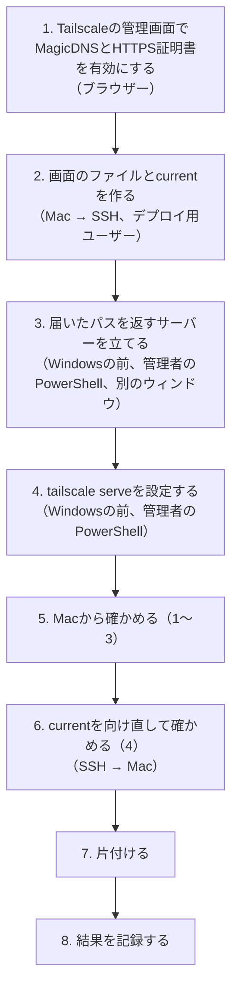

# `tailscale serve`で画面とAPIを振り分けられるかを、家のWindowsで確かめる手順

## 文書ステータス

- 作成日: **2026-11-11**
- 対象: 家のWindows（入口の`tailscale serve`）と、Mac（確かめる側）
- 目的: [ADR 0002 論点1](../adr/0002-switch-deploy-target-by-configuration.md#決定2026-11-11-c)で決めたC
  （画面とAPIを同じOriginから返し、振り分けは入口が担う）を、`tailscale serve`だけで組めるかを確かめる
- 根拠: ADR 0002 論点1の[決める前の検証](../adr/0002-switch-deploy-target-by-configuration.md#決める前の検証windows15分ほどmercariへは通信しない)
- 前提: [前回の確かめの手順書](windows-deploy-checks.md)が済んでいる（Run unattendedが有効、デプロイ用ユーザーへSSHで入れる）
- 状態: **2026-11-11に実行中。**1〜5-1は済んだ（1・4はできた。2はパスが削られたが、渡し先をパスつきにして直った。3は404）。6はまだ

**前回までの手順書の書き方をそのまま使う。**伏せ字、[どこで誰として打つか](windows-deploy-checks.md#どこで誰として打つか)、
[コマンドの貼り方](windows-deploy-checks.md#コマンドの貼り方)は、前回の手順書にある。

## 0. 何を確かめるか

| # | 確かめること | 期待どおりでないと |
|---|---|---|
| **1** | `tailscale serve`で、画面のファイル（`dist/`）を`/`に配れるか | Cを`tailscale serve`だけで組めない |
| **2** | `/api`をuvicornへ渡したとき、**パスが`/api/health`のまま届くか**、`/health`に削られるか | 削られると、APIが壊れる |
| **3** | `/sellers/abc123`のような画面の住所を直接開いたとき、`index.html`が返るか、404になるか（SPA fallback） | 404なら、D（`HashRouter`）かCaddyを組み合わせる（利用者が選ぶ） |
| **4** | 配るフォルダーが`current\dist`（デプロイ用ユーザーが作ったジャンクション）を通るとき、配れるか。**`current`を向け直すと、入口の設定を変えずに新しい画面が配られるか** | 配れなければ、入口の指し方を変える |

結果で何を選ぶかは、ADR 0002の[結果の表](../adr/0002-switch-deploy-target-by-configuration.md#決める前の検証windows15分ほどmercariへは通信しない)のとおり。

### 本物のCard Diggerは使わない

| 本番 | この確かめ | 理由 |
|---|---|---|
| `dist/`（Viteのビルド） | `index.html`と`assets\app.js`の2つだけの、手で作ったファイル | 確かめたいのは「入口が配れるか」で、中身は何でもよい。版を見分けるため`v1`・`v2`の2つを作る |
| uvicorn（`127.0.0.1:8000`） | **届いたパスをそのまま返すだけの小さなサーバー**（PowerShell） | 2の答えが、返事を見るだけで分かる。uvもタスクも要らない。Mercariへ通信しない |

```text
Mac（curl）
   │  https://<PC名>.<tailnet>.ts.net/...
   ▼
tailscale serve（入口。管理者のもの）
   ├── /api/*  → http://127.0.0.1:8000  （届いたパスを返すサーバー）
   └── /*      → C:\card-digger-check\current\dist
                        └── current → releases\v1（または v2）
```

## 全体の流れ



## 1. MagicDNSとHTTPS証明書を有効にする（ブラウザー、Tailscaleの管理画面）

**`tailscale serve`がHTTPSで受けるには、tailnetでHTTPS証明書が使えるようになっている必要がある。**
[ADR 0001 決定3](../adr/0001-run-on-home-windows-via-tailscale.md#決定3--入口はtailscale-serve)の入口は、もともとこれを前提にしている。

1. ブラウザーで<https://login.tailscale.com/admin/dns>を開く（Tailscaleの管理画面の「DNS」）
2. **MagicDNS**が有効か見る。無効なら有効にする
3. **HTTPS Certificates**の「Enable HTTPS」を押す

| 設定 | 何をするか |
|---|---|
| MagicDNS | tailnetの中で、端末を`<PC名>.<tailnet>.ts.net`という名前で引けるようにする |
| HTTPS Certificates | `<PC名>.<tailnet>.ts.net`の証明書を、Tailscaleが自動で取れるようにする（Let's Encrypt） |

### 有効にする前に確かめること — 名前が公開される

**HTTPS証明書を取ると、`<PC名>.<tailnet>.ts.net`という名前が、証明書の公開記録（Certificate Transparency）に載る。**
証明書を出した記録は、誰でも検索できる。**載るのは名前だけ**で、中身やIPアドレスは載らない。tailnetの外からは、名前が分かっても届かない。

| 載るもの | 確かめること |
|---|---|
| PC名 | 本名などの個人情報が入っていないか（[ADR 0001](../adr/0001-run-on-home-windows-via-tailscale.md)は「PC名に個人情報を入れない」としている） |
| tailnetの名前 | 管理画面の「DNS」の上に出る`tailXXXX.ts.net`の形か。自分で付けた名前なら、それも載る |

**名前に気になるものがあれば、有効にする前に変える。**載った記録は消せない。

### 端末の名前を調べる（Windowsの前、管理者のPowerShell）

```powershell
& "C:\Program Files\Tailscale\tailscale.exe" status --json | ConvertFrom-Json | ForEach-Object { $_.Self.DNSName }
```

`<PC名>.<tailnet>.ts.net.`の形の名前が出る（最後の`.`は付いたままでよい）。以下、最後の`.`を除いたものを`<入口の名前>`と書く。
**この名前は文書に書かない**（[この手順書に書かないもの](windows-deploy-checks.md#この手順書に書かないもの)）。

## 2. 画面のファイルと`current`を作る（Mac → SSH、デプロイ用ユーザー）

`ssh <ホスト名>-deploy`で入り、`powershell`に切り替えてから貼る。

```powershell
New-Item -ItemType Directory -Force C:\card-digger-check\releases\v1\dist\assets, C:\card-digger-check\releases\v2\dist\assets | Out-Null
'<!doctype html><title>check</title><p>card-digger-check v1</p>' | Set-Content -Encoding ascii C:\card-digger-check\releases\v1\dist\index.html
'console.log("v1")' | Set-Content -Encoding ascii C:\card-digger-check\releases\v1\dist\assets\app.js
'<!doctype html><title>check</title><p>card-digger-check v2</p>' | Set-Content -Encoding ascii C:\card-digger-check\releases\v2\dist\index.html
'console.log("v2")' | Set-Content -Encoding ascii C:\card-digger-check\releases\v2\dist\assets\app.js
cmd /c mklink /J C:\card-digger-check\current C:\card-digger-check\releases\v1
```

| 行 | 何をしているか |
|---|---|
| `New-Item … releases\v1\dist\assets, …v2…` | 版を2つ作る。本番の`releases\<commit SHA>\dist\`と同じ形 |
| `index.html`、`assets\app.js` | 本番の`dist/`の代わり。中身の`v1`・`v2`で、どちらが配られたかを見分ける |
| `mklink /J … current … v1` | `current`を`v1`へ向ける。**本番と同じく、デプロイ用ユーザーが作るジャンクション** |

`ジャンクションが作成されました`と出ればよい。**SSHのセッションからはこのジャンクションをたどれない**（[ジャンクションの問答 Q6](../questions/2026-11-10-what-a-junction-is.md#q6-なぜsshからはたどれなかったのか管理者でもだめなのか)）が、作ることはできる。

## 3. 届いたパスを返すサーバーを立てる（Windowsの前、管理者のPowerShell）

**新しく「管理者として実行」でPowerShellを開き、そのウィンドウはこのサーバー専用にする。**このウィンドウは、確かめが終わるまで閉じない。

```powershell
$l = New-Object System.Net.HttpListener; $l.Prefixes.Add('http://127.0.0.1:8000/'); $l.Start(); 'listening on 127.0.0.1:8000'; while ($l.IsListening) { $c = $l.GetContext(); $b = [Text.Encoding]::UTF8.GetBytes('path=' + $c.Request.RawUrl); $c.Response.ContentType = 'text/plain'; $c.Response.OutputStream.Write($b, 0, $b.Length); $c.Response.Close() }
```

| 部分 | 何をしているか |
|---|---|
| `HttpListener`、`127.0.0.1:8000` | 本番のuvicornと同じ口で待つ。このWindowsの中からしか届かない |
| `'path=' + $c.Request.RawUrl` | **届いたパスを、そのまま返事にする。**`/api/health`と来たら`path=/api/health`と返す |
| 管理者で動かす | 一般ユーザーが`HttpListener`で待つには、別の設定（URLの予約）が要る。確かめの間だけなので、管理者で動かす |

`listening on 127.0.0.1:8000`と出たら、そのままにしておく。**止めるときは、ウィンドウを閉じる**（`Ctrl+C`は、次の要求が来るまで効かないことがある）。

## 4. `tailscale serve`を設定する（Windowsの前、管理者のPowerShell。3とは別のウィンドウ）

**もう1つ「管理者として実行」でPowerShellを開く。**

### 4-1. 今の設定を控える

```powershell
$ts = "C:\Program Files\Tailscale\tailscale.exe"
& $ts serve status
```

| 結果 | 意味 |
|---|---|
| `No serve config` | 何も設定されていない。4-2へ |
| 設定が表示される | **既に何かが設定されている。表示をそのまま控え、利用者に知らせる。**別の用途かもしれないので、7の片付けで`reset`を使わない |

### 4-2. 画面を`/`に、APIを`/api`に振り分ける

```powershell
& $ts serve --bg --set-path=/ C:\card-digger-check\current\dist
```

```powershell
& $ts serve --bg --set-path=/api http://127.0.0.1:8000
```

```powershell
& $ts serve status
```

| 部分 | 何をしているか |
|---|---|
| `--set-path=/ C:\…\current\dist` | `/`に来た要求に、`current\dist`のファイルを返す（**1・4**）。**`current`を通して指す** |
| `--set-path=/api http://127.0.0.1:8000` | `/api`に来た要求を、3のサーバーへ渡す（**2**）。**このままでは`/api`が削られる。**[5-1](#5-1-apiの渡し先をパスつきにする2の手当て)で`http://127.0.0.1:8000/api`に直した |
| `--bg` | 設定を残したまま、コマンドを終える。本番も`--bg`で設定する |
| HTTPSの443番 | 何も指定しないと、`https://<入口の名前>/`で受ける |

`serve status`に、`https://<入口の名前>`の下に`/`と`/api`の2行が出ればよい。
初めてHTTPSで受けるときは、証明書を取るのに数十秒かかることがある。

| エラー | 意味 |
|---|---|
| HTTPSが有効でない、という文 | 1が済んでいない |
| パスの形が違う、という文 | 文をそのまま記録する。`--set-path`の書き方がこの版で違う可能性がある |

## 5. Macから確かめる（Macのターミナル）

`<入口の名前>`は、1で調べた名前に置き換える。

```bash
curl -s https://<入口の名前>/ ; echo
curl -s https://<入口の名前>/assets/app.js ; echo
curl -s https://<入口の名前>/api/health ; echo
curl -s -o /dev/null -w "%{http_code}\n" https://<入口の名前>/sellers/abc123
curl -s https://<入口の名前>/sellers/abc123 | head -c 200 ; echo
```

| 行 | 確かめ | 期待する結果 | 期待どおりでないと |
|---|---|---|---|
| `/` | **1・4** | `card-digger-check v1`を含むHTML | 画面を配れていない。`current`をたどれていないかもしれない |
| `/assets/app.js` | 1 | `console.log("v1")` | 下の階層を配れていない |
| `/api/health` | **2** | **`path=/api/health`** | `path=/health`なら、入口が`/api`を**削っている** |
| `/sellers/abc123`の番号 | **3** | `200` | `404`なら、SPA fallbackができない |
| `/sellers/abc123`の中身 | 3 | `card-digger-check v1`を含むHTML（`index.html`） | 200でも別の中身（ファイルの一覧など）なら、SPA fallbackではない |

**ブラウザーでも見てよい。**`https://<入口の名前>/`をMacやiPhoneのブラウザーで開くと`card-digger-check v1`と出る。

**2026-11-11の結果。**

```text
<!doctype html><title>check</title><p>card-digger-check v1</p>
console.log("v1")
path=/health
404
404 page not found
```

| # | 結果 | 判定 |
|---|---|---|
| 1 | `/`と`/assets/app.js`が`v1`の中身を返した | **できた** |
| 4 | `current`（デプロイ用ユーザーがSSHから作ったジャンクション）を通して配った | **入口はたどれた** |
| **2** | **`path=/health`** | **入口が`/api`を削って渡した。**このままではAPIが壊れる |
| **3** | **`404`、`404 page not found`** | **SPA fallbackができない** |

### 5-1. `/api`の渡し先をパスつきにする（2の手当て）

**入口は`/api`を削ってから渡す。**渡し先を`http://127.0.0.1:8000/api`と**パスつきで**書けば、削った後に`/api`を付け直して、
`/api/health`のまま届く見込みである。決める前に試す。

**Windowsの前、4の管理者のPowerShell**で、1つずつ貼る。

```powershell
& $ts serve --set-path=/api off
```

```powershell
& $ts serve --bg --set-path=/api http://127.0.0.1:8000/api
```

```powershell
& $ts serve status
```

| 行 | 何をしているか |
|---|---|
| `--set-path=/api off` | 今の`/api`の振り分けだけを消す。`/`の振り分けは残る |
| `--set-path=/api http://127.0.0.1:8000/api` | 渡し先に`/api`を付けて、もう一度振り分ける |

**Macのターミナル**で確かめる。

```bash
curl -s https://<入口の名前>/api/health ; echo
curl -s "https://<入口の名前>/api/search?keyword=x" ; echo
```

| 結果 | 意味 |
|---|---|
| **`path=/api/health`**、**`path=/api/search?keyword=x`** | **渡し先の書き方で直る。**2は解決する |
| `path=/health`のまま | 書き方では直らない |
| `path=/api/api/health` | 削っていなかった（5の結果と食い違うので、記録する） |

2行目は、下の階層のパスと、`?`以降（クエリ）がそのまま届くかを見る。

**2026-11-11の結果。`path=/api/health`、`path=/api/search?keyword=x`。渡し先をパスつきにすると、パスもクエリもそのまま届いた。2は解決した。**
**本番の入口も、渡し先を`http://127.0.0.1:8000/api`と書く。**

**3（404）は、書き方では直らない。**ADR 0002の結果の表のとおり、**C＋D**（`HashRouter`。URLに`#`が入る）か
**C＋Caddy**（SPA fallbackをCaddyが担う。Windowsで常駐するものが1つ増える）を、利用者が選ぶ。

## 6. `current`を向け直す（4）

**本番のデプロイと同じく、入口の設定は変えずに`current`だけを`v2`へ向け直す。**

### 6-1. 向け直す（Windowsの前、管理者のPowerShell）

**SSHのセッションからは、ジャンクションを消せるか分からない**（たどれないため）。ここではWindowsの前で行う。
本番では、デプロイ用のタスクの中で行う（[ADR 0003 論点5の見直し](../adr/0003-deploy-changes-to-the-target.md#2026-11-10の見直し--準備と切り替えはタスクの中で行う)）。

```powershell
cmd /c rmdir C:\card-digger-check\current
cmd /c mklink /J C:\card-digger-check\current C:\card-digger-check\releases\v2
```

| 行 | 何をしているか |
|---|---|
| `rmdir … current` | `current`の札だけを消す。`v1`の中身は消えない |
| `mklink /J … v2` | `current`を`v2`へ向ける |

**このジャンクションは管理者が作ったものになる。**本番では、デプロイ用ユーザー（のタスク）が作る。
2で作った`v1`への`current`はデプロイ用ユーザーが作ったものなので、**5の結果が「デプロイ用ユーザーが作ったジャンクションを入口がたどれるか」の答えになる。**

### 6-2. 確かめる（Macのターミナル）

```bash
curl -s https://<入口の名前>/ ; echo
```

| 結果 | 意味 |
|---|---|
| **`card-digger-check v2`** | **入口の設定を変えずに、`current`の向け直しだけで新しい画面が配られた** |
| `card-digger-check v1`のまま | 入口が古い中身を持ち続けている（キャッシュ）。数秒おいてもう一度試し、変わるまでの時間を記録する |
| 失敗する | 入口が`current`を開いたまま離さないなど。記録する |

## 7. 片付ける

| # | 何を | どこで | コマンド |
|---|---|---|---|
| 1 | 入口の設定を戻す | Windowsの前、管理者のPowerShell（4のウィンドウ） | 4-1で`No serve config`だったなら`& $ts serve reset`（2026-11-11はこれ）。**別の設定があったなら**、`& $ts serve --set-path=/api off`と`& $ts serve --set-path=/ off`で、足した2つだけを消す |
| 2 | 設定が戻ったか見る | 同じ | `& $ts serve status`。4-1で控えたのと同じ表示ならよい |
| 3 | 届いたパスを返すサーバーを止める | 3のウィンドウ | **ウィンドウを閉じる** |
| 4 | `current`を消す | Windowsの前、管理者のPowerShell | `cmd /c rmdir C:\card-digger-check\current` |
| 5 | フォルダーを消す | 同じ | `Remove-Item -Recurse -Force C:\card-digger-check` |

**残すもの。**MagicDNSとHTTPS証明書の設定（本番の入口で使う）。

## 8. 結果を記録する

ADR 0002 論点1の[検証](../adr/0002-switch-deploy-target-by-configuration.md#決める前の検証windows15分ほどmercariへは通信しない)に結果を書き、Cの中身を決める。

| 結果 | ADR 0002の結果の表では |
|---|---|
| 1〜4がすべて期待どおり | **C（`tailscale serve`だけ）**。Windowsで常駐するものは増えない |
| 1・2・4は期待どおり、3が404 | **C＋D**（`HashRouter`。URLに`#`）か**C＋Caddy**（SPA fallbackをCaddyが担う）。**利用者が選ぶ** |
| 1か2が期待どおりでない | C＋Caddy、またはB′に戻る。改めて決める |
| 4が期待どおりでない（`current`をたどれない、向け直しが効かない） | 入口の指し方を変える。ADR 0003 論点5にも関わる |
