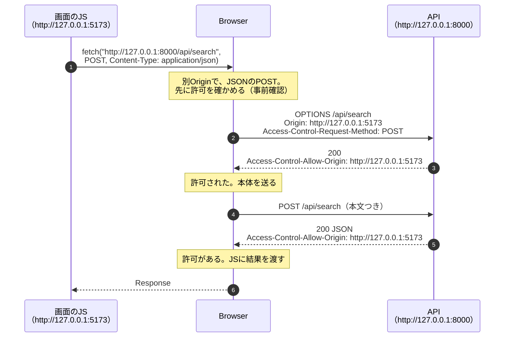

# CORSは何のためにあるのか — 2026-11-08の問答

画面とAPIを同じOriginから返すかを議論している途中で、利用者が出した問いと答えをまとめる。
Originとは何か（スキーム・ホスト・ポートの3つ組）は前提として扱う。

| # | 問い |
|---|---|
| Q1 | [別OriginだとCORSの設定が必要か](#q1-別originだとcorsの設定が必要か) |
| Q2 | [CORSは何のためにあるのか](#q2-corsは何のためにあるのか) |
| Q3 | [CORSは何を守らないのか](#q3-corsは何を守らないのか) |
| Q4 | [Card DiggerのCORS設定は、何をしているのか](#q4-card-diggerのcors設定は何をしているのか) |
| Q5 | [Card Diggerで、CORSでは止まらない要求はあるか](#q5-card-diggerでcorsでは止まらない要求はあるか) |

## Q1. 別OriginだとCORSの設定が必要か

**BrowserのJSが別OriginのAPIを呼び、その結果を読むなら必要である。**設定するのは**呼ばれる側
（API）**で、呼ぶ側（画面）ではない。

| 場面 | CORSが要るか | 理由 |
|---|---|---|
| JSの`fetch()`で別OriginのAPIを呼び、結果を読む | **要る** | Q2の規則がJSに結果を見せない |
| ``で別Originの画像を表示する | 要らない | 表示するだけで、JSが中身を読まない。Mercariの商品画像はこれ |
| `<script src>`・`<link href>`で別OriginのJS・CSSを読み込む | 要らない | 同上 |
| 同じOriginのAPIを呼ぶ | **要らない** | 確認そのものが起きない |
| `curl`やサーバー同士の通信 | **関係ない** | CORSはBrowserの仕組みで、Browser以外は従わない |

## Q2. CORSは何のためにあるのか

**CORSそのものは「守る仕組み」ではなく、「緩める仕組み」である。**守っているのはその手前にある
**同一Originポリシー**で、CORSはそこに**APIの側から例外を開ける**手続きである。

### 先に、同一Originポリシーがある

Browserは既定で、**あるOriginのページのJSが、別Originの応答を読むことを禁じる。**
これを同一Originポリシー（Same-Origin Policy）と呼ぶ。

なぜ禁じるか。**Browserは利用者の持ち物を背負って要求を出すから**である。

| Browserが背負っているもの | 禁じなかったら |
|---|---|
| **Cookie**（ログイン状態） | 悪意あるページ`evil.example`のJSが`fetch("https://bank.example/balance")`を呼ぶと、Browserは利用者のCookieを付けて送る。**残高を読まれる** |
| **ネットワーク上の位置**（家のLAN、Tailnet、自分のPC） | `fetch("http://192.168.1.1/admin")`（Router）や`fetch("http://127.0.0.1:8000/...")`を呼ぶと、外からは届かない場所に**利用者のBrowserが代わりに届いてしまう** |

**守られているのは利用者である。**サーバーではない。

### CORSは、APIが「読ませてよい相手」を宣言する手続き

同一Originポリシーのままでは、正当に別Originを使いたいアプリ（`example.com`の画面が
`api.example.com`を呼ぶ、など）も動かない。そこで**API側が応答のヘッダーで許可を出す**と、
Browserがその相手にだけ結果を見せる。これがCORS（Cross-Origin Resource Sharing）である。

### 事前確認（preflight）が起きる要求、起きない要求

| 種類 | 例 | Browserの動き |
|---|---|---|
| **単純な要求** | `GET`、または`POST`で`Content-Type`が`text/plain`・フォーム形式。独自のヘッダーなし | **事前確認なしで本体を送る。**応答に許可が無ければ、JSに**見せない**だけ |
| **それ以外** | `Content-Type: application/json`の`POST`、`PUT`・`DELETE`、独自のヘッダー | **先に`OPTIONS`で許可を確かめる。**許可が無ければ、**本体を送らない** |

単純な要求に事前確認が無いのは、HTMLのフォームや``が昔からその形の要求を別Originへ
送れたからである。CORSが後から加わったとき、それ以上に危険にしない形で線が引かれた。

## Q3. CORSは何を守らないのか

**CORSは「読ませない」仕組みであって、「届かせない」仕組みではない。**

| 守らないもの | 説明 |
|---|---|
| **単純な要求の副作用** | 単純な要求は、許可が無くても**サーバーに届き、最後まで実行される。**JSが結果を読めないだけ |
| Browser以外からの要求 | `curl`、スクリプト、サーバー同士の通信はCORSに従わない |
| 許可した相手のページが乗っ取られた場合 | 許可した以上、そのページのJSは読める |

**だからCORSは認証の代わりにならない。**「誰が要求を出せるか」は、別の仕組み（入口の認証、
届く範囲の制限）で決める。Card Diggerでは、TailscaleとBind先`127.0.0.1`がそれを受け持つ
（[家のPCへ繋ぐ問答 Q5](2026-11-08-reaching-home-server-from-devices.md#q5-127001のままにすると何が守られて何が守られないのか)）。

## Q4. Card DiggerのCORS設定は、何をしているのか

`src/backend/card_digger/api/main.py`の`create_app()`で、FastAPIの`CORSMiddleware`を使っている。

| 設定 | 値 | 意味 |
|---|---|---|
| `allow_origins` | `http://localhost:5173`、`http://127.0.0.1:5173` | **Viteの開発サーバーの画面だけ**に結果を読ませる。`*`（誰でも）にしない |
| `allow_credentials` | `False` | Cookieを付けた別Originの要求を許さない。Card DiggerはCookieを使わない |
| `allow_methods` | `GET`、`POST` | 使っているものだけ |
| `allow_headers` | `Content-Type` | JSONのPOSTに要るものだけ |
| `expose_headers` | `Retry-After` | 下の補足 |

**なぜ要るのか。**今の開発構成では、画面（5173番）とAPI（8000番）がポート違いの別Originだから
である。

**補足：`expose_headers`。**別Originの応答では、JSが読める応答ヘッダーも限られる
（`Content-Type`など数個だけ）。安全停止のときに返す`Retry-After`はそこに入らないので、
許可しないと**Browserがヘッダーを隠し**、画面は「あと何秒待てばよいか」を言えなくなる。
`main.py`の`EXPOSED_HEADERS`のコメントがこの理由を書いている。

### 実際の応答（2026-11-08にMock Adapterで確かめた）

`scripts/acceptance_app.py`（Mercariへ通信しない受入用アプリ）を`TestClient`で呼んだ。

| 要求 | `Origin` | 結果 |
|---|---|---|
| `OPTIONS /api/search`（JSONのPOSTの事前確認） | `http://127.0.0.1:5173` | **200**、`Access-Control-Allow-Origin: http://127.0.0.1:5173` |
| 同上 | `https://evil.example` | **400**、許可ヘッダーなし。**Browserは本体を送らない** |
| `GET /api/health` | `http://127.0.0.1:5173` | 200、`Access-Control-Expose-Headers: Retry-After` |

### 画面とAPIを同じOriginにしたら

画面とAPIを同じOriginから返す構成（議論中の案）にすると、**Browserは確認そのものをしなくなる。**
この設定は開発時にも使われなくなり、残しても害は無い。消すかどうかは、その構成が決まって
動くのを確かめてから判断する。

## Q5. Card Diggerで、CORSでは止まらない要求はあるか

**ある。Seller分析の`GET`である。**

| API | 要求の種類 | 別Originのページから | 2026-11-08にMock Adapterで確かめた結果 |
|---|---|---|---|
| `POST /api/search`（JSON） | 事前確認が要る | **事前確認で止まる。**本体は届かない | 事前確認は400 |
| `POST /api/search`を`text/plain`で送る | 単純な要求 | 届くが、FastAPIが本文をJSONとして扱わない | **422**。検索は実行されない |
| `GET /api/sellers/{id}/analysis` | **単純な要求** | **届き、最後まで実行される** | **200。**許可ヘッダーが無いので、BrowserはJSに結果を見せない |

つまり、Card Diggerを開いているBrowserで**悪意あるページを開くと、そのページは結果を読めないまま、
Seller分析を実行させることはできる。**本番の構成なら、その分のRequestがMercariへ出る。

| 緩和しているもの | 内容 |
|---|---|
| `MarketplaceAccess` | 実行させられても、同時実行1・開始間隔2秒以上・安全停止は守られる。**Mercariへの約束は破れない** |
| 届く範囲 | そのページが`127.0.0.1:8000`や`PC名.ts.net`へ届くのは、**利用者のBrowserがTailnetの中か、Windows本体にいるとき**だけ |

**緩和していないもの。**Seller IDを指定した外部Requestを、利用者の意図なく出させられること
自体は防げていない。`PC名.ts.net`は証明書透明性Logに載るので、名前は推測されうる。

**今は対策しない。**利用者1人のLocal実行で、Mercariへの約束は`MarketplaceAccess`が守っている。
対策が要るとしたら、候補は次の3つ。

| 候補 | 内容 |
|---|---|
| `Origin`ヘッダーの検査 | 許可していないOriginからの要求を、CORSとは別にサーバー側で拒否する |
| `Sec-Fetch-Site`ヘッダーの検査 | 新しいBrowserが付ける「どこから来た要求か」を見て、`cross-site`を拒否する |
| Seller分析を`POST`（JSON）にする | 事前確認が必要になり、Browserが本体を送らなくなる |
