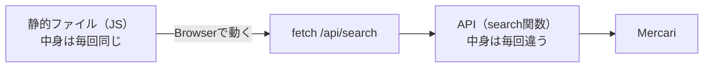
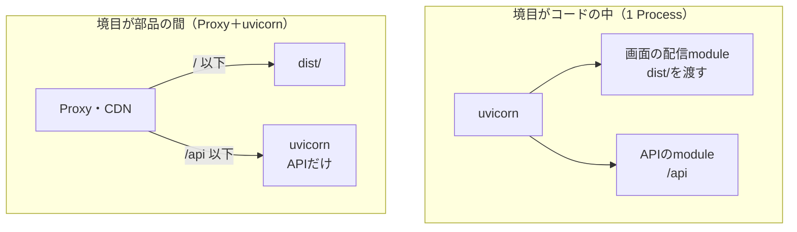
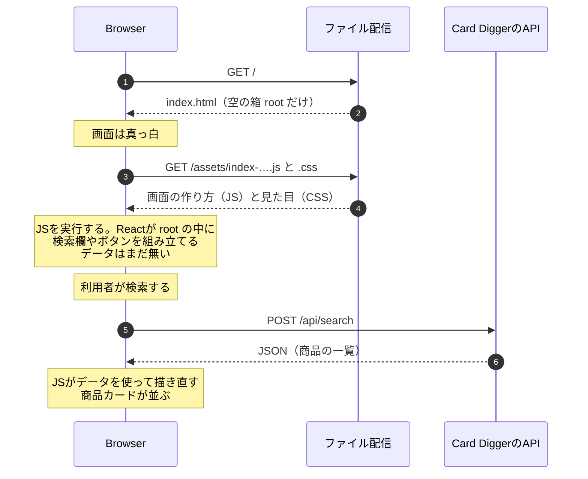
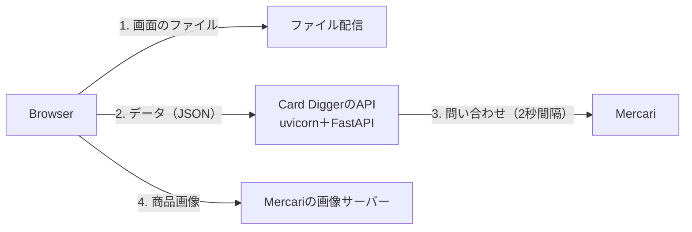

# 静的ファイルとは何か。配られた時点で何が入っているのか — 2026-11-08の問答

画面とAPIを同じOriginから返す方法（FastAPIが画面も配るか、前段のProxyが配るか）を
議論している途中で、利用者が出した問いと答えをまとめる。

| # | 問い |
|---|---|
| Q1 | [静的ファイルとは、Mercariへのリクエストが飛ばないファイルのことか](#q1-静的ファイルとはmercariへのリクエストが飛ばないファイルのことか) |
| Q2 | [画面を返すのも「API」か](#q2-画面を返すのもapiか) |
| Q3 | [CSRなら、画面の配信とAPIは分けるべきか](#q3-csrなら画面の配信とapiは分けるべきか) |
| Q4 | [配られた時点では何も入っておらず、BrowserでJSを実行して初めて画面ができるのか](#q4-配られた時点では何も入っておらずbrowserでjsを実行して初めて画面ができるのか) |
| Q5 | [Card Diggerには、何種類の通信があるのか](#q5-card-diggerには何種類の通信があるのか) |

## Q1. 静的ファイルとは、Mercariへのリクエストが飛ばないファイルのことか

**違う。静的か動的かは、要求のたびに中身が変わるかどうかで決まる。**Mercariへ行くかどうかではない。

| | 静的ファイル | API（動的な応答） |
|---|---|---|
| 例 | `index.html`、`assets/index-….js`、`assets/index-….css` | `POST /api/search`、`GET /api/sellers/{id}/analysis`、`GET /api/health` |
| 中身はいつ決まるか | **Buildしたとき。**誰がいつ要求しても同じ | **要求のたびに計算する** |
| 誰が作るか | Vite（`npm run build`） | FastAPIの関数 |
| 配るときに計算するか | しない。置いてあるファイルを渡すだけ | する |
| Mercariへ行くか | 行かない | 行くものと行かないものがある（`/api/health`は行かない） |

**静的ファイルのJSこそが、Mercariへの検索を引き起こすコードを含んでいる。**
`src/frontend/src/api/client.ts`の`fetch(…"/api/search"…)`は、Buildされて`assets/index-….js`に入る。



**「配る時点では何も計算しない、決まった中身のファイル」**と捉えると正確である。

## Q2. 画面を返すのも「API」か

**APIと呼ばない方がよい。静的ファイルを返すのは「ファイル配信」である。**

| | ファイル配信 | API |
|---|---|---|
| やること | 置いてあるファイルをそのまま渡す | 要求に応じて計算し、データ（JSON）を返す |
| 返すもの | HTML・JS・CSS・画像 | JSON |
| 得意な部品 | nginx、Caddy、`tailscale serve`、CDN、FastAPIの`StaticFiles` | FastAPIのようなアプリ |
| 中で何かを判断するか | しない（あってもSPA fallback程度） | する（検証、Mercariへの問い合わせ、状態コードの決定） |

## Q3. CSRなら、画面の配信とAPIは分けるべきか

**分けなければならないわけではない。CSRだと分けられる、が正確である。**

| | SSR（サーバーサイドレンダリング） | CSR（Card Digger） |
|---|---|---|
| サーバーが返すもの | データ入りのHTML（毎回違う） | 静的ファイル（毎回同じ）＋API（毎回違う） |
| 画面とデータの関係 | 画面を作るのにデータが要る | 画面のファイルはデータを知らない |
| 2つを分けられるか | 分けにくい | **分けられる。**静的ファイルは誰が配ってもよい |

CSRでは、分ける境目をどこに置くかを選べる。



**どちらも「静的ファイル」と「API」を分けている。**違うのは、境目がコードの中か、部品の間か、である。

## Q4. 配られた時点では何も入っておらず、BrowserでJSを実行して初めて画面ができるのか

**ほぼそのとおり。**ただし「何も入っていない」のは**`index.html`の画面部分とデータ**であり、
JSには**画面の作り方がすべて入っている。**

### 実物：`index.html`の中身

`src/frontend/index.html`。Buildすると`<script>`の行だけが`/assets/index-….js`に書き換わる。

```html
<body>
  <div id="root"></div>                                  <!-- 画面はここだけ。中は空 -->
  <script type="module" src="/src/main.tsx"></script>    <!-- このJSを実行せよ -->
</body>
```

`src/frontend/src/main.tsx`が`document.getElementById("root")`を探し、Reactにその中を組み立てさせる。

### 配られた時点で、何が入っていて何が無いか

| | 配られた時点 | 入っている場所 |
|---|---|---|
| 画面の部品（検索欄、ボタン、商品カード、Seller画面）の**作り方** | **入っている** | JS（`assets/index-….js`） |
| 画面に出す**固定の文言** | **入っている** | JS。2026-11-08に手元の`dist/assets/index-DzBczMP1.js`の中に`検索をやり直す`があることを確かめた |
| 色・余白・書体 | **入っている** | CSS（`assets/index-….css`） |
| 実際の画面の要素（組み立て結果） | **無い** | JSが実行されて初めてできる |
| 商品やSellerの**データ** | **無い** | 検索したときにAPIから取ってくる |

たとえると、配られるのは**組み立て説明書と部品（JS・CSS）と空の箱（`index.html`）**である。
Browserが説明書どおりに組み立て、中に入れる商品（データ）は後から取り寄せる。

### Browserの中で起きること



| 段階 | 画面に見えるもの | 中身の出どころ |
|---|---|---|
| 1〜2の後 | 真っ白 | `index.html`（静的） |
| 3〜4の後 | 検索欄・ボタン（データなし） | JS・CSS（静的）をBrowserが組み立てた |
| 5〜6の後 | 商品カード | API（動的）のデータを、JSが描いた |

### 自分で確かめる方法

| 開発者ツールの操作 | 見えるもの |
|---|---|
| **「ページのソースを表示」** | サーバーから届いた`index.html`そのもの。`<div id="root"></div>`が**空のまま** |
| **「要素を検証」（Elements）** | JSが組み立てた後の画面。`root`の中に検索欄などが**入っている** |

SSRのサイトで同じことをすると、「ページのソースを表示」の時点でデータ入りのHTMLが入っている。
**ここがCSRとSSRの見分け方である。**

## Q5. Card Diggerには、何種類の通信があるのか

**4種類ある。Mercariへ行くのは、APIの内側の1種類だけである。**



| # | 通信 | 中身 | 静的か動的か | 誰が答える |
|---|---|---|---|---|
| 1 | Browser → ファイル配信 | 画面のコード（HTML・JS・CSS） | 静的 | ファイル配信（FastAPIの中か、Proxy・CDNか） |
| 2 | Browser → Card DiggerのAPI | 検索・Seller分析のデータ（JSON） | 動的 | uvicorn＋FastAPI |
| 3 | Card DiggerのAPI → Mercari | Mercariへの問い合わせ | 動的 | Mercari。`MarketplaceAccess`が間隔と安全停止を守る |
| 4 | Browser → Mercariの画像 | 商品画像 | 静的（Mercari側の） | Mercariの画像サーバー。**Card Diggerを通らない**（[mvp-spec §10](../product/mvp-spec.md#10-data取扱い)） |

**Browserから見れば、Card DiggerのAPIの先にMercariがあるかどうかは見えない。**3はAPIの内側の話である。
