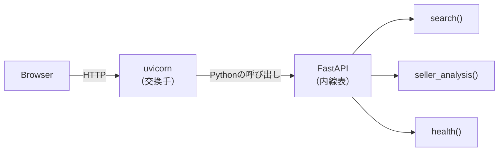
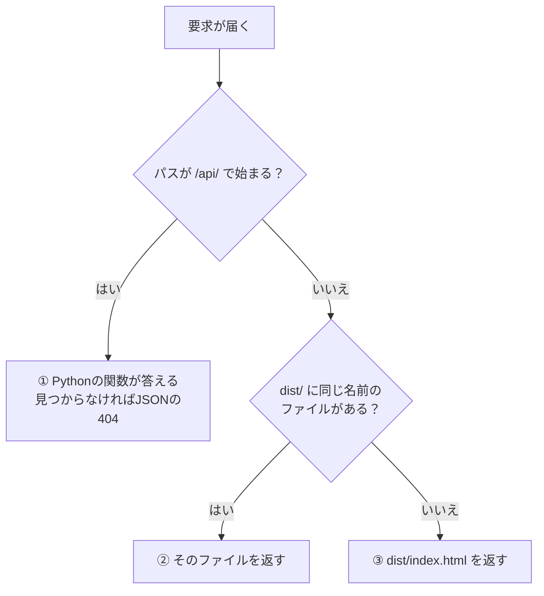
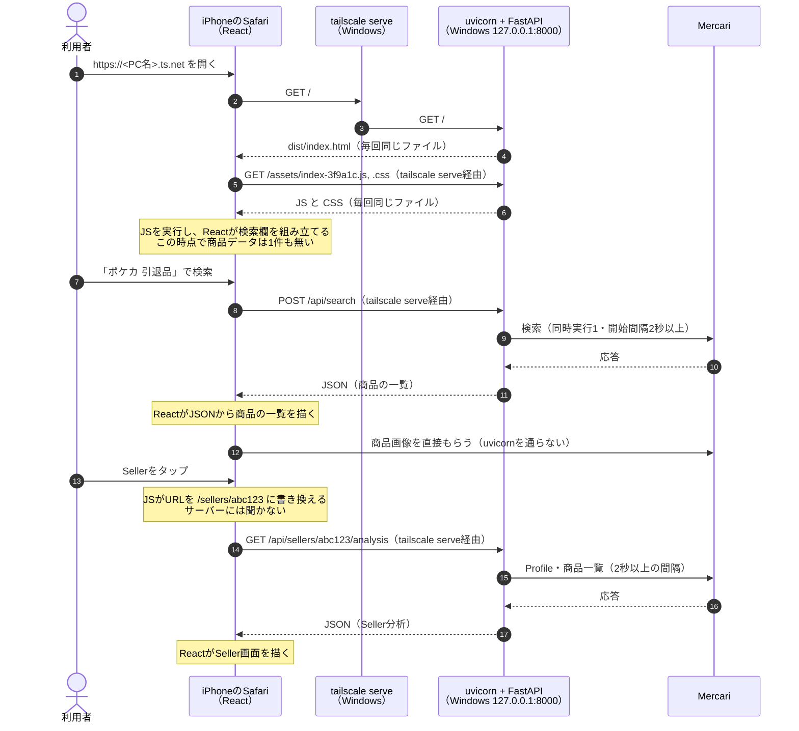
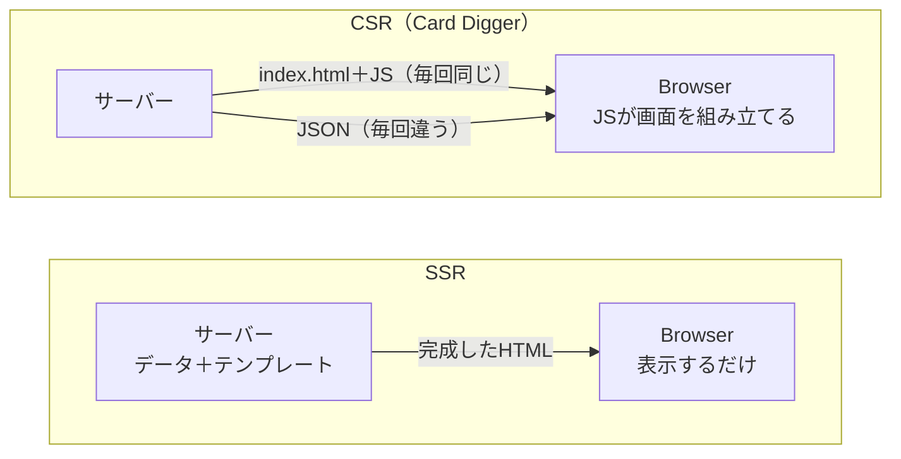
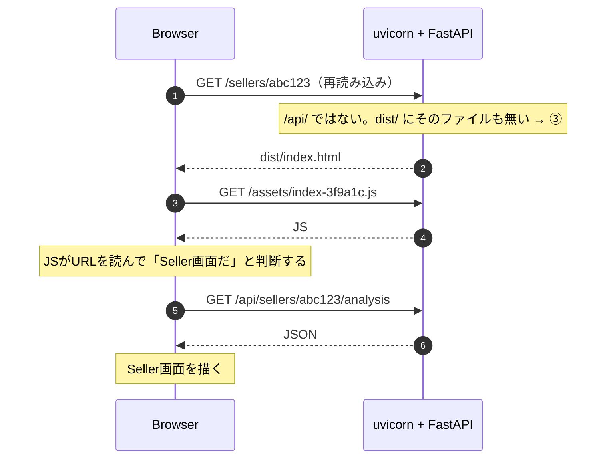
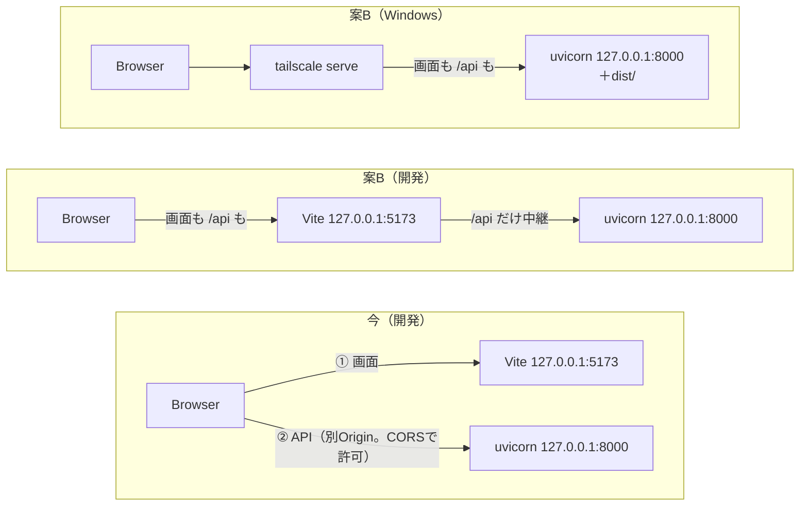

# 画面とAPIは、誰がどこで組み立てるのか — 2026-11-08の問答

[ADR 0001](../adr/0001-run-on-home-windows-via-tailscale.md#未決--frontendが127001を見に行く問題)の
案B（**FastAPIがBuild済みFrontendも返し、APIは同じOriginの`/api/...`で呼ぶ**）を説明する途中で、
利用者が出した問いと答えをまとめる。

> **2026-11-08時点で、案Bは未実装である。**この文書は案Bを採ったときの姿を説明する。
> 今の開発構成との違いは[Q6](#q6-今の開発構成と何が違うのか)にまとめた。

| # | 問い |
|---|---|
| Q1 | [uvicornとは何か](#q1-uvicornとは何か) |
| Q2 | [`/api/search`は`dist/`の中のファイルか](#q2-apisearchはdistの中のファイルか) |
| Q3 | [uvicornは届いた要求をどう振り分けるのか](#q3-uvicornは届いた要求をどう振り分けるのか) |
| Q4 | [画面にデータを埋め込むのはuvicornか、Browserか](#q4-画面にデータを埋め込むのはuvicornかbrowserか) |
| Q5 | [`/sellers/abc123`で再読み込みすると、何が起きるのか](#q5-sellersabc123で再読み込みすると何が起きるのか) |
| Q6 | [今の開発構成と何が違うのか](#q6-今の開発構成と何が違うのか) |

## Q1. uvicornとは何か

**PythonのHTTPサーバーである。**ポートで待ち、届いたHTTPの文字列を読み解いてアプリ（FastAPI）に
渡し、返ってきた結果をHTTPにして送り返す。**用件の中身は判断しない。**

用語が3つ重なっているので分ける。

| 名前 | 役割 | たとえ |
|---|---|---|
| **uvicorn** | 8000番で待ち、HTTPを読み書きする | 電話の**交換手** |
| **FastAPI** | 「どのURLにどの関数で答えるか」の対応表を持つ | **内線表** |
| **Card Diggerのコード**（`card_digger/api/main.py`の`search()`など） | Mercariへ問い合わせ、結果をJSONにする | 内線の先の**担当者** |



起動コマンドはこう読む。

| コマンドの部分 | 意味 |
|---|---|
| `uv run uvicorn` | 交換手を起動する |
| `--factory card_digger.api.main:create_app` | `create_app()`を呼んで、できた内線表（FastAPIのアプリ）を渡す |
| （`--host`を付けない） | 既定の`127.0.0.1`で待つ（[0.0.0.0の問答](2026-11-08-what-binding-to-0000-means.md)） |
| （`--workers`を付けない） | 1 Processで動かす（[src/backend/README.md](../../src/backend/README.md#起動)） |

同じ立場の部品と比べると、こうなる。

| 部品 | 本業 |
|---|---|
| nginx・Apache | 静的ファイルを配る |
| Viteの開発サーバー（5173番） | 開発中のFrontendを配る。保存すると画面を自動で更新する |
| **uvicorn** | **Pythonの関数を呼ぶ。**案Bでは`dist/`のファイルを渡す役も足す |

## Q2. `/api/search`は`dist/`の中のファイルか

**ファイルではなく、Pythonの関数である。**`dist/`に`api/search`というフォルダーは作らない。

### `dist/`に入るのは画面の静的ファイルだけ

`npm run build`の出力（ファイル名の英数字はBuildごとに変わる）。

```text
src/frontend/dist/
├── index.html              ← 中身はほぼ「このJSとCSSを読め」だけ
└── assets/
    ├── index-3f9a1c.js     ← React（画面）のコードをまとめたもの
    └── index-8b2e07.css
```

APIのコードは`src/backend/card_digger/api/main.py`のまま動かさない。

### URLのパスは、ファイルの場所とは限らない

| サーバーの種類 | URLのパスが指すもの |
|---|---|
| 静的ファイルのサーバー（nginxなど） | ディスク上のファイル。`/a/b.html`→`a/b.html` |
| **FastAPI** | **関数。**パスと関数の対応表で決まる |

```python
@app.post("/api/search")   # このパスにPOSTが来たら
async def search(...):      # この関数を実行して、結果をJSONで返す
```

`/api/search`はこの対応表の1行であり、ディスク上には存在しない。

## Q3. uvicornは届いた要求をどう振り分けるのか

案Bでは、FastAPIが**この順番で**照合する。FastAPIは登録した順に照合するので、APIを先に、
何でも受ける画面の処理を最後に登録する。



| 要求 | 振り分け | 返すもの |
|---|---|---|
| `GET /` | ③ | `index.html` |
| `GET /assets/index-3f9a1c.js` | ② | そのJSファイル |
| `POST /api/search` | ① | `search()`の結果（JSON） |
| `GET /api/sellers/abc123/analysis` | ① | `seller_analysis()`の結果（JSON） |
| `GET /sellers/abc123` | ③ | `index.html`（[Q5](#q5-sellersabc123で再読み込みすると何が起きるのか)） |
| `GET /api/xxx`（存在しない） | ① | **JSONの404。**③へ落とさない |
| `GET /../secret.txt` | ③ | `index.html`。**`dist/`の外のファイルは返さない** |

①は今すでにある。案Bで`main.py`に足すのは②と③である。

## Q4. 画面にデータを埋め込むのはuvicornか、Browserか

**Browserである。**uvicornが渡すのは「`dist/`の静的ファイル」と「APIのJSON」の2種類だけで、
それらが出会って画面になるのは**Browserの中で動くJavaScript（React）の中**である。

### iPhoneで開いてから、Seller画面が出るまで



uvicornの仕事は2種類しかない。

| 要求 | uvicornの仕事 | 中身は毎回変わるか |
|---|---|---|
| 画面のファイル（2〜6） | `dist/`のファイルを**そのまま**渡す | **変わらない。**誰がいつ開いても同じ |
| API（8〜11、14〜17） | Pythonの関数を呼び、結果を**JSON**で渡す | 変わる。検索するたびに違う |

画像はBrowserがMercariから直接もらう。Backendは画像を中継も保存もしない
（[mvp-spec §10](../product/mvp-spec.md#10-data取扱い)）。

### 「サーバーがデータを埋め込む」は別の作り方

最初に浮かんだ「uvicornがデータを静的ファイルに埋め込んで返す」は間違いではなく、
**実在する別の作り方**である。

| | サーバーサイドレンダリング（SSR） | クライアントサイドレンダリング（CSR、SPA） |
|---|---|---|
| 画面を組み立てる場所 | **サーバー** | **Browser** |
| サーバーが返すもの | データ入りの完成したHTML | 空の`index.html`とJS。データは別にJSON |
| 検索するたびに | ページ全体を取り直す | JSONだけ取り、画面の一部を描き直す |
| 例 | PHP、Djangoのテンプレート、Next.jsのSSR | **Card Digger**（React＋Vite） |



## Q5. `/sellers/abc123`で再読み込みすると、何が起きるのか

**サーバーには`index.html`を返させ、どの画面かはBrowserのJSが決める。**

Frontendは`BrowserRouter`を使い、Seller画面のURLは`/sellers/:sellerId`である
（`src/frontend/src/App.tsx`）。画面の中でLinkをたどるときは、JSがURLを書き換えるだけで
サーバーには聞かない（[Q4](#iphoneで開いてからseller画面が出るまで)の13の直後）。ところが再読み込みや
ブックマークから開くと、Browserはサーバーに`GET /sellers/abc123`を要求する。



③が無いと、1で404が返り、画面が出ない。この「見つからなければ`index.html`」を
**SPA fallback**と呼ぶ。

## Q6. 今の開発構成と何が違うのか

**窓口が2つから1つになる。**



| | 今 | 案B（開発） | 案B（Windows） |
|---|---|---|---|
| 画面を返す | Vite（5173番） | Vite（5173番） | **uvicorn（8000番）** |
| APIを返す | uvicorn（8000番） | uvicorn（8000番）。**Viteが中継** | uvicorn（8000番） |
| JSが呼ぶAPIの宛先 | `http://127.0.0.1:8000/api/...`（**固定**） | `/api/...`（相対） | `/api/...`（相対） |
| 画面とAPIのOrigin | **別**。CORSで許可している | 同じ | 同じ |
| iPhoneから | 動かない（[前の問答 Q1](2026-11-08-reaching-home-server-from-devices.md#q1-なぜiphoneから開くと1270018000では動かないのか)） | — | **動く** |
| 起動コマンド | `npm run dev`とuvicorn | **今と同じ** | uvicornだけ（事前に`npm run build`） |

相対パス`/api/...`は「`index.html`をもらったのと同じ場所」へ向かう。開いたURLが
`http://127.0.0.1:5173`ならViteへ、`https://<PC名>.ts.net`ならtailscale serveへ向かうので、
**同じBuildがどの端末でも動く。**
