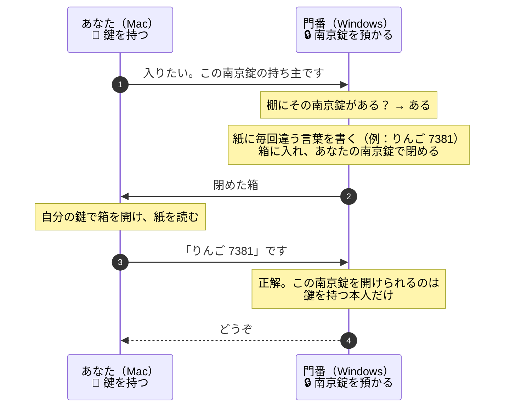

# SSHの鍵は、どうやって本人だと証明するのか — 南京錠のたとえ — 2026-11-09の問答

WindowsのSSHを「鍵認証だけ」にすると決めた（ADR 0003、PR #48）ときに、利用者が出した問いと答えを
まとめる。**この文書は、南京錠と鍵のたとえを軸にする。**本物の仕組みとの対応は最後に置く。

| # | 問い |
|---|---|
| Q1 | [鍵認証とは、どういう仕組みか](#q1-鍵認証とはどういう仕組みか) |
| Q2 | [なぜ鍵の方がパスワードより安全なのか](#q2-なぜ鍵の方がパスワードより安全なのか) |
| Q3 | [公開鍵が漏れても大丈夫なのか](#q3-公開鍵が漏れても大丈夫なのか) |
| Q4 | [では、何がまずいのか](#q4-では何がまずいのか) |
| Q5 | [秘密鍵のパスフレーズは、何をしているのか](#q5-秘密鍵のパスフレーズは何をしているのか) |
| Q6 | [本物のSSHでは、どう動いているのか](#q6-本物のsshではどう動いているのか) |

## Q1. 鍵認証とは、どういう仕組みか

**一言でいうと、「鍵を見せずに、鍵を持っていることを証明する仕組み」である。**

### 登場するもの

| たとえ | 本物 | 誰が持つか | 人に見せてよいか |
|---|---|---|---|
| **鍵🔑** | **秘密鍵**（Macの`~/.ssh/id_ed25519`） | あなた（Mac）だけ | **見せない。誰にも渡さない** |
| **南京錠🔒**（その鍵でしか開かない） | **公開鍵**（`~/.ssh/id_ed25519.pub`） | 何個でも作って配れる | **見せてよい。**閉めることしかできないから |
| 門番 | Windows（SSHサーバー） | — | — |
| 門番が預かる南京錠の棚 | Windowsの`authorized_keys` | Windows | — |

### 準備（最初に1回だけ）

1. あなたは、**鍵を1本**と、**その鍵でしか開かない南京錠**を作る（`ssh-keygen`）
2. 門番に、**南京錠を1つ預ける**（公開鍵を`authorized_keys`に登録する）

```text
あなた（Mac）                    門番（Windows）
  🔑 鍵（誰にも渡さない）           🔒 あなたの南京錠（棚に預かっている）
```

### 入るとき（毎回）



**あなたは鍵を一度も門番に見せていない。**それでも、箱を開けて中の言葉を答えられたことが、
「鍵を持っている」証拠になる。

## Q2. なぜ鍵の方がパスワードより安全なのか

**一番大きな違いは、秘密を相手に渡すかどうかである。**

| | パスワード | 鍵 |
|---|---|---|
| 入るときにやること | 門番に**合言葉を言う** | 門番が閉めた箱を**開けて、中身を言う** |
| 門番に伝わるもの | **合言葉そのもの** | **その回だけの答え** |
| 偽の門番に言ってしまったら | **合言葉を知られる** | 何も困らない（その回の答えしか知られない） |
| 盗み聞きされたら | 合言葉を知られる | 次は別の言葉なので、使えない |
| 当てずっぽうで試されたら | **いつか当たりうる**（人が覚えられる長さ） | 当たらない（コンピューターが作った、組み合わせが膨大な鍵） |
| 失くした・盗まれた端末を締め出す | 合言葉を変える（**全員が影響を受ける**） | 門番の棚から**その南京錠だけを外す** |
| 門番の棚が盗まれたら | 合言葉を照合する情報を取られる | **南京錠を取られるだけ。**開けられない |

Card Diggerの場合、もう1つ大きな理由がある。2026-11-09まで、SSHの合言葉は**Windowsへのログインと同じパスワード**
だった。鍵にすると、SSHのための秘密がWindowsのパスワードと切り離される。

## Q3. 公開鍵が漏れても大丈夫なのか

**大丈夫である。南京錠は、閉めることしかできないからである。**

| 南京錠🔒（公開鍵）でできること | できないこと |
|---|---|
| 箱を閉める（本物では：署名が正しいか確かめる） | **箱を開ける**（本物では：署名を作る） |
| 南京錠の形から、合う鍵を推測する | **できない。**鍵から南京錠を作るのは一瞬だが、南京錠から鍵を作るのは現実には終わらない |

実際、公開鍵は普通に公開されている。GitHubは、各ユーザーのSSH公開鍵を
`https://github.com/<ユーザー名>.keys`で誰でも見られるようにしている。

### ただし、「見られる」と「棚に足される」は別

| 起きること | 危険か | 理由 |
|---|---|---|
| 門番の棚（`authorized_keys`）を**見られる** | 危険ではない | 南京錠を見ても、鍵は作れない |
| 門番の棚に、**他人の南京錠を足される** | **危険** | 足した人は、自分の鍵で入れるようになる |

**守るべきは南京錠を隠すことではなく、棚を勝手に触らせないことである。**
WindowsのOpenSSHは、管理者用の棚（`C:\ProgramData\ssh\administrators_authorized_keys`）について、
**管理者とSYSTEMだけが触れる権限**を求める。権限が緩いと、OpenSSHはその棚を**使わずに無視する。**
鍵を置いたのに入れないときは、まずここを疑う。

同じ理由で、南京錠を預けるときは**自分の南京錠を、自分で確かな経路で**棚に置く。
人から渡された「あなたの南京錠です」をそのまま置かない。

## Q4. では、何がまずいのか

**一番まずいのは、鍵🔑（秘密鍵）が盗まれることである。**盗んだ人は箱を開けられるので、
門番には本人と区別できない。ほかに3つある。

| まずいこと | たとえ | どうなるか | 手当て |
|---|---|---|---|
| **秘密鍵が盗まれる** | 鍵🔑を盗まれ、合鍵を作られる | **入られる。**門番には区別できない | 鍵を**金庫に入れる**（パスフレーズ。[Q5](#q5-秘密鍵のパスフレーズは何をしているのか)）。盗まれたら、門番の棚から**その南京錠を外す** |
| **門番の棚に、他人の南京錠を足される** | 悪い人が自分の南京錠を棚に置く | **悪い人が自分の鍵で入れる** | 棚を管理者しか触れないようにする（[Q3](#q3-公開鍵が漏れても大丈夫なのか)） |
| **偽の門番を信じる** | 門番になりすました人の箱を開けてしまう | 鍵は盗まれない。ただ、偽物の家の中で作業してしまう | 初めて行く家の「門番の顔」を確かめる（下） |
| **鍵を失くす** | 鍵🔑を落とす | **自分も入れなくなる** | 予備の入り方を残す。Card Diggerでは、Windowsの前に座れば作業できる。予備の端末の南京錠も預けておくとよい |

**南京錠🔒（公開鍵）を盗まれることは、この表に入らない。**

### 門番の顔：もう1組の鍵

SSHには、**門番（Windows）自身の鍵と南京錠**もある。こちらは「繋いだ先は本物の門番か」を、
**あなたが**確かめるためのものである。

| | 誰の鍵か | 確かめる人 | 確かめること | Macでの置き場所 |
|---|---|---|---|---|
| あなたの鍵（Q1〜Q3の話） | あなた | 門番 | 入ってくるのは本人か | 秘密鍵：`~/.ssh/id_ed25519` |
| **門番の鍵（ホストの鍵）** | 門番 | **あなた** | 繋いだ先は本物の門番か | 門番の南京錠：`~/.ssh/known_hosts` |

初めて繋いだときに出る`The authenticity of host … can't be established. … fingerprint is SHA256:…`が、
門番の顔の確認である。**指紋を確かめずに`yes`と答えると、偽の門番を信じてしまうことがある。**

## Q5. 秘密鍵のパスフレーズは、何をしているのか

**鍵🔑を金庫に入れている。**

| | パスフレーズなし | パスフレーズあり |
|---|---|---|
| たとえ | 鍵を机の上に置いている | 鍵を**金庫**に入れている |
| 本物 | 秘密鍵のファイルがそのまま読める | 秘密鍵のファイルが**暗号化**されている |
| ファイルを盗まれたら | **そのまま使われる** | 金庫の番号（パスフレーズ）を当てない限り使えない |
| 門番に伝わるか | — | **伝わらない。**Macの中で鍵を取り出すためだけに使う |

macOSでは、キーチェーンとssh-agentを使えば、毎回パスフレーズを入れずに済む。
さらに強くするなら、鍵をMacの外へ出せない形（USBのセキュリティキーを使う`ed25519-sk`など）にする。

## Q6. 本物のSSHでは、どう動いているのか

### たとえと本物の対応

| たとえ | 本物 |
|---|---|
| 鍵🔑 | 秘密鍵 |
| 南京錠🔒 | 公開鍵 |
| 門番に南京錠を預ける | Windowsの`authorized_keys`に公開鍵を登録する |
| 門番の棚 | `authorized_keys`（管理者なら`C:\ProgramData\ssh\administrators_authorized_keys`） |
| 毎回違う言葉 | **その接続でしか生まれない値（セッションID）** |
| 箱を開けて答える | **秘密鍵で署名を作り、送る** |
| 門番が答えを確かめる | Windowsが**公開鍵で署名を確かめる** |
| 金庫 | パスフレーズ |
| 門番の顔 | ホストの鍵（`~/.ssh/known_hosts`） |

### 「箱を開ける」と「署名」の違い

今のSSHは、本物では「箱を開ける」代わりに**署名**というやり方をしている。

| | たとえ（箱を開ける） | 本物（署名） |
|---|---|---|
| 門番が用意するもの | 毎回違う言葉を、南京錠で閉めた箱 | 毎回違う値（セッションID）。接続を作るときに両者が得る |
| あなたがやること | 鍵で箱を開け、中身を答える | **鍵で、その値に印（署名）を付けて**送る |
| 門番が確かめること | 答えが合っているか | **南京錠（公開鍵）で、印が本物か** |
| 共通すること | **鍵を持っている人にしかできないことを、毎回違う題材でやってみせる。鍵そのものは渡さない** | ← 同じ |

理解としては、南京錠のたとえで十分である。

### 本物の流れ

```text
Mac                                              Windows
 │ ① 暗号化した通信路を作る。両者が同じ「セッションID」を得る │
 │ ◀──────────────────────────────────────────────────▶ │
 │ ② 「kajih として、この公開鍵で入りたい」                    │
 │ ────────────────────────────────────────────────────▶│ 棚にある？ → ある
 │ ③ セッションIDを含むメッセージに、秘密鍵で署名する           │
 │    署名だけを送る（秘密鍵は送らない）                       │
 │ ────────────────────────────────────────────────────▶│ ④ 公開鍵で確かめる
 │ ◀────────────────────────────────────────────────────│ 正しい → 入れる
```

| 攻撃 | なぜ失敗するか |
|---|---|
| 盗み見て署名を手に入れる | 通信は①で暗号化されている。仮に手に入れても、**その接続のセッションIDへの署名**なので、次の接続では使えない |
| 偽のWindowsに署名させる | 手に入るのは偽物との接続への署名だけ。秘密鍵は手に入らない |
| 公開鍵を盗む | 公開鍵からは署名を作れない |

### 付録：小さな数で見る署名（RSAのおもちゃ版）

**読まなくてよい。**「公開鍵で確かめられるのに、公開鍵では作れない」ことを数で見たい人向けである。

| | 値 |
|---|---|
| 秘密の2つの素数 | 3 と 11 |
| 公開鍵（南京錠） | (3, 33) |
| 秘密鍵（鍵） | (7, 33)。3と11を知っていると計算できる |

```text
署名する（秘密鍵 7）：  4 の 7乗 を 33 で割った余り ＝ 16
確かめる（公開鍵 3）： 16 の 3乗 を 33 で割った余り ＝ 4  ← 元の「4」と一致 → 本物
```

公開鍵(3, 33)しか知らない人が7を求めるには、33を3×11に分解する必要がある。33なら一瞬だが、
本物は約600桁の数で、現実的な時間では分解が終わらない。今回の鍵（ed25519）は別の数学
（楕円曲線）を使うが、「秘密鍵で作り、公開鍵で確かめる。公開鍵からは作れない」役割は同じである。
