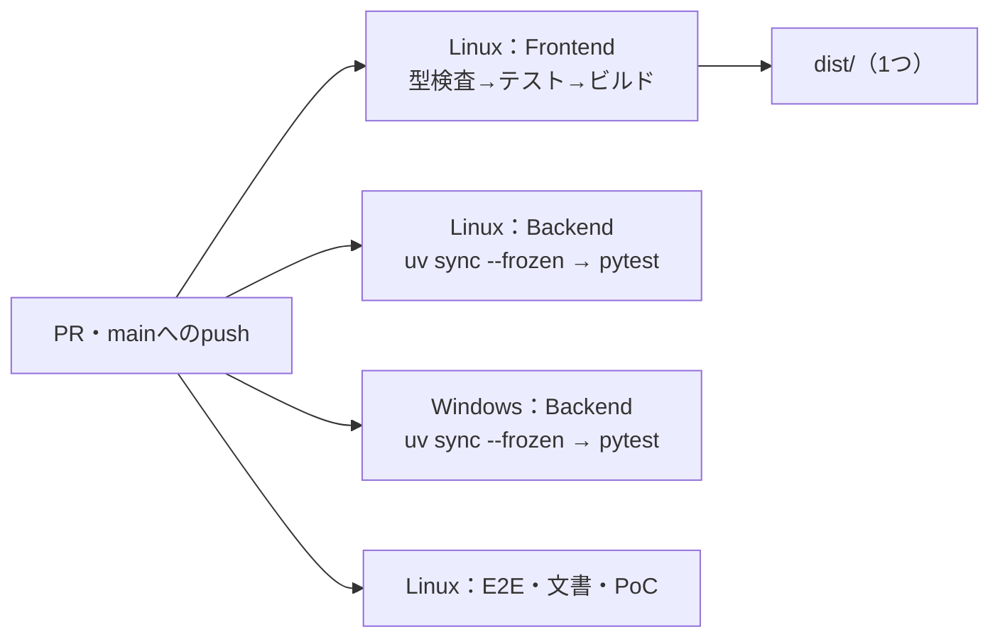
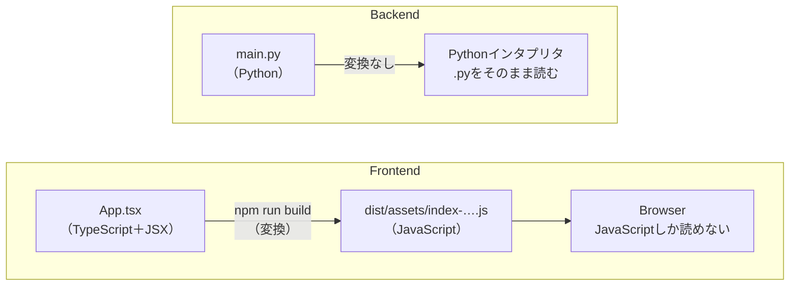
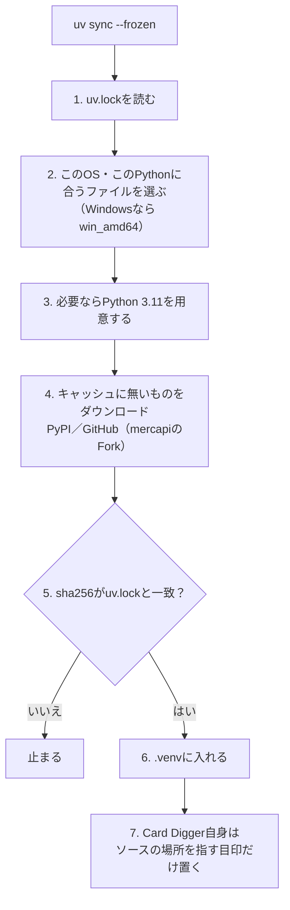
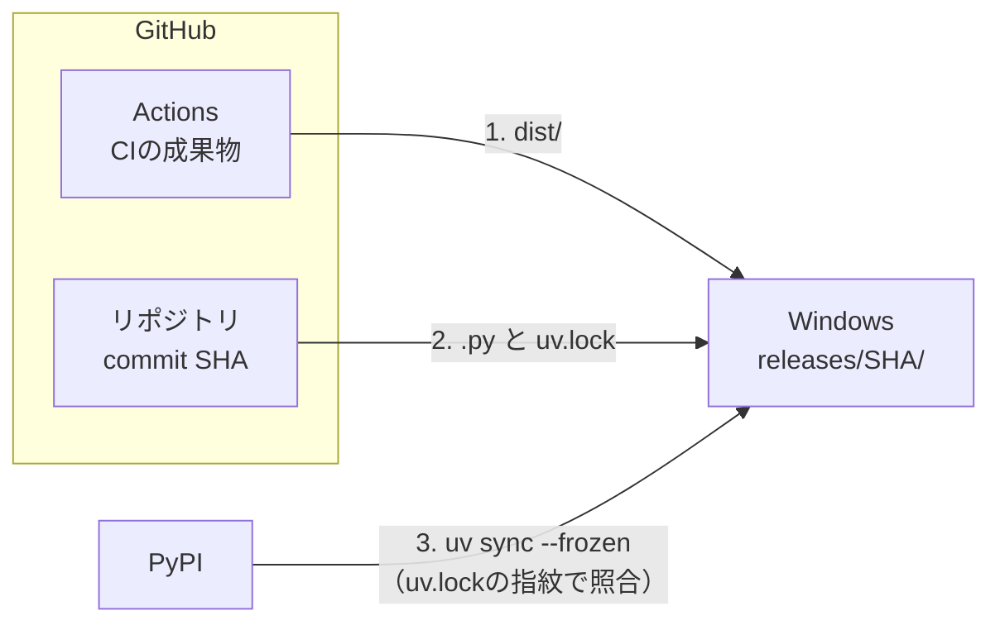

# Pythonのバックエンドは、何をデプロイするのか — 2026-11-09の問答

変更をデプロイ先（家のWindows）へ反映する方法を議論している途中で、利用者が出した問いと答えを
まとめる。**どの方法を選ぶかは、ここでは決めない。**ここには、選ぶために要る仕組みの説明だけを置く。

| # | 問い |
|---|---|
| Q1 | [CIでは、ソースのテストをLinuxとWindowsで分けるのか](#q1-ciではソースのテストをlinuxとwindowsで分けるのか) |
| Q2 | [FrontendはOSで変わらず、BackendはOSで変わりうると、どこで判断するのか](#q2-frontendはosで変わらずbackendはosで変わりうるとどこで判断するのか) |
| Q3 | [なぜBackend（Python）にはビルドが無いのか](#q3-なぜbackendpythonにはビルドが無いのか) |
| Q4 | [Pythonは、実行ファイル無しにソースのまま動くのか](#q4-pythonは実行ファイル無しにソースのまま動くのか) |
| Q5 | [`uv.lock`とは何か](#q5-uvlockとは何か) |
| Q6 | [`uv sync --frozen`は、ビルドなのか。何をダウンロードするのか](#q6-uv-sync---frozenはビルドなのか何をダウンロードするのか) |
| Q7 | [デプロイ先は、何をどこから受け取るのか](#q7-デプロイ先は何をどこから受け取るのか) |

## Q1. CIでは、ソースのテストをLinuxとWindowsで分けるのか

**分けるのではなく、同じテストを2つのOSで流す。**テストのコードは1つのままで、実行する機械を
2種類にする。GitHub Actionsでは、同じJobをOSだけ変えて並べる仕組み（matrix）がある。

**すべてのJobを両方で流す必要はない。**OSで結果が変わりうるものだけを、Windowsでも流す。

| Job（2026-11-09の`.github/workflows/ci.yml`） | Linux | Windows | 理由 |
|---|---|---|---|
| Backendのテスト（pytest） | 流す | **流す対象** | OSで変わりうる（[Q2](#q2-frontendはosで変わらずbackendはosで変わりうるとどこで判断するのか)） |
| Frontendの型検査・テスト・**ビルド** | 流す | 流さない | 出力はOSに依存しない。ビルドはLinuxで1回だけ行い、それを持っていく |
| E2E | 流す | 流さない | Browserの中の動きを見るもので、サーバーのOSには関係が薄い |
| 文書のLink検査、PoC | 流す | 流さない | デプロイしない |

**ビルドは1回、テストは2つのOS**である。



### 「ソース → ビルド → 成果物」の検査に当てはめると

| 段 | 2026-11-09のCI | 欠けているもの |
|---|---|---|
| ソースのテスト | ある（型検査、Unit、pytest） | BackendのpytestをWindowsでも流すこと |
| ビルド | ある（`npm run build`） | **結果を保存していない** |
| 成果物のテスト | **無い。**E2EはViteの開発サーバー（ソース）で動き、`dist/`を通らない | 保存した`dist/`を、デプロイ先と同じ形で配ってE2Eを流すこと |

## Q2. FrontendはOSで変わらず、BackendはOSで変わりうると、どこで判断するのか

### 判断の基準：3つの問い

| 問い | Frontend（`dist/`） | Backend |
|---|---|---|
| **① どこで動くか** | **利用者の端末のBrowserの中。**サーバーのOSはファイルを渡すだけで、中身を実行しない | **サーバーのOSの上**で、Pythonが実行する |
| **② 成果物にOS専用のバイナリが入っているか** | 入っていない。HTML・JS・CSSという**テキスト**だけ | **入っている。**`uv.lock`にWindows専用のファイル（例：`cffi-…-win_amd64.whl`）が別に記録されている |
| **③ コードがOSの機能を呼ぶか** | 呼ばない（Browserの機能だけを使う） | **呼ぶ。**時刻・タイムゾーン、ファイル、非同期処理の仕組み |

3つとも「いいえ」ならOSの差は出にくい。1つでも「はい」なら出うる。

### Backendが変わる具体例（このリポジトリの中にある）

| 例 | 場所 | OSの差 |
|---|---|---|
| タイムゾーン | `src/backend/card_digger/adapters/mercari.py`の`astimezone(timezone.utc)` | `mercapi`は**実行しているOSのローカル時刻**で日時を作る。2026-09に「9時間ずれる」問題として起きた（[todo](../planning/todo.md#1-naive-datetimeをutcとして解釈すると9時間ずれる)） |
| **テストそのもの** | `src/backend/tests/unit/test_normalization.py`の`time.tzset()` | **`time.tzset()`はUnix（Linux・macOS）にしか無い。**Windowsで流すと、このテストはエラーになる見込み（2026-11-09時点で未実行） |

```python
os.environ["TZ"] = zone
time.tzset()        # Unixにしか無い関数
```

**CIにWindowsのJobを足すと、最初に見つかるのはおそらくこれである。**

### Frontendも「何も変わらない」わけではない

| 変わる軸 | Frontend | Backend |
|---|---|---|
| サーバーのOS（Windows／Linux） | **影響しない** | **影響する** |
| 利用者のBrowser（iPhoneのSafari／Chrome） | **影響する** | 影響しない |

E2EはChromiumだけで動いている。**iPhoneのSafariでは、自動テストを一度も通していない。**

### 最終的には、テストで確かめる

3つの問いは「どこを疑うか」を決める道具で、「変わらない」を証明するものではない。
**証拠は、その環境でテストを流した結果だけ**である。`time.tzset()`の例は、流してみないと
気づかないことがあると示している。

## Q3. なぜBackend（Python）にはビルドが無いのか

**ビルドが要るかどうかは、書いたコードを実行する側がそのまま読めるかで決まる。**



| 言語 | 実行する側 | 書いたコードをそのまま読めるか | ビルド |
|---|---|---|---|
| **TypeScript**（Frontend） | Browser（JavaScriptしか読めない） | **読めない** | **必要**（`npm run build` → `dist/`） |
| **Python**（Backend） | Pythonインタプリタ | **読める** | **不要** |
| Go、Rust、C | OS（機械語しか読めない） | 読めない | 必要（実行ファイルを作る） |
| Java | JVM（バイトコードしか読めない） | 読めない | 必要（`.class`・`.jar`を作る） |

Frontendのビルドがやっている変換。

| 書いたもの | ビルド後 |
|---|---|
| 型がある（`(props: Props) => …`） | 型が消えた素のJavaScript |
| JSX（`<SearchPage />`） | 関数呼び出しに置き換わる |
| 数十個のファイル | 1つのファイルにまとめられる |
| CSS Modules | ふつうのCSSに変換される |

**Pythonも内部では`.py`を中間形式（バイトコード、`.pyc`）に変換している。**ただし実行時に自動で
行われ、`__pycache__`フォルダーに置かれるだけで、人が実行する「ビルドの工程」は無い。

## Q4. Pythonは、実行ファイル無しにソースのまま動くのか

**Card Diggerのコード（`.py`）は、ソースのまま動く。**自分のアプリ用の実行ファイルは作らない。
ただし、**ソースを読んで動かす側（Pythonインタプリタ）は実行ファイルとして必要**である。

```text
[実行ファイル]  python（Windowsでは python.exe）  ← OSごとに別物。機械語
      │ 読んで実行する
      ▼
[ソース]        card_digger/api/main.py など       ← OSに関係なく同じファイル
```

| | 形 | OSごとに違うか |
|---|---|---|
| **Pythonインタプリタ** | **実行ファイル**（機械語） | **違う** |
| **Card Diggerのコード**（`.py`） | ソース（テキスト） | 同じ |
| 依存パッケージの大半（FastAPIなど） | ソース（`.py`） | 同じ |
| 依存パッケージの一部（`cffi`など） | **機械語の部品**を含む | **違う** |

Frontendと同じ構造である。

| | 実行する側（実行ファイル） | 読まれる側（テキスト） |
|---|---|---|
| Frontend | Browser | JavaScript（`dist/`） |
| Backend | Pythonインタプリタ | Python（`.py`） |

### OSの差は「ソースの外側」に出る

開発機（macOS）の`.venv`では、`cffi`の機械語の部品がこの名前で入っている（2026-11-09に確認）。

```text
.venv/lib/python3.11/site-packages/_cffi_backend.cpython-311-darwin.so
                                                    ↑ Python 3.11用  ↑ macOS用
```

Windowsでは同じパッケージが、`.pyd`という拡張子のWindows用の部品になる。

| OSの差が出る場所 | 例 |
|---|---|
| Pythonインタプリタ | `python.exe`（Windows）と`python`（Linux） |
| 機械語を含むパッケージ | `cffi`の`.so`（macOS・Linux）と`.pyd`（Windows） |
| コードがOSの機能を呼ぶところ | `time.tzset()`（Unixにしか無い） |

### デプロイ先に要るもの

| 要るもの | 理由 | 版を決めている場所 |
|---|---|---|
| **Python 3.11** | ソースを実行する側 | `src/backend/.python-version`（`3.11`）、`pyproject.toml`（`>=3.11`） |
| 依存パッケージ | ソースが使う部品 | `uv.lock` |
| Card Diggerのソース | 動かすもの本体 | commit SHA |

`uv`はPython本体の入手もできる（`.python-version`を見てその版を用意する）。Windowsに入れるのは
`uv`だけで足りる見込みである（未確認）。

## Q5. `uv.lock`とは何か

**`uv`（Pythonのパッケージ管理ツール）が作る、入れるパッケージをすべて固定した記録である。**
npmの`package-lock.json`にあたる。

| 役割 | Frontend（npm） | Backend（uv） |
|---|---|---|
| 欲しいパッケージを宣言する（範囲で書く） | `package.json` | `pyproject.toml` |
| **実際に入れる版を、すべて固定して記録する** | `package-lock.json` | **`uv.lock`** |
| 記録どおりに入れる | `npm ci` | `uv sync --frozen` |
| コマンドをその環境で実行する | `npm run …` | `uv run …` |
| ビルド（変換して成果物を作る） | `npm run build` → `dist/` | **無い** |

### OSごとのファイルを、指紋付きで記録している

`uv.lock`は版の一覧ではない。**依存の依存まで全部について、OSごとにどのファイルを入れるかを、
指紋（sha256）付きで**記録している。2026-11-09の`src/backend/uv.lock`には、378個のsha256がある。

```text
uv.lock（1つ）
 ├─ cffi … Linux用のファイル    sha256:…  ← CIのLinux Jobが入れる
 └─ cffi … Windows用のファイル  sha256:…  ← CIのWindows Jobも、デプロイ先のWindowsも、これを入れる
```

例：`cffi-2.1.1-cp311-cp311-win_amd64.whl`（Python 3.11・Windows 64bit用）とそのsha256が記録されている。

**だから、CIのWindows Jobでテストしたパッケージと、デプロイ先のWindowsに入るパッケージは、
同じ指紋のファイルになる。**OSごとのフォルダーを自分で用意しなくても、`uv.lock`がOSごとの
「中身の一覧」を兼ねている。

## Q6. `uv sync --frozen`は、ビルドなのか。何をダウンロードするのか

**ビルドではなく、インストールである。**`npm ci`と同じ立場にある。

| コマンド | やること | 分類 |
|---|---|---|
| `npm run build` | TypeScriptをJavaScriptに変換し、`dist/`を作る | **ビルド** |
| `uv sync --frozen` | `uv.lock`のとおりのパッケージを`.venv`に入れる。`uv.lock`は書き換えない | **インストール** |
| `uv build` | 自分のコードを、他の人が入れられる配布用パッケージ（`.whl`）に固める | 配布用のビルド。**Card Diggerは使わない**（配布しない） |

`--frozen`は「`uv.lock`を更新せず、そのまま使え」という指定である。似た指定の`--locked`は
「`uv.lock`が`pyproject.toml`と食い違っていたらエラーにしろ」という、もう一段厳しい指定である。

### 流れ



### 扱うものは2種類

| 対象 | 取得元 | `.venv`への入れ方 |
|---|---|---|
| **依存パッケージ**（FastAPI、`cffi`、`mercapi`など） | **インターネットからダウンロード**（PyPI。`mercapi`はGitHubの管理下Fork） | ファイルを`.venv`の中に**コピーして入れる** |
| **Card Digger自身**（`card_digger`） | **ダウンロードしない。**手元のソースをそのまま使う | **場所を指す目印だけ**を入れる（editableインストール） |

Card Digger自身は、`uv.lock`に`source = { editable = "." }`（このフォルダーのソースを直接使う）と
記録されている。開発機の`.venv`には、その目印が実際にある（2026-11-09に確認）。

```text
.venv/lib/python3.11/site-packages/
├── _editable_impl_card_digger_backend.pth   ← 「card_digger のソースはここ」という目印
└── card_digger_backend-0.1.0.dist-info       ← 入っていることの記録
```

`mercapi`はPyPIではなくForkのcommit SHAから入れている（`pyproject.toml`）。こうしたパッケージは、
インストールのときにソースから配布用ファイルを組み立てる。中身は純粋なPythonなので、OSの差は出にくい。

**editableインストールの注意。**目印はソースの場所を指すので、**ソースのフォルダーを動かしたり
消したりすると`.venv`が壊れる。**版ごとにフォルダーを分けるなら、`.venv`も版ごとに作る。
ダウンロード済みのパッケージは`uv`のキャッシュに残るので、変わっていないものは再ダウンロードしない。

## Q7. デプロイ先は、何をどこから受け取るのか

**3つのものを、それぞれ別の場所から受け取る。つないでいるのは1つのcommit SHAである。**

| # | もの | 取得元 | 取り方 | 同じものだと何で確かめるか |
|---|---|---|---|---|
| 1 | **Frontendのビルド成果物**（`dist/`） | **GitHub Actions**（CIが保存したもの） | `gh run download`（そのcommitのCI実行から） | CIが記録したハッシュ（必要ならartifact attestation） |
| 2 | **Backendのソース**（`.py`と`uv.lock`） | **GitHubのリポジトリ** | `git checkout <SHA>` | **commit SHAそのもの** |
| 3 | **Backendの依存パッケージ** | **PyPI**（`mercapi`はGitHubのFork） | `uv sync --frozen` | **`uv.lock`のsha256** |



### 一度だけビルドし、同じものをどこへでも持っていく

デプロイの基本原則に**「Build once, deploy many」**がある。テストした成果物と、デプロイする成果物を
同じものにする。デプロイ先でビルドし直すと、同じcommitでも別の成果物になる。

| もの | 「テストしたものと同じ」を保証する方法 |
|---|---|
| `dist/` | **CIがビルドした実物を持ってくる。**`dist/`はGitに入っていない（`.gitignore`で除外）ので、commit SHAでは取れない |
| `.py`と`uv.lock` | **commit SHAで`checkout`する。**Gitのcommit SHAは、全ファイルの中身から計算した指紋で、1文字違えば変わる |
| 依存パッケージ | **`uv.lock`のsha256で照合する。**1バイトでも違えば入れない |

**完全に同じものにできないのは、Pythonインタプリタと、機械語を含むパッケージだけ**である
（[Q4](#q4-pythonは実行ファイル無しにソースのまま動くのか)）。OSごとに別物なので、Linuxで作ったものを
Windowsへは持っていけない。そこは**CIのWindows Jobでテストする**ことで埋める。
インタプリタまで含めて同じものにするには、コンテナ（Linuxのイメージをそのまま動かす）を使う。

### 1つのファイルにまとめる形もある

| | 分けて取る（上の形） | CIで1つにまとめる |
|---|---|---|
| 中身 | 1・2・3を別々に取る | CIが`dist/`と`.py`・`uv.lock`を1つのファイルに固めて保存する |
| Windowsが接続する先 | GitHub Actions、GitHubのリポジトリ、PyPI | GitHub Actions、PyPI |
| 「同じもの」の保証 | SHAと`uv.lock`の指紋 | 1つのファイルのハッシュ（＋`uv.lock`の指紋） |
| デプロイの単位 | 3つ | **1つのファイル** |

どちらでも中身は同じになる。依存パッケージだけは、コンテナを使わない限り、どちらの形でも
デプロイ先でPyPIから入れる。
