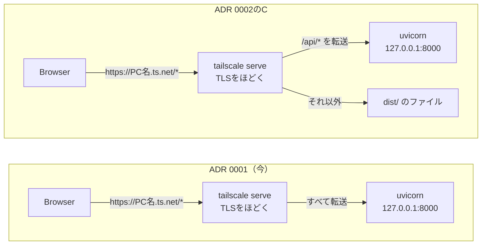
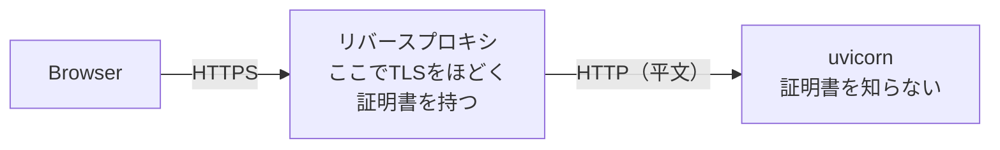
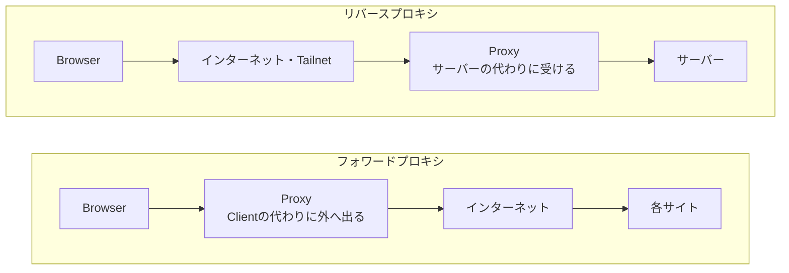
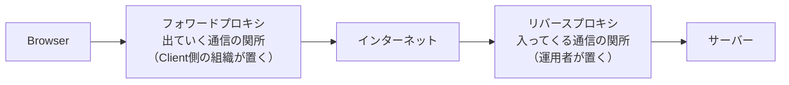
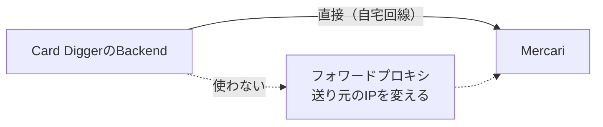

# リバースプロキシとは何か。`tailscale serve`は何をしているのか — 2026-11-09の問答

画面とAPIを入口のProxyで振り分ける案（ADR 0002のC）を議論している途中で、利用者が出した問いと
答えをまとめる。

| # | 問い |
|---|---|
| Q1 | [`tailscale serve`は、HTTPSにする機能のほかにProxyの役割もあるのか](#q1-tailscale-serveはhttpsにする機能のほかにproxyの役割もあるのか) |
| Q2 | [HTTPSにすることは、Proxyの役割の1つか](#q2-httpsにすることはproxyの役割の1つか) |
| Q3 | [このようなProxyを何と呼ぶのか](#q3-このようなproxyを何と呼ぶのか) |
| Q4 | [フォワードプロキシとリバースプロキシは、何のために入れるのか](#q4-フォワードプロキシとリバースプロキシは何のために入れるのか) |
| Q5 | [Card Diggerは、フォワードプロキシを使うか](#q5-card-diggerはフォワードプロキシを使うか) |

## Q1. `tailscale serve`は、HTTPSにする機能のほかにProxyの役割もあるのか

**ある。むしろProxyが本業で、HTTPSはそのProxyの入口に付いている機能である。**しかも
[ADR 0001](../adr/0001-run-on-home-windows-via-tailscale.md#決定3--入口はtailscale-serve)の時点から、Proxyとして使っている。

| 役割 | 内容 | Card Diggerでの使い方 |
|---|---|---|
| **入口（待ち受け）** | Tailnet側の口（`PC名.ts.net`の443番）で接続を待つ | ADR 0001から |
| **HTTPS（TLS終端）** | 証明書を自動で取り、TLSをほどく | ADR 0001から |
| **リバースプロキシ（転送）** | 受けた要求をPCの中のサービス（`127.0.0.1:8000`）へ渡し、返事を返す | **ADR 0001から** |
| **パスごとの振り分け** | `--set-path`で、パスごとに渡し先を変える | ADR 0002のCで新しく使う |
| **ファイル・ディレクトリの配信** | 指定したファイルやディレクトリをそのまま返す | ADR 0002のCで新しく使う |

ADR 0001で決めた`tailscale serve --bg 8000`は、「Tailnetから来た要求を、HTTPSをほどいて
`127.0.0.1:8000`へ渡す」という**リバースプロキシの設定**だった。
[家のPCへ繋ぐ問答 Q4](2026-11-08-reaching-home-server-from-devices.md#q4-127001にbindしたままなぜ外から使えるのか)の
「tailscaledが受けて、PCの中で`127.0.0.1:8000`へ繋ぎ直す」がこの転送である。

### Cでは、同じProxyに仕事を2つ足すだけ

**新しい部品を置くわけではない。**すでに入口にいる`tailscale serve`に、振り分けとファイル配信を
追加でやらせる。うまくいけば、Windowsで常駐するものは増えない。

### 他のProxyとの比較

| | `tailscale serve` | nginx・Caddy |
|---|---|---|
| HTTPS | 自動（`ts.net`の証明書） | Caddyは自動、nginxは自分で設定 |
| リバースプロキシ | できる | できる |
| パスごとの振り分け | できる（`--set-path`） | できる |
| ディレクトリの配信 | できる | できる |
| **SPA fallback**（無いパスに`index.html`） | **公式ドキュメントに記述なし（できない見込み）** | できる（`try_files`） |
| 届く範囲 | **Tailnetの中だけ** | 設定次第（LANやインターネットにも出せる） |

`tailscale serve`は「**Tailnetの中だけに出す、設定の少ないリバースプロキシ**」である。
nginx・Caddyより機能が絞られており、その差がちょうどSPA fallbackにある。

同じ仕組みでインターネットへ公開する**Tailscale Funnel**もあるが、認証の無いCard Diggerを
外へ出すことになるので使わない。

## Q2. HTTPSにすることは、Proxyの役割の1つか

**Proxyなら必ず持つ役割ではないが、リバースプロキシがよく引き受ける代表的な役割である。**

リバースプロキシがHTTPSを受けてTLSをほどき、後ろへは平文のHTTPで渡すことを**TLS終端
（TLS termination）**と呼ぶ。古い言い方では**SSLオフロード**。これをするProxyを**TLS終端プロキシ**と呼ぶ。

TLSをほどかずに、暗号化されたまま後ろへ流す方式もある（**TLSパススルー**）。

| 方式 | TLSをほどく場所 | 後ろのサーバーが証明書を持つか | Card Digger |
|---|---|---|---|
| **TLS終端** | リバースプロキシ | 持たない | **こちら。**uvicornはHTTPだけを話す |
| TLSパススルー | 後ろのサーバー | 持つ | 使わない |

TLS終端にすると、証明書の取得と更新を**入口1か所**に任せられる。uvicornは証明書のことを一切知らない。

後ろへの区間（tailscaled→uvicorn）が平文でも困らないのは、それが**同じPCの中**だからである
（[WireGuardとTLSの問答 Q4](2026-11-08-what-wireguard-and-tls-protect.md#q4-二重にすると守られる範囲は広がるのか)）。

## Q3. このようなProxyを何と呼ぶのか

**リバースプロキシである。**Proxyは、誰の代わりに立つかで2種類に分かれる。

| 名前 | 誰の代わりに立つか | 置き場所 | 例 |
|---|---|---|---|
| **フォワードプロキシ** | **Client（Browser）** | Client側（会社のネットワークの出口など） | 社内のWebアクセスを中継するProxy |
| **リバースプロキシ** | **サーバー** | サーバー側（サーバーの手前） | nginx、Caddy、`tailscale serve`、CloudFront |

**`tailscale serve`は、Tailnetの中だけに出す、TLS終端をするリバースプロキシである。**

### 役割の組み合わせで、別の名前で呼ばれることもある

| 呼び名 | 主に強調している役割 |
|---|---|
| ロードバランサー（L7） | 負荷分散＋パスでの振り分け |
| APIゲートウェイ | 認証、流量制限、APIの振り分け |
| Ingress（Kubernetes） | クラスターの入口での振り分けとTLS終端 |
| CDN（CloudFrontなど） | 世界中に置いたキャッシュ＋静的ファイル配信＋振り分け |

## Q4. フォワードプロキシとリバースプロキシは、何のために入れるのか

**立つ位置が逆なので、入れる人も理由も逆になる。**

- **フォワードプロキシ**は、**出ていく**通信をまとめて管理したい**Client側の組織**が入れる
- **リバースプロキシ**は、**入ってくる**通信をまとめて管理したい**サービスの運用者**が入れる

### フォワードプロキシを入れる理由

| 理由 | 内容 | 例 |
|---|---|---|
| **アクセス制限** | 行ってよいサイト・いけないサイトを決める | 会社や学校のWebフィルタ |
| **記録・監査** | 誰がどこへアクセスしたかを残す | 情報漏えいの調査 |
| **出口のIPを1つにまとめる** | 相手から見える送り元のIPを固定する | 取引先が「このIPからだけ許可」としているとき |
| キャッシュ | 同じファイルを何度も外から取らない | 回線が細い拠点 |
| 送り元を隠す | 相手に自分のIPを見せない | プライバシー目的のProxy・VPNサービス |
| 検査 | 出入りする中身を調べる | マルウェアの検査 |

### リバースプロキシを入れる理由

| 理由 | 内容 | Card Digger（`tailscale serve`）では |
|---|---|---|
| **入口を1つにする** | 後ろに何台・何種類のサーバーがあっても、外からは1つに見せる。中の構成を隠す | uvicornは`127.0.0.1`に隠れたまま |
| **TLS終端** | 証明書とHTTPSを入口1か所で引き受ける | 使う |
| **届く相手を絞る** | 認証、IP制限、流量制限、WAF（攻撃の遮断） | Tailnetに入った端末だけ |
| **パスでの振り分け** | 複数のサービスを1つのドメインにまとめる → **同じOriginになる** | ADR 0002のC（`/api`はuvicorn、`/`は`dist/`） |
| **静的ファイルの配信・キャッシュ** | ファイルはProxyが返し、後ろのアプリを煩わせない | ADR 0002のC |
| 負荷分散・冗長化 | 複数のサーバーに振り分け、1台落ちても止めない | **使わない。**uvicornは1つだけ（[architecture §7](../development/architecture.md#7-分かっている構造上の弱点)の1） |
| 止めずに入れ替える | 後ろのサーバーを切り替えてデプロイする | 使わない |
| 後ろのアプリを守る | 遅いClientの相手や圧縮をProxyが引き受ける | 使わない |

**リバースプロキシを入れる理由は、「アプリ本体に入れたくない仕事（証明書、認証、振り分け、
ファイル配信）を入口に寄せる」ことである。**ADR 0002でCを推す理由（APIはAPIだけを返し、
それ以外の仕事は入口が持つ）は、リバースプロキシを入れる理由そのものである。

### 2つの比較

| | フォワードプロキシ | リバースプロキシ |
|---|---|---|
| 誰の代わりに立つか | Client | サーバー |
| 誰が置くか | Client側の組織 | サービスの運用者 |
| 管理したい通信 | 出ていく通信 | 入ってくる通信 |
| 相手から見えるもの | 相手のサーバーからは、Proxyが送り元に見える | Clientからは、Proxyが目的のサーバーに見える（後ろは見えない） |
| Clientは存在を知っているか | 普通は知っている（設定する） | 普通は知らない |

## Q5. Card Diggerは、フォワードプロキシを使うか

**使わない。あえて置いていない。**

BackendからMercariへの通信の手前にフォワードプロキシを置けば、Mercariから見える送り元のIPを
変えられる。世の中には、これを使って**拒否や流量制限をすり抜ける**使い方がある。
Card Diggerはそれをしない。

| 根拠 | 内容 |
|---|---|
| [mvp-spec §9](../product/mvp-spec.md#9-ui状態とerror表示) | 401 / 403 / 429 / Challengeで、**Login情報入力やProxy変更を促す表示は行わない** |
| [architecture §4.1](../development/architecture.md#41-外部アクセスの条件と2秒間隔の出所) | 拒否されたら取得そのものができなくなり、**復旧手段はこちらに無い。**緩める理由が無い |
| 安全停止 | 拒否が3回続いたら止まる。**すり抜けるのではなく、止まる**のがCard Diggerの方針である |

| | 使うProxy | 目的 |
|---|---|---|
| **リバースプロキシ**（`tailscale serve`） | 使う | **自分のサービスを守り、整える** |
| フォワードプロキシ | 使わない | 相手の制限を回避することはしない |
