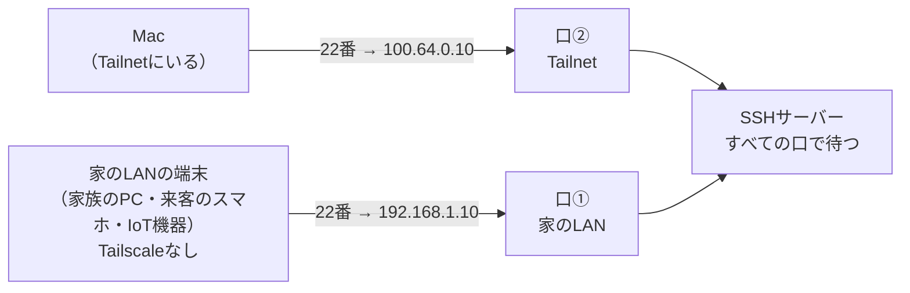
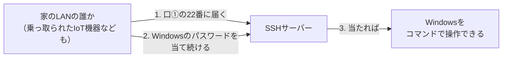
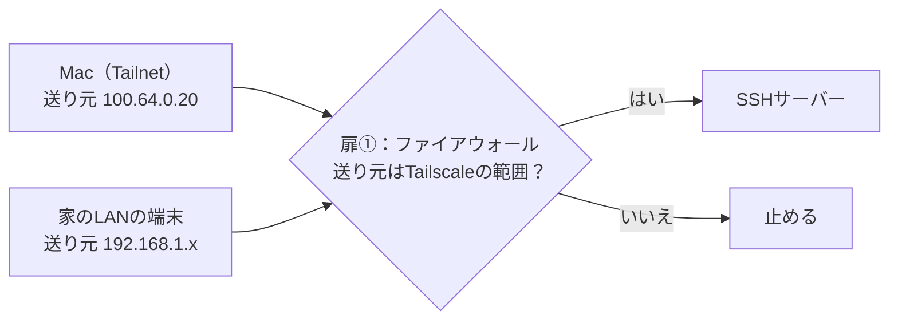

# SSHサーバーが`0.0.0.0:22`で待つと、なぜ家のLANから入れて、なぜ危ないのか — 2026-11-09の問答

デプロイをMacからも実行するために、Windowsへ入るSSHの入口を確かめた。その途中で利用者が出した
問いと答えをまとめる。**どう絞るかは、ここでは決めない。**2026-11-09に利用者は[Q5](#q5-家のlanからもsshで入りたいときはどうするか)のB
（家のLANからも入れるまま、鍵認証だけにする）を選んだ。決定の正本はADR 0003（PR #48）である。

この文書では、実際のIPアドレスやホスト名の代わりに**説明用の値**を使う。

| 説明用の値 | 指すもの |
|---|---|
| `192.168.1.10` | Windowsの、家のLANでの住所 |
| `100.64.0.10` | Windowsの、Tailscaleでの住所 |
| `100.64.0.20` | Macの、Tailscaleでの住所 |

| # | 問い |
|---|---|
| Q1 | [`0.0.0.0:22`（`[::]:22`）とは、どういう意味か](#q1-000022とはどういう意味か) |
| Q2 | [なぜ家のLANから入れるのか](#q2-なぜ家のlanから入れるのか) |
| Q3 | [なぜ危ないのか](#q3-なぜ危ないのか) |
| Q4 | [どちらの扉を閉めるのがよいか](#q4-どちらの扉を閉めるのがよいか) |
| Q5 | [家のLANからもSSHで入りたいときは、どうするか](#q5-家のlanからもsshで入りたいときはどうするか) |
| Q6 | [自分で確かめるには、どうするか](#q6-自分で確かめるにはどうするか) |

前提として、Bindの意味は[`0.0.0.0`の問答](2026-11-08-what-binding-to-0000-means.md)にまとめてある。

## Q1. `0.0.0.0:22`とは、どういう意味か

**「このPCが持つすべての住所に届いた、22番（SSH）宛ての接続を受け付ける」という意味である。**

### Windowsは住所を複数持っている

Windowsは、つながっているネットワークごとに別の住所を持つ。

```text
                          ┌──────────────── Windows ────────────────┐
家のLAN（Wi-Fi・有線） ───┤ 口①  192.168.1.10  （家のLANでの住所）   │
Tailnet（仮想NIC）    ───┤ 口②  100.64.0.10   （Tailscaleでの住所） │
PCの中だけ             ───┤ 口③  127.0.0.1     （自分自身）          │
                          └──────────────────────────────────────────┘
```

### 待つ住所の書き方

| 書き方 | 受け付ける接続 |
|---|---|
| `127.0.0.1:22` | 口③だけ。**同じPCの中から**しか届かない |
| `100.64.0.10:22` | 口②だけ。Tailnetから届いたものだけ |
| `192.168.1.10:22` | 口①だけ。家のLANから届いたものだけ |
| **`0.0.0.0:22`** | **口①②③のすべて**（IPv4） |
| **`[::]:22`** | **すべての口**（IPv6。Windowsでは普通、IPv4の接続もこの口で受ける） |

**今回、`0.0.0.0:22`に設定したのではない。**WindowsのSSHサーバー（OpenSSH）は、**最初からすべての口で待つ**
設定で動いていた。

### 実際の表示（2026-11-09、Windowsで`netstat -an | findstr ":22 "`）

```text
  TCP         0.0.0.0:22             0.0.0.0:0              CLOSED
  TCP         100.64.0.10:22         100.64.0.20:51163      ESTABLISHED
  TCP         [::]:22                [::]:0                 LISTENING
```

（住所は説明用の値に置き換えた）

| 行 | 読み方 |
|---|---|
| `[::]:22  LISTENING` | SSHサーバーが**すべての口で待っている** |
| `100.64.0.10:22 ↔ 100.64.0.20:51163  ESTABLISHED` | そのとき使っていたSSHの接続。**MacのTailscaleの住所から、WindowsのTailscaleの住所へ**（Tailnetを通っている） |
| `0.0.0.0:22  CLOSED` | IPv4用の口がこの状態で出る理由は、はっきりしない。上の2行から、IPv4の接続も実際に受けていることは確かである |

## Q2. なぜ家のLANから入れるのか

**家のLANにいる端末は、Tailscaleに入っていなくても、Windowsの家のLANでの住所（口①）には普通に届く。**
同じRouterの下にいるからである。SSHサーバーがその口でも待っているので、受け付けてしまう。



| 誰が | どの住所へ | 通る口 | 受け付けるか |
|---|---|---|---|
| Mac（いつものSSH） | ホスト名 → Tailscaleの住所 | 口②（Tailnet） | 受け付ける |
| **家のLANにいる端末** | 家のLANの住所 | **口①（家のLAN）** | **受け付ける** |

### 実際に確かめた（2026-11-09、MacからTCPで接続できるかだけを試した。ログインはしていない）

| Macから試した宛先 | 通る口 | 結果 |
|---|---|---|
| WindowsのTailscaleの住所の22番 | 口②（Tailnet） | **届いた** |
| **Windowsの家のLANの住所の22番** | **口①（家のLAN）** | **届いた** |

MacはTailnetにも家のLANにもいるので、両方の口に届いた。**家のLANにしかいない端末でも、口①には届く。**

### 2枚の扉で見ると

外から届くには、**ファイアウォール**と**待っている口**の2枚の扉を両方通る必要がある
（[`0.0.0.0`の問答 Q3](2026-11-08-what-binding-to-0000-means.md#q3-osはアプリへ何を渡すのか)）。

| 扉 | SSHサーバー（2026-11-09） | 比べると：Card Diggerのuvicorn |
|---|---|---|
| ① ファイアウォールが22番を通すか | **通している**（家のLANから届いたので） | 関係ない |
| ② その口で待っているか | **待っている**（すべての口） | **待っていない**（`127.0.0.1`だけ） |
| 結果 | **家のLANから入れる** | 家のLANから入れない |

uvicornは`127.0.0.1`に閉じているので、扉②が閉まっている。SSHサーバーは扉①②の両方が開いている。

## Q3. なぜ危ないのか

**「家のLANの誰でも入口に届く」ことと、「パスワードで入れる」ことが重なっているからである。**

2026-11-09時点で、MacからはWindowsのパスワードでSSHしていた（利用者の申告）。



| 要素 | 危険の大きさ | 理由 |
|---|---|---|
| **パスワードで入れる** | **大** | 当て続けられる。そのパスワードは**Windowsへのログインと同じもの**で、使い回しや推測の危険がある |
| 家のLANから届く | 中 | 入口が家のLANの全員に見える。ただし**鍵認証だけなら、鍵を持たない人は届いても入れない** |
| 家のLANにいるもの | — | 家族のPC、来客のスマホ、**乗っ取られたIoT機器**。自分で管理していない端末が混ざる |

### 入られると、何が起きるか

| 失うもの | 内容 |
|---|---|
| Windowsそのもの | SSHで入ると、Windowsをコマンドで自由に操作できる |
| **Card Diggerのデプロイの入口** | デプロイScriptを好きな版で実行される。GitHubへのログイン情報（`gh`）もWindowsにある |
| 自宅の回線 | Windowsから外へ何でも送れる。Card Diggerが守っている「Mercariへの約束」も、Windowsごと奪われれば意味が無い |

**Card Diggerが`127.0.0.1`に閉じて、Tailnetの外から届かないようにしても、同じWindowsのSSHが家のLANに
開いていれば、そこが裏口になる。**

## Q4. どちらの扉を閉めるのがよいか

| 閉める扉 | やり方 | 問題 |
|---|---|---|
| ② 待つ口をTailnetだけにする | `sshd_config`に`ListenAddress 100.64.0.10`と書く | Windowsの起動時に、**Tailscaleより先にSSHサーバーが起動すると、その住所がまだ無いので起動に失敗する。**[ADR 0001 決定3](../adr/0001-run-on-home-windows-via-tailscale.md#決定3--入口はtailscale-serve)で「uvicornをTailscaleのIPにBindしない」とした理由と同じ |
| **① ファイアウォールで、Tailnetから来た接続だけ通す** | 受け付ける相手（送り元）を`100.64.0.0/10`と`fd7a:115c:a1e0::/48`だけにする | 無い。SSHサーバーはすべての口で待ったまま、家のLANから来た接続は扉①で止まる |

**ファイアウォールは「どの口に届いたか」ではなく「誰から来たか（送り元の住所）」で判断する。**
Tailnetから来る接続の送り元は必ずTailscaleの範囲（`100.64.0.0/10`、IPv6では`fd7a:115c:a1e0::/48`）に
入るので、それだけを通せば、家のLANからの接続だけが止まる。



## Q5. 家のLANからもSSHで入りたいときは、どうするか

### 家のLANにいても、Tailnet経由で入れる

**Tailscaleを入れた端末なら、家にいても外にいても、同じホスト名で入れる。**しかもTailscaleは、
同じLANにいる相手とは**LANの中で直接**つなぐ（2026-11-09のTailscaleの表示は`direct`だった）。
インターネットを回り道しない。

```text
家のLANにいるMac ──[Tailnet：WireGuardで暗号化。経路は家のLANの中を直接]──> Windows
```

ファイアウォールをTailnetだけに絞っても、この使い方は何も変わらない。**家のLANの住所で直接入る
必要が出るのは、次の場合だけ**である。

| 場面 | 例 |
|---|---|
| Tailscaleを入れていない端末から入りたい | 新しいPCを、まだTailnetに入れていない |
| Tailscaleが動いていない | WindowsでTailscaleがログアウトした、止まった |

### 選択肢

| | A. このまま | B. LANも許すが、鍵だけにする | C. Tailnetだけ＋鍵だけ |
|---|---|---|---|
| ファイアウォール | 誰からでも | 誰からでも（またはTailnetと家のLANだけ） | Tailnetだけ |
| 認証 | **パスワード** | **鍵だけ** | **鍵だけ** |
| 家のLANの住所で直接入る | できる | **できる（鍵があれば）** | できない（Tailscale経由ならできる） |
| 家のLANの他人が入れるか | **パスワードを当てれば入れる** | 入れない | 入口すら見えない |
| Tailscaleが壊れたとき | LANから入れる | LANから入れる（鍵で） | Windowsの前で作業する |

**最低限、パスワードは切る（B以上）のが安全である。**「家のLANからも入りたい」はBでも叶う。

### 鍵認証に切り替えるときの注意

| 注意 | 内容 |
|---|---|
| **順番** | **鍵で入れることを確かめてから、パスワードを切る。**逆にすると締め出される |
| 公開鍵の置き場所（Windows標準のOpenSSH） | Windowsのアカウントが**管理者なら`C:\ProgramData\ssh\administrators_authorized_keys`**（管理者とSYSTEMだけが読める権限にする）、一般ユーザーなら`C:\Users\<名前>\.ssh\authorized_keys` |
| ファイアウォールを変えるとき | **SSH越しではなく、Windowsの前で作業する。**設定を誤ると入れなくなる |

## Q6. 自分で確かめるには、どうするか

| 確かめたいこと | どこで | コマンド | 読み方 |
|---|---|---|---|
| どの口で待っているか | Windows | `netstat -an \| findstr ":22 "` | `0.0.0.0:22`や`[::]:22`なら**すべての口** |
| ファイアウォールが誰を通すか | Windows（PowerShell） | `Get-NetFirewallRule -DisplayName '*SSH*' \| Get-NetFirewallAddressFilter` | `RemoteAddress`が`Any`なら**誰からでも** |
| パスワードで入れるか | Windows | `C:\ProgramData\ssh\sshd_config`の`PasswordAuthentication`の行 | 書かれていない・コメントアウトなら、既定で**入れる** |
| 家のLANから届くか | Mac | `nc -z -G 3 <家のLANの住所> 22` | `succeeded`なら**届く** |
| パスワードを断るか | Mac | `ssh -o PubkeyAuthentication=no <ホスト名>` | 断られれば鍵だけになっている |

### つまずいたところ：PowerShellのコマンドがcmdで動かない

WindowsのOpenSSHは、SSHで入ったときの既定のシェルが**コマンドプロンプト（cmd.exe）**である。
`Get-Service`や`Get-NetFirewallRule`はPowerShellのコマンドなので、cmdでは「内部コマンドまたは外部コマンド…
として認識されていません」になる（2026-11-09に起きた）。**権限の問題ではない。**

| プロンプト | シェル |
|---|---|
| `ユーザー@PC名 C:\Users\…>` | cmd |
| `PS C:\Users\…>` | PowerShell |

cmdからは`powershell -Command "…"`で呼ぶ。MacからデプロイScriptを動かすときも、
`ssh <ホスト名> "powershell -NoProfile -File …"`のように**PowerShellを明示して**呼ぶ。
