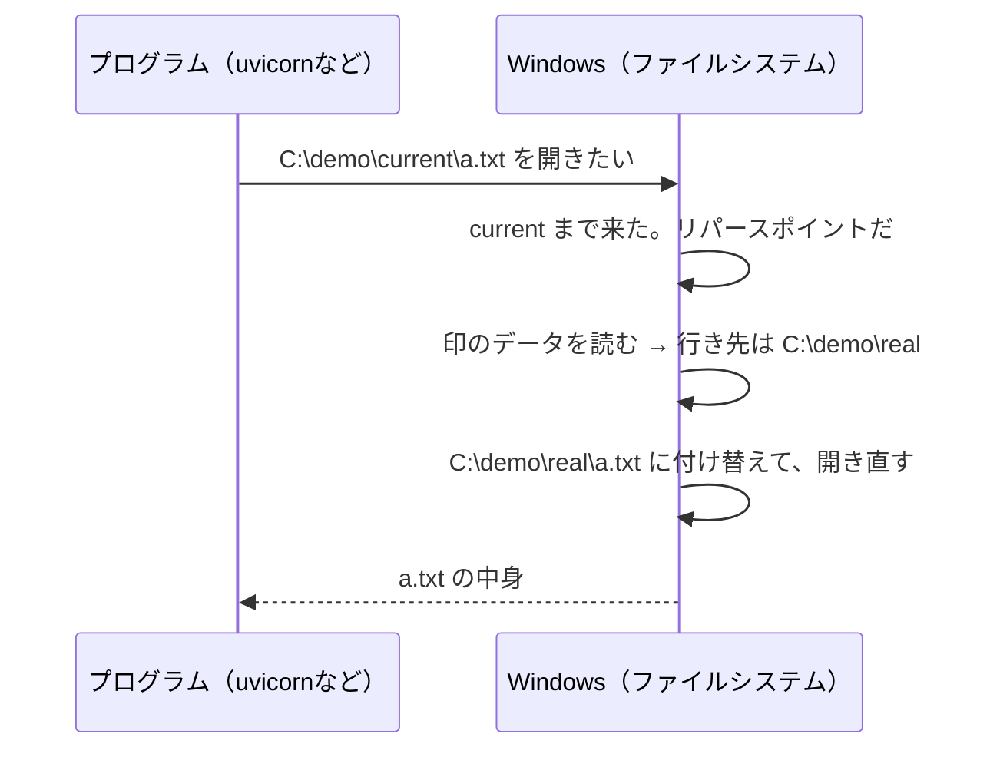

# ジャンクションとは何か。なぜSSHからはたどれなかったのか — 2026-11-10の問答

家のWindowsでデプロイの前提を確かめていたとき（デプロイ前の確かめの手順書、PR #52）、
SSHから入ったデプロイ用ユーザーでは`uv venv`が`os error 448`で失敗した。原因を追ううちに
**ジャンクション**という言葉が出てきて、利用者が出した問いと答えをまとめる。

ジャンクションを版の切り替えにどう使うか、ほかの方法と比べてどうかは
[`current`の問答](2026-11-10-why-switch-releases-through-current.md)にある。

| # | 問い |
|---|---|
| Q1 | [ジャンクションとは何か。コピーしたフォルダーなのか](#q1-ジャンクションとは何かコピーしたフォルダーなのか) |
| Q2 | [どういう仕組みで、別のフォルダーの中身が見えるのか](#q2-どういう仕組みで別のフォルダーの中身が見えるのか) |
| Q3 | [ショートカットやシンボリックリンクとは何が違うのか](#q3-ショートカットやシンボリックリンクとは何が違うのか) |
| Q4 | [どんな場面で使われているのか](#q4-どんな場面で使われているのか) |
| Q5 | [今回、ジャンクションはどこに出てきたのか。なぜ自分で作ったのか](#q5-今回ジャンクションはどこに出てきたのかなぜ自分で作ったのか) |
| Q6 | [なぜSSHからはたどれなかったのか。管理者でもだめなのか](#q6-なぜsshからはたどれなかったのか管理者でもだめなのか) |
| Q7 | [扱うときに気をつけることは何か](#q7-扱うときに気をつけることは何か) |

## Q1. ジャンクションとは何か。コピーしたフォルダーなのか

**コピーではない。フォルダーの「別名」である。**ジャンクションには、ファイルが1つも入っていない。
入っているのは「**本当のフォルダーはここです**」という**行き先だけ**である。札のようなものだと考えるとよい。

```text
C:\demo\
├── real\            ← ファイルが本当にあるのはここだけ
│   └── a.txt
└── current  →  C:\demo\real   ← 中身は「行き先」だけ
```

`C:\demo\current\a.txt`を開くと、Windowsは`current`の札を見て、`C:\demo\real\a.txt`を開く。

| | コピー | ジャンクション |
|---|---|---|
| ファイルの数 | 2倍になる | **増えない**（本物は1つだけ） |
| ジャンクション側のファイルを書き換えると | コピーだけが変わる | **本物が変わる**（同じファイルだから） |
| 行き先を変えるには | ファイルをすべてコピーし直す | **札の行き先を書き換えるだけ**（一瞬で終わる） |
| 使う場所（ディスク） | 中身の分だけ使う | ほぼ使わない |

### 手で確かめる

Windowsの前のPowerShell（管理者でなくてよい）で、次を順に打つと、札の動きが見える。
作るのは自分のフォルダーの中の`junction-demo`だけで、最後に消す。

```powershell
mkdir $HOME\junction-demo\real
"hello" | Out-File $HOME\junction-demo\real\a.txt
cmd /c mklink /J $HOME\junction-demo\current $HOME\junction-demo\real
Get-Content $HOME\junction-demo\current\a.txt
```

`current`には何も入れていないのに`hello`と出る。札を通って`real`の`a.txt`を読んだからである。

```powershell
Get-Item $HOME\junction-demo\current | Select-Object LinkType, Target
```

`LinkType`に`Junction`、`Target`に行き先が出る。片付けは、**札を先に消してから**フォルダーを消す（[Q7](#q7-扱うときに気をつけることは何か)）。

```powershell
cmd /c rmdir $HOME\junction-demo\current
Remove-Item -Recurse $HOME\junction-demo
```

## Q2. どういう仕組みで、別のフォルダーの中身が見えるのか

**ファイルシステム（NTFS）が、途中で行き先へ付け替える。**プログラムは何もしていない。

ジャンクションは、NTFSの**リパースポイント**という仕組みの1つである。リパースポイントは「ここに来たら、
このデータを見て扱いを変えよ」という印を付けたファイルやフォルダーで、ジャンクションの場合、その印のデータが行き先のパスである。



**プログラムからは、ジャンクションが普通のフォルダーとまったく同じに見える。**自分が札を通ったことに気づかない。
だから、どのプログラムでも使える（プログラムの側にジャンクション対応の仕組みは要らない）。

このとき、Windowsが札を見て行き先へ進むことを、この文書では**たどる**と呼ぶ。
[Q6](#q6-なぜsshからはたどれなかったのか管理者でもだめなのか)で断られたのは、このたどるところである。

### ジャンクションの決まりごと

| 決まり | 中身 |
|---|---|
| 指せるもの | **フォルダーだけ**。ファイルは指せない |
| 行き先 | **同じPCの中**のフォルダー（別のドライブでもよい）。ネットワークの共有フォルダーは指せない |
| 行き先の書き方 | `C:\…`から始まる**絶対パス**で保存される |
| 作れる人 | **そのフォルダーに書き込める人なら誰でも**（管理者の権限は要らない） |
| 行き先が無いとき | 札は残る。開こうとすると「見つからない」になる |

## Q3. ショートカットやシンボリックリンクとは何が違うのか

Windowsには「別の場所を指すもの」が4つあり、名前が似ている。

| | ショートカット（`.lnk`） | **ジャンクション** | シンボリックリンク | ハードリンク |
|---|---|---|---|---|
| 作り方 | エクスプローラーで「ショートカットの作成」 | `mklink /J` | `mklink /D`（フォルダー）、`mklink`（ファイル） | `mklink /H` |
| 指せるもの | ファイルもフォルダーも | **フォルダーだけ** | ファイルもフォルダーも | **ファイルだけ** |
| 行き先 | どこでも | **同じPCの中** | 同じPC、ネットワークの共有も | **同じドライブの中** |
| 解釈するのは | **エクスプローラーだけ** | **ファイルシステム**（どのプログラムにも効く） | ファイルシステム | ファイルシステム |
| 普通のプログラムが開くと | ただの`.lnk`ファイルとして読む。行き先へは行かない | 行き先が開く | 行き先が開く | 同じファイルが開く |
| 一般ユーザーが作れるか | 作れる | **作れる** | **作れない**（管理者か、開発者モードが要る） | 作れる |
| Macでいえば | エイリアス | （近いものはシンボリックリンク） | シンボリックリンク | ハードリンク |

**ジャンクションの立ち位置。**「どのプログラムにも効く」のに「一般ユーザーが作れる」のは、4つのうちジャンクション
（フォルダー用）とハードリンク（ファイル用）だけである。**一般ユーザーが、フォルダーの別名をプログラムに効く形で作りたい**とき、
ジャンクションが選ばれる。

**ショートカットは別物である。**`.lnk`はエクスプローラーが読む「行き先メモ」のファイルにすぎない。
uvicornやPythonが`C:\demo\current.lnk`を開いても、行き先へは行かない。

## Q4. どんな場面で使われているのか

**「場所を変えたいが、古い場所を見に来るプログラムも動かしたい」**とき、または
**「同じものを、コピーせずに2か所から見せたい」**ときに使われる。

| 場面 | 例 | 何のためか |
|---|---|---|
| **Windows自身の互換性** | `C:\Documents and Settings` → `C:\Users`、`C:\Users\<名前>\Application Data` → `…\AppData\Roaming` | Windows XPまでの場所を見に来る古いプログラムを、今の場所へ案内する |
| **ツールの版の切り替え** | uvが作る`cpython-3.11-windows-x86_64-none` → 実際の`3.11.x`のフォルダー（[Q5](#q5-今回ジャンクションはどこに出てきたのかなぜ自分で作ったのか)） | 「3.11」と指しておけば、3.11.xを上げても指す側を直さずに済む |
| **パッケージを共有する** | Node.jsの`npm link`やpnpmの`node_modules`（Windowsの場合） | 同じパッケージを、コピーせずに複数の場所から使わせる |
| **アプリの版の切り替え** | Card Diggerの`current` → `releases\<版>`（ADR 0003の論点5、PR #48） | 版を、別名の向きを替えるだけで切り替える（[`current`の問答](2026-11-10-why-switch-releases-through-current.md)） |
| **置き場所を移す** | 容量の大きいフォルダーを別のドライブへ移し、元の場所にジャンクションを置く | プログラムの設定を変えずに、中身だけ別のドライブへ移す |

`C:\Documents and Settings`がジャンクションであることは、エクスプローラーでは隠れていて見えないが、
コマンドプロンプトで`dir /AL C:\`と打つと`<JUNCTION>`として出る。

## Q5. 今回、ジャンクションはどこに出てきたのか。なぜ自分で作ったのか

**2つ出てきた。作った人も理由も違う。**

| ジャンクション | 誰が作ったか | 何のためか |
|---|---|---|
| `C:\Users\<デプロイ用ユーザー>\AppData\Roaming\uv\python\cpython-3.11-windows-x86_64-none` | **uvが自動で** | uvの仕組み。Pythonを入れるとき、`3.11`という札を作り、実際の版（3.11.x）のフォルダーを指させる。`.venv`の`pyvenv.cfg`の`home`がこの札を指すので、**`.venv`のPythonは起動するたびにこの札をたどる** |
| `C:\card-digger-check\link` | **私たちが手で**（`mklink /J`） | **試すため** |

### 起きた順

1. SSHから`uv venv`を打つと、`信頼されていないマウントポイントが含まれているため、パスをスキャンできません (os error 448)`で失敗した
2. uvの不具合なのか、ジャンクションそのものが断られているのかが分からなかった
3. **uvを使わずに、自分で簡単なジャンクション（`link`）を作って開いてみた**
4. 作ることはできたが、開くと同じ448で断られた → **uvの問題ではなく、SSHからはジャンクション全般をたどれない**と分かった

### 手で試したもう1つの理由

ADR 0003の論点5（PR #48）は、もともと**`current`というジャンクションで版を切り替える**設計だった。
これはuvとは関係なく、Card Digger側で選んだ仕組みである。「SSHからジャンクションをたどれない」が本当なら、
uvの`.venv`だけでなく`current`にも当たる。`link`を作ったのは、この両方に当たるかを確かめるためでもあった。

| 影響を受けるもの | ジャンクションを使う理由 |
|---|---|
| uvの`.venv` | uvの仕組み（避けにくい） |
| `current` | Card Diggerの設計（版を一瞬で切り替えるため） |

## Q6. なぜSSHからはたどれなかったのか。管理者でもだめなのか

### 分かっていること（2026-11-10に確かめた）

**同じデプロイ用ユーザーでも、どこから動かしたかで結果が分かれた。**

| 誰が | どこから | ジャンクションをたどれたか |
|---|---|---|
| デプロイ用ユーザー（一般ユーザー） | **SSH** | **たどれなかった**（448。uvの`.venv`のPythonも起動できなかった） |
| デプロイ用ユーザー | Windowsの前（`runas`） | たどれた（`uv venv`が通った） |
| デプロイ用ユーザー | **タスク**（タスクスケジューラーが起動） | たどれた（`.venv`のPythonが動いた） |
| **管理者** | SSH | **試していない** |
| 管理者 | Windowsの前 | 試していない |

**管理者でもだめかは、分かっていない。**SSHで試したのはデプロイ用ユーザーだけである。

SSHから入ると、Windowsはそのユーザーを「ネットワーク越しにログインした人」（`NT AUTHORITY\NETWORK`）として扱う。
Windowsの前でログインした人（`INTERACTIVE`）とは別の扱いになる。同じSSHのセッションでは、ほかにもCIMの窓口や`C:\Users\Public`が断られた
（デプロイ前の確かめの手順書、PR #52の「わかったこと」）。

### 分かっていないこと（推測）

**448は、Windowsの「リダイレクトの保護」が返すエラーだと考えている。**

ジャンクションは一般ユーザーが作れる（[Q2](#ジャンクションの決まりごと)）。これは攻撃にも使われてきた。
権限の強いプログラムが`C:\…\log`に書こうとしたとき、一般ユーザーがそこに別の場所を指すジャンクションを置いておくと、
**強いプログラムに、本来書けない場所へ書かせる**ことができる。

これを防ぐため、Windowsには「**一般ユーザーが作ったジャンクションは信頼しない**」という保護がある。
この保護が有効なプロセスは、一般ユーザーが作ったジャンクションをたどらず、448（信頼されていないマウントポイント）を返す。
**保護はプロセスごとに有効にするもので、Windows全体で常に効くものではない。**

ここからの推測。

| 推測 | 根拠 | 確かめていない点 |
|---|---|---|
| SSHのサーバーが、自分と、そこから起動するプロセスにこの保護を有効にしている | SSHのときだけ448になり、Windowsの前とタスクでは通った | SSHのサーバーの設定や記録で確かめていない |
| **管理者が作ったジャンクションなら、SSHからでもたどれる** | 保護が信頼しないのは「一般ユーザーが作った」もの | 管理者では試していない |

**確かめる必要は今のところ無い。**ADR 0003の論点8で、デプロイは一般ユーザーで行い、管理者のSSHの鍵は踏み台にだけ使うと決めている。
「管理者ならSSHからできる」と分かっても、その形は取らない。

## Q7. 扱うときに気をつけることは何か

| 注意 | 理由 | どうするか |
|---|---|---|
| **消すときは、札だけを消す** | 道具によっては、ジャンクションをたどって**行き先の中身まで消す**ことがある（`Remove-Item -Recurse`など） | `cmd /c rmdir <ジャンクション>`で札だけを消す。札を含むフォルダーを消すときは、**先に札を消す** |
| **コピーするときは、中身ごとコピーされることがある** | コピーの道具がジャンクションをたどると、行き先の中身を複製する | `robocopy`なら`/XJ`でジャンクションを飛ばす |
| **行き先を消すと、札が宙に浮く** | 札は残り、開くと「見つからない」になる | 行き先を消す前に、指している札が無いか確かめる |
| **行き先は絶対パス** | 行き先のフォルダーを別の場所へ動かすと、札は古い場所を指したままになる | 動かしたら札を作り直す |
| **見た目では区別しにくい** | エクスプローラーでは、矢印の付いたフォルダーとして出るだけ | `Get-Item <パス> \| Select-Object LinkType, Target`、またはコマンドプロンプトの`dir /AL` |
| **SSHのセッションからはたどれないことがある** | [Q6](#q6-なぜsshからはたどれなかったのか管理者でもだめなのか) | ジャンクションに触る作業を、SSHから直接行わない |
