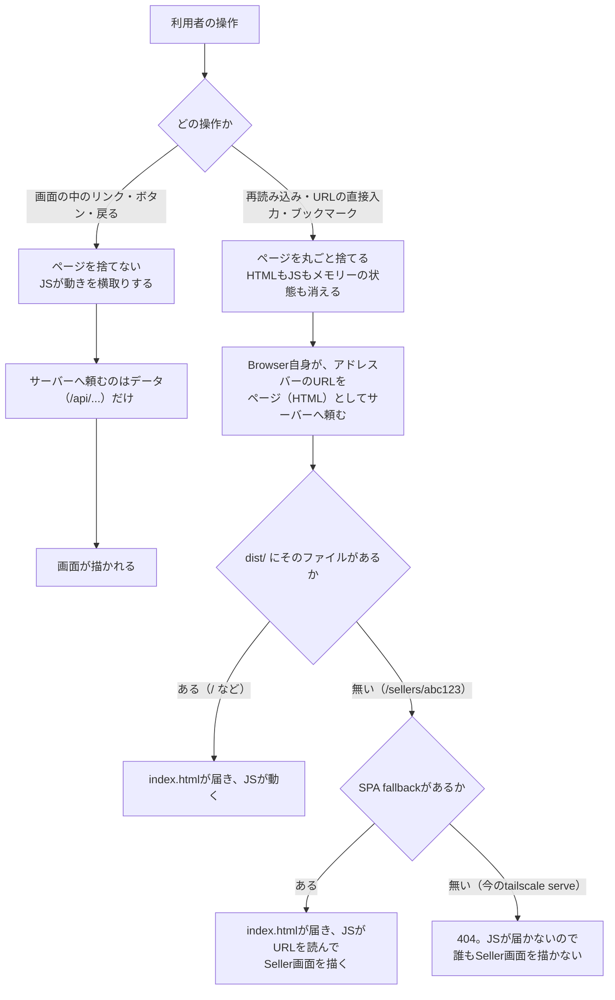
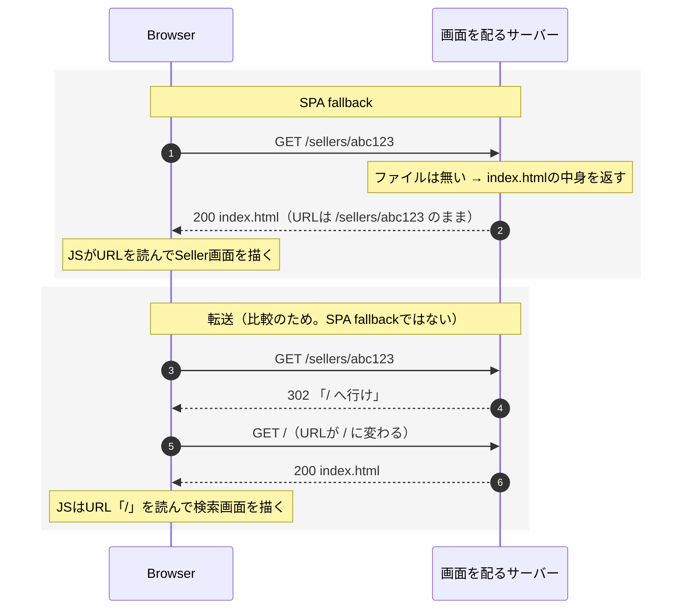
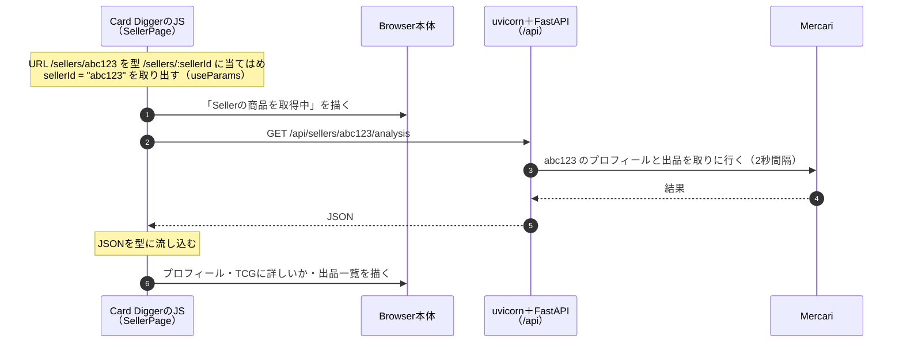
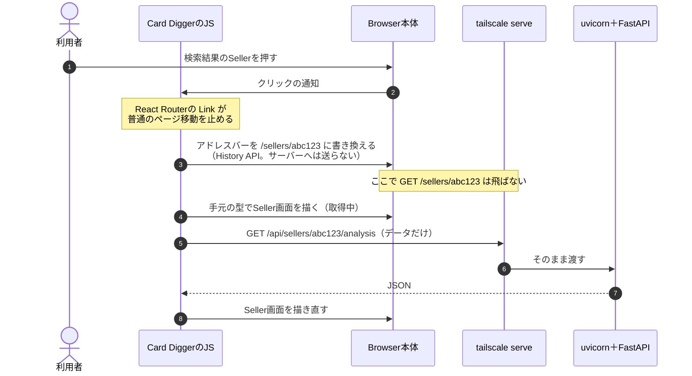
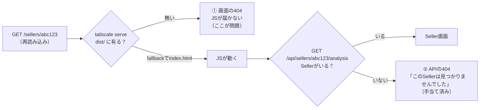
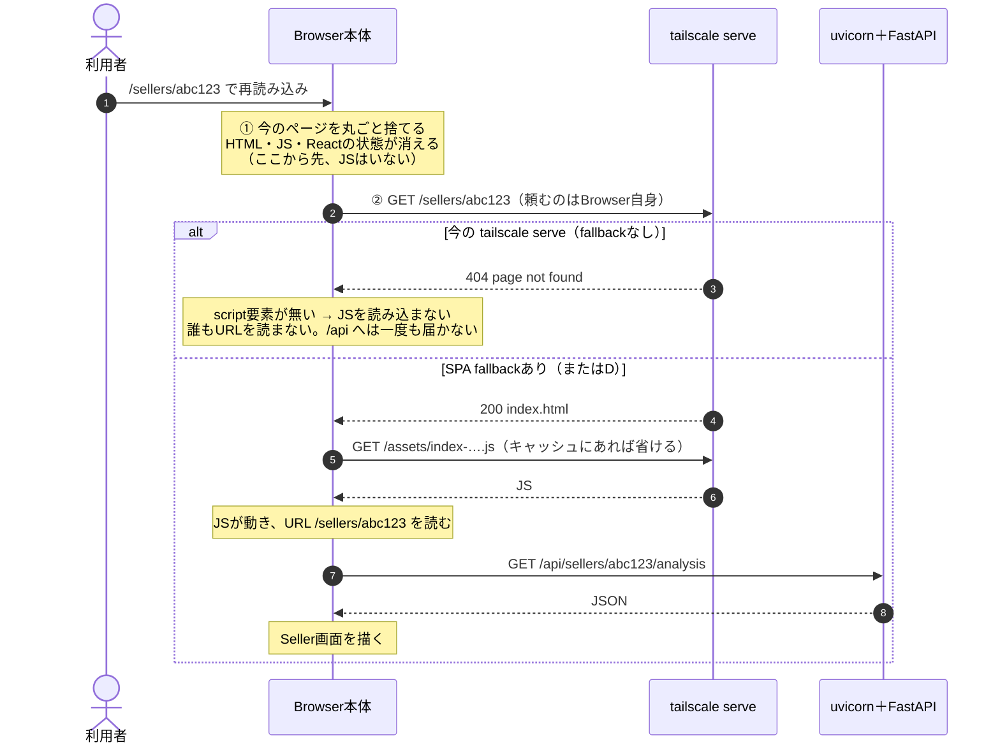
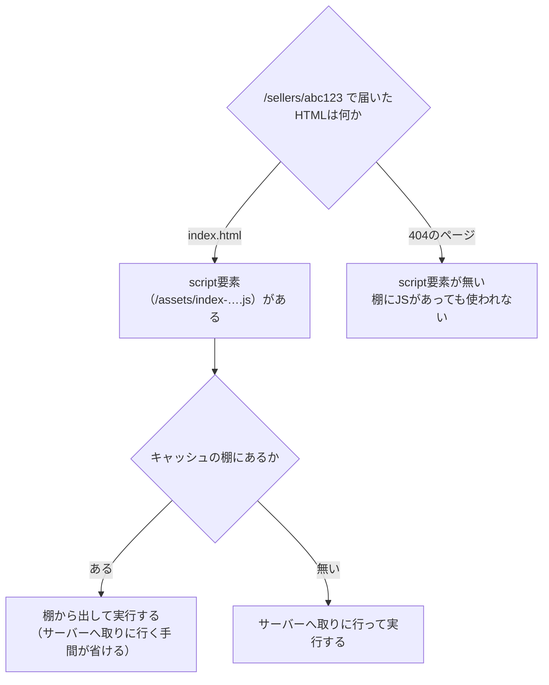
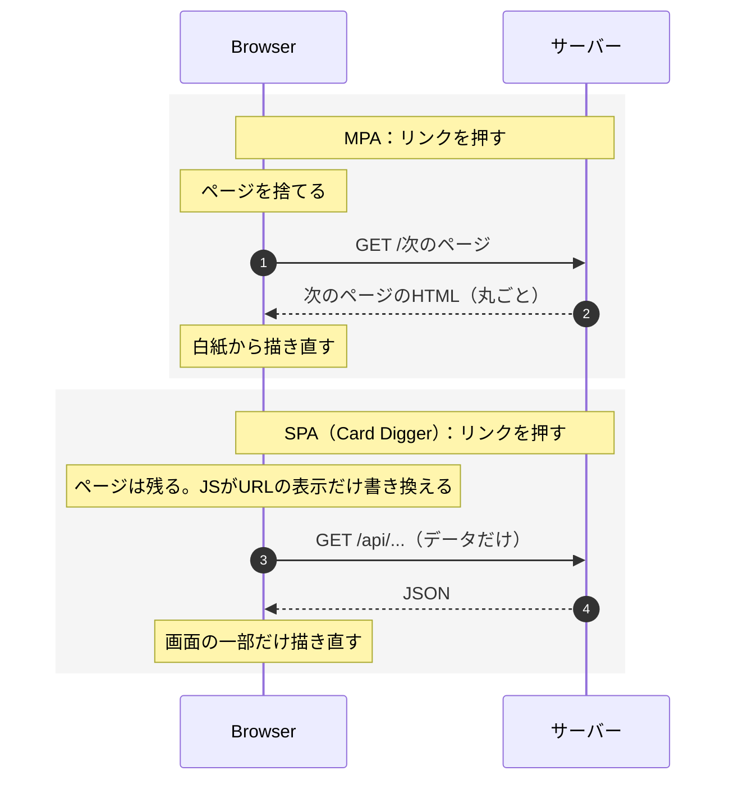
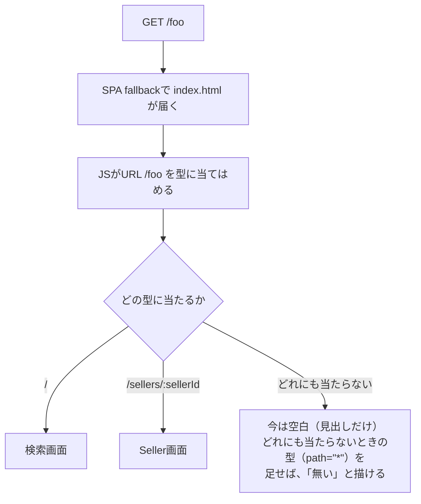

# 再読み込みでBrowserは何を捨てるのか。SPA fallbackは何を埋めるのか — 2026-11-15の問答

[ADR 0002 論点1の検証](../adr/0002-switch-deploy-target-by-configuration.md#検証の結果2026-11-11途中)で、
`tailscale serve`は`/sellers/abc123`を直接開くと**404**を返した（SPA fallbackができない）。
その手当て（C＋DかC＋Caddy）を選ぶ前に、利用者が出した問いと答えをまとめる。

**この文書は、Browserがいつページを捨て、いつ捨てないか、そのときサーバーに何が届くかを説明する。
C＋DとC＋Caddyのどちらを選ぶか、なぜ選ぶかは[ADR 0002](../adr/0002-switch-deploy-target-by-configuration.md)が持つ。**
案B（FastAPIが`dist/`も配る）を前提にした再読み込みの説明は、
[画面を組み立てる問答 Q7](2026-11-08-who-builds-the-screen.md#q7-sellersabc123で再読み込みすると何が起きるのか)にある。
この文書は、論点1で決めたC（**`tailscale serve`が`dist/`を直接配る**）を前提にする。

| # | 問い |
|---|---|
| Q1 | [SPA fallbackとは何か。URLを書き換えて`/`の画面を返すことか](#q1-spa-fallbackとは何かurlを書き換えての画面を返すことか) |
| Q2 | [「サーバーにファイルが無い」とはどういうことか](#q2-サーバーにファイルが無いとはどういうことか) |
| Q3 | [`/sellers/abc123`のページが無いなら、何を表示するのか](#q3-sellersabc123のページが無いなら何を表示するのか) |
| Q4 | [画面の中でSellerへ移るとき、サーバーへ頼みに行かないのか](#q4-画面の中でsellerへ移るときサーバーへ頼みに行かないのか) |
| Q5 | [Sellerがいないなら、そうJSONで返してFrontendで描けばよいのではないか](#q5-sellerがいないならそうjsonで返してfrontendで描けばよいのではないか) |
| Q6 | [再読み込みのとき、JSはパスを読んでBackendへ頼まないのか](#q6-再読み込みのときjsはパスを読んでbackendへ頼まないのか) |
| Q7 | [JSは初回に届いてキャッシュされ、使い回されるのではないか](#q7-jsは初回に届いてキャッシュされ使い回されるのではないか) |
| Q8 | [ページを丸ごと捨てるのはSPAだからか。SSRならどうか](#q8-ページを丸ごと捨てるのはspaだからかssrならどうか) |
| Q9 | [リンクで移るときやボタンを押すときも、捨ててから頼むのか](#q9-リンクで移るときやボタンを押すときも捨ててから頼むのか) |
| Q10 | [無いパスでも画面が出たら、利用者は「ある」と思ってしまわないか](#q10-無いパスでも画面が出たら利用者はあると思ってしまわないか) |

先に全体を1枚で示す。**捨てるのは「再読み込み・URLの直接入力・ブックマーク」のときだけで、
そのときにだけ、サーバーは`/sellers/abc123`という住所を頼まれる。**



## Q1. SPA fallbackとは何か。URLを書き換えて`/`の画面を返すことか

**URLは書き換えない。返す画面も`/`の画面（検索画面）ではない。**サーバーに無いパスを頼まれたとき、
404の代わりに**`index.html`の中身を返す**ことをSPA fallbackと呼ぶ。URLは頼まれたまま（`/sellers/abc123`）で、
届いた`index.html`のJSがURLを読み、**Seller画面**を描く。

似ているが違うものに**転送（redirect）**がある。

| | URL | 表示される画面 |
|---|---|---|
| SPA fallback | `/sellers/abc123`のまま | **Seller画面**（開きたかった画面） |
| 転送 | `/`に変わる | 検索画面。`abc123`という情報が消える |



`index.html`は「検索画面のファイル」ではない。**どの画面でも描ける入れ物**である。

## Q2. 「サーバーにファイルが無い」とはどういうことか

**`dist/`の中に`sellers`というフォルダーもファイルも無い、という意味である。**

2026-11-15に`src/frontend`で`npm run build`した`dist/`には、ファイルが3つしかなかった。

```text
dist/
├── index.html                  ← 入れ物（中身はほぼ空。JSを読み込む指示がある）
└── assets/
    ├── index-bNhsAk3q.js       ← 検索画面もSeller画面も、描き方は全部この中
    └── index-CdmTlwaY.css      ← 見た目
```

`-bNhsAk3q`の部分はビルドのたびに変わる。名前の付き方は
[画面を組み立てる問答 Q6](2026-11-08-who-builds-the-screen.md#パスの出どころ)にある。

`tailscale serve`は、URLのパスを**`dist/`の中のファイルの場所**として読む
（[`tailscale serve`の確かめの手順書](../development/windows-tailscale-serve-checks.md)の4-2で、`/`を`current\dist`に向けた）。

| Browserが頼むURL | `tailscale serve`が探す場所 | 結果 |
|---|---|---|
| `/` | `dist/index.html` | ある → 返す |
| `/assets/index-bNhsAk3q.js` | `dist/assets/index-bNhsAk3q.js` | ある → 返す |
| `/sellers/abc123` | `dist/sellers/abc123` | **無い → 404**（2026-11-11の確かめの3） |

`/sellers/abc123`は**JSの中にだけある住所**である。`dist/`のフォルダーの中には無い。

開発で使うVite（`npm run dev`）では、この404は起きない。ViteはSPA fallbackを自分でするからである。
`tailscale serve`に替えたときに初めて表に出た。

## Q3. `/sellers/abc123`のページが無いなら、何を表示するのか

**Seller画面の「型」に、`abc123`のSellerの中身を当てはめて表示する。**Sellerごとのページは無く、
1つの型を全Sellerで使い回す。

型の割り当ては`src/frontend/src/App.tsx`の`AppRoutes`にある。

```tsx
<Route path="/" element={<SearchPage />} />
<Route path="/sellers/:sellerId" element={<SellerPage />} />
```

`:sellerId`は「何が入ってもよい」空欄である。`/sellers/abc123`でも`/sellers/xyz999`でも`SellerPage`が選ばれ、
空欄の文字だけが変わる。



- `sellerId`を取り出すのは`src/frontend/src/pages/SellerPage.tsx`の`useParams`
- 頼むパスを組み立てるのは`src/frontend/src/api/client.ts`の`sellerAnalysis()`
  （`` `/api/sellers/${encodeURIComponent(sellerId)}/analysis` ``）

**ページの中身はファイルとして置いておらず、開くたびにAPIから取ってくる。**`dist/`にファイルが無いのはそのためである。

## Q4. 画面の中でSellerへ移るとき、サーバーへ頼みに行かないのか

**頼みに行く。ただし頼むのはデータ（`/api/...`）だけで、`/sellers/abc123`という画面は頼まない。**
画面の型は、最初に`/`を開いたとき届いたJSの中にもう入っている。



| 順番 | 誰が | 何をする | サーバーへ頼むか |
|---|---|---|---|
| 1 | JS | アドレスバーの表示を`/sellers/abc123`に書き換える | **頼まない** |
| 2 | JS | 手元のSeller画面の型を出し、「取得中」と描く | **頼まない** |
| 3 | JS | `/api/sellers/abc123/analysis`を頼む | **頼む（データ）** |
| 4 | JS | 届いたデータを型に流し込む | — |

アドレスバーの書き換えは、Browserの履歴機能（History API）をJSが呼んでいる。書き換えた先がサーバーにあるかどうかは、
Browserもサーバーも確かめない。**`/sellers/abc123`は、JSが作り、サーバーが知らない住所である。**

## Q5. Sellerがいないなら、そうJSONで返してFrontendで描けばよいのではないか

**その仕組みはもうある。SPA fallbackの問題は、この仕組みより手前で起きる。**

Sellerが本当にいないときは、次のように動く。

1. BackendがAPIの404を返す
2. `src/frontend/src/api/client.ts`が404を`not_found`に変える
3. `src/frontend/src/pages/SellerPage.tsx`が「**このSellerは見つかりませんでした**」と描く

問題になるのは再読み込みのときで、そのときはこの流れが**始まりもしない**（[Q6](#q6-再読み込みのときjsはパスを読んでbackendへ頼まないのか)）。
`abc123`が実在するSellerでも同じように404になる。**Sellerがいるかを確かめる前に、画面の入れ物が届かずに止まる。**

404には2種類あり、別物である。

| 404を返すもの | 意味 | 誰が手当てするか |
|---|---|---|
| API（`/api/sellers/...`） | そのSellerがMercariにいない | **手当て済み。**Frontendが「見つかりませんでした」と描く |
| 画面を配るサーバー（`tailscale serve`） | `dist/`にそのファイルが無い | **SPA fallback、またはD（`HashRouter`）** |



## Q6. 再読み込みのとき、JSはパスを読んでBackendへ頼まないのか

**JSが手元にあれば頼む。再読み込みの瞬間は、JSが手元に無い。**

再読み込みすると、Browserは今のページを**丸ごと捨てる**。HTMLも、メモリーに読み込んでいたJSも、Reactの状態も消える。
そのあと**Browser自身が**、アドレスバーのURLをページとしてサーバーへ頼む。ここで頼んでいるのはJSではない。

「パスを読んでBackendへ頼む」JSも、**サーバーから届けてもらうもの**である。JSを届けるきっかけは`index.html`の
`<script src="/assets/index-….js">`である。



| サーバーの返事 | JSが届くか | パスを読んでBackendへ頼むか |
|---|---|---|
| `index.html`（SPA fallbackあり） | 届く | 頼む |
| 404（今の`tailscale serve`） | 届かない | 頼めない |

## Q7. JSは初回に届いてキャッシュされ、使い回されるのではないか

**JSのファイルがキャッシュに残っていることはある。ただし、使えというHTMLの指示が無いと使われない。**

Browserのキャッシュは、URLごとにファイルをしまっておく棚である。棚からファイルを出すのは、
**今読んでいるHTMLに「このファイルを読み込め」と書いてあるとき**だけである。

```html
<!-- dist/index.html の中 -->
<script type="module" src="/assets/index-bNhsAk3q.js"></script>
```



| | SPA fallbackあり | 今の`tailscale serve` |
|---|---|---|
| `/sellers/abc123`の返事 | `index.html` | 404のページ |
| 返事に`<script src="/assets/index-….js">`があるか | ある | **無い** |
| 棚のJS | 使われる | **棚にあっても使われない** |

**キャッシュが省くのは「JSを取りに行く手間」である。「どのJSを動かすか」を決めるHTMLは、URLごとにサーバーへ頼む。**

## Q8. ページを丸ごと捨てるのはSPAだからか。SSRならどうか

**丸ごと捨てるのは、どのWebサイトでも同じBrowserの動きである。SPAで困るのは、URLとファイルが対応していないからである。**

再読み込みの流れは、どのサイトでも次のとおり。

1. 今のHTMLとJSを捨てる
2. アドレスバーのURLで、**まずHTMLだけ**をサーバーへ頼む
3. 届いたHTMLを読み、`<script src>`に書いてあるJSを頼む（キャッシュにあれば棚から出す）
4. JSを実行する

**HTMLとJSを同時に頼むのではない。**HTMLが届くまで、どのJSが要るかをBrowserは知らない。
SPA fallbackが効くのは2の段である。

違いは、2でサーバーが返せるものにある。

| | 2で届くHTML | `/sellers/abc123`で再読み込みすると |
|---|---|---|
| 普通のWebサイト（MPA） | そのURLのHTMLファイル | URLを作ったのがサーバーなので、ファイルがある → 返る |
| SSR | サーバーがURLを見て、その場で組み立てた完成品 | サーバーが画面を知っているので返る。**SPA fallbackは要らない** |
| SPA（Card Digger） | ほぼ空の`index.html` | URLを作ったのがJSで、`dist/`に無い → **404。SPA fallbackが要る** |

SSRでも3でJSは届く。届いた完成品のHTMLに、ボタンなどの動きを付けるためである（hydrationと呼ぶ）。
SSRとCSRの違いそのものは[画面を組み立てる問答 Q5](2026-11-08-who-builds-the-screen.md#サーバーがデータを埋め込むは別の作り方)にある。

## Q9. リンクで移るときやボタンを押すときも、捨ててから頼むのか

**Card Digger（SPA）では捨てない。**捨てるのは、再読み込み・URLの直接入力・ブックマークから開くときだけである。

| 操作 | HTMLとJSを捨てるか | サーバーへ頼むもの |
|---|---|---|
| 再読み込み、URLの直接入力、ブックマークから開く | **捨てる** | HTML（→ JS） |
| 画面の中のリンクで移る（検索 → Seller） | 捨てない | データだけ（API） |
| Browserの「戻る」 | 捨てない | 必要ならデータだけ |
| 検索ボタンを押す | 捨てない | データだけ（`POST /api/search`） |

リンクやボタンの操作は、JSが動きを横取りし、`fetch`でデータだけをBackendへ頼む。ページはそのまま残り、
届いたデータで画面の一部を描き直す。

普通のWebサイト（MPA）は、リンクを押すたび、フォームを送るたびに、ページを捨てて次のHTMLを頼む。
画面が一瞬白くなって切り替わるのはそのためである。



| | リンク・ボタン | 再読み込み |
|---|---|---|
| 普通のWebサイト（MPA） | 捨てる | 捨てる |
| SPA | **捨てない** | 捨てる |

**捨てないことを、Card Diggerは使っている。**Seller画面から検索へ戻ったとき、検索をやり直さずに前の結果が出る。
ページを捨てていないので、メモリーに検索結果が残っているからである。`src/frontend/src/App.tsx`の`SearchProvider`は
このためにRouterの外に置いてある（同じファイルの説明文にある）。逆に再読み込みすると、検索結果は消える。

SPAは普段捨てないように作られている。そのぶん、**捨てざるを得ない再読み込みのときに、
「JSが作ったURL」と「サーバーにあるファイル」のズレが表に出る。**それを埋めるのがSPA fallbackである。

## Q10. 無いパスでも画面が出たら、利用者は「ある」と思ってしまわないか

**SPA fallbackを入れると、本当に無いパスにも`index.html`が返る。何が描かれるかはJSの決まり次第になる。**

無いパスには2種類ある。

| パス | アプリにとって | サーバー（`dist/`）にとって |
|---|---|---|
| `/sellers/abc123` | **ある**（Seller画面の型に当たる） | 無い |
| `/foo` | **無い**（どの型にも当たらない） | 無い |

SPA fallbackが救いたいのは上の行である。下の行にも同じく`index.html`が返る。

2026-11-15時点の`src/frontend/src/App.tsx`には、`/`と`/sellers/:sellerId`の2つの型しか無く、
**どれにも当たらないときの型が無い。**そのため`/foo`を開くと、見出しの「Card Digger」だけが出て、その下は空白になる。
エラーにはならないが、「無い」とも言わない。



SPA fallbackを入れると、「その住所の画面があるか」を判断する者が、サーバーからJSへ移る。

| 判断すること | SPA fallbackなし | SPA fallbackあり |
|---|---|---|
| ファイルがあるか | サーバー | サーバー |
| その住所の画面があるか | （サーバーが「ファイルが無い」で代わりに答えてしまう） | **JS**（`App.tsx`の型） |
| そのSellerがいるか | API | API |

もう1つ違いがある。JSが「無い」と描いても、サーバーが返したHTTPの番号は**200（成功）**のままになる。
これを気にするのは主に検索エンジンである。番号と画面の言うことが食い違うからである。

D（`HashRouter`）でも同じことが起きる。`/#/foo`のとき、サーバーには`/`しか届かず、
`#/foo`をどの型に当てるかはJSが決める。
