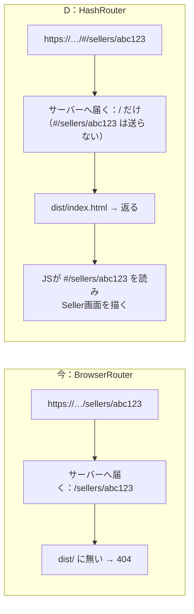
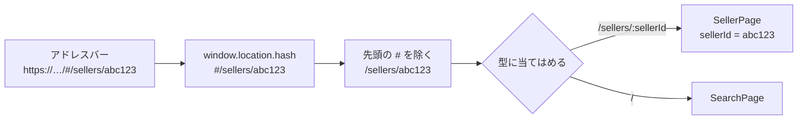
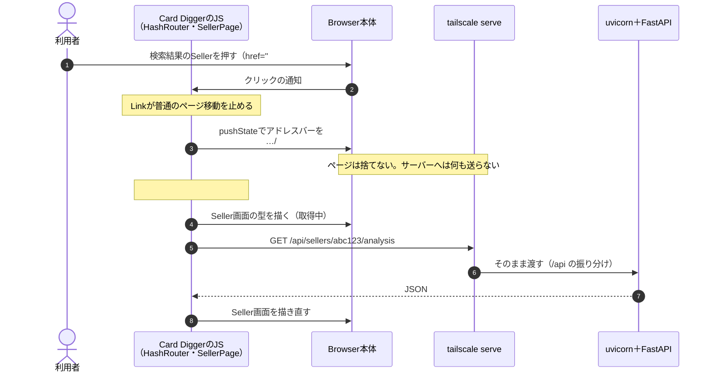
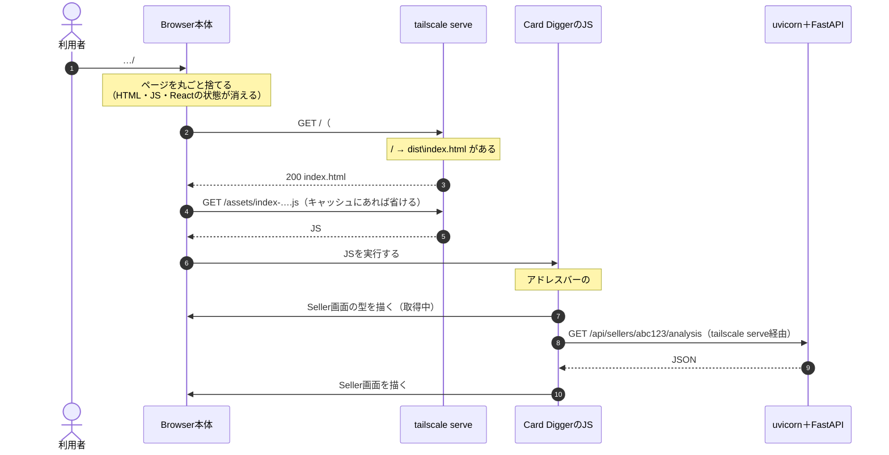
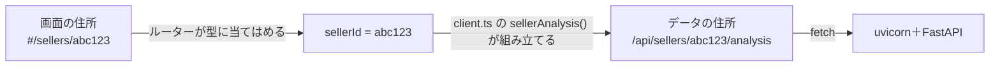
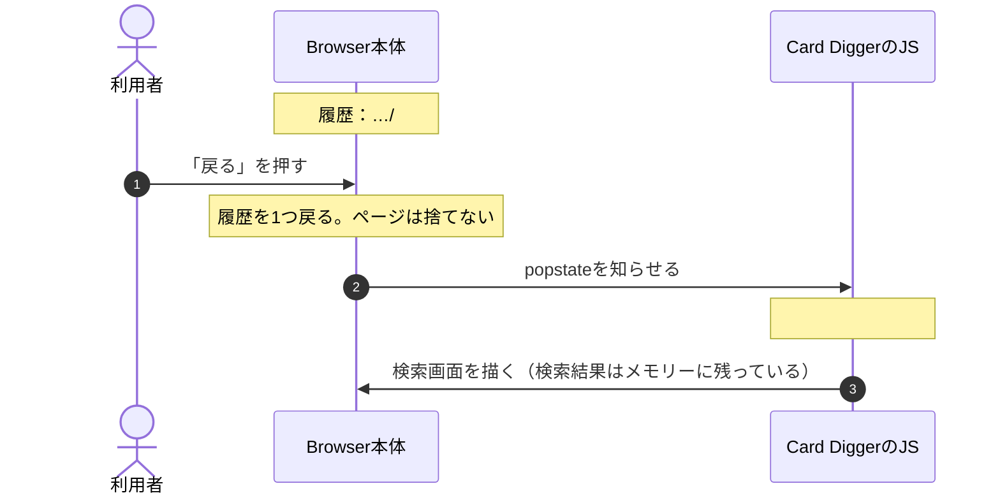

# `HashRouter`は、どうやってSPA fallbackを要らなくするのか — 2026-11-16の問答

[ADR 0002 論点1の検証](../adr/0002-switch-deploy-target-by-configuration.md#検証の結果2026-11-11途中)で、
`tailscale serve`は`/sellers/abc123`を直接開くと404を返した（SPA fallbackができない）。
その手当ての1つが**D（`HashRouter`）**である。利用者が「C＋DとC＋Caddyの説明、特に`HashRouter`の仕組み」を問い、
その答えをまとめる。

**この文書は、`HashRouter`がどう動き、Card Diggerで何が変わるかを説明する。DとCaddy（とE）のどれを選ぶか、
なぜ選ぶかは[ADR 0002](../adr/0002-switch-deploy-target-by-configuration.md#d-ルーティングをhashrouterにしてspa-fallbackを無くすb・cと組み合わせる)が持つ。**
再読み込みでBrowserが何を捨て、なぜ404になるかは[再読み込みの問答](2026-11-15-what-a-reload-throws-away.md)にある。
この文書はその続きで、そこで説明したことは繰り返さない。

| # | 問い |
|---|---|
| Q1 | [`HashRouter`は何をするものか](#q1-hashrouterは何をするものか) |
| Q2 | [URLの`#`より後ろは、なぜサーバーへ送られないのか](#q2-urlのより後ろはなぜサーバーへ送られないのか) |
| Q3 | [ルーターは`#`の後ろをどう読むのか](#q3-ルーターはの後ろをどう読むのか) |
| Q4 | [画面の中でSellerへ移るとき、何が起きるのか](#q4-画面の中でsellerへ移るとき何が起きるのか) |
| Q5 | [`/#/sellers/abc123`で再読み込みすると、何が起きるのか](#q5-sellersabc123で再読み込みすると何が起きるのか) |
| Q6 | [JSは`/sellers/abc123`をAPIでフェッチするのか](#q6-jsはsellersabc123をapiでフェッチするのか) |
| Q7 | [「戻る」、ブックマーク、無い住所、古い形のURLではどうなるのか](#q7-戻るブックマーク無い住所古い形のurlではどうなるのか) |
| Q8 | [Card Diggerでは、どこを変えることになるのか](#q8-card-diggerではどこを変えることになるのか) |
| Q9 | [`HashRouter`にすると、何が気になるのか](#q9-hashrouterにすると何が気になるのか) |

## Q1. `HashRouter`は何をするものか

**画面の住所を、URLの`#`より後ろに置くルーターである。**`#`より後ろはサーバーへ送られないので、
サーバーは何を開かれても`/`しか頼まれない。**「知らない住所」がサーバーへ届かなくなる**ので、SPA fallbackが要らなくなる。

SPA fallbackの穴への手当ては、向きが2つある。

| 手当て | 考え方 | 「知らない住所」は |
|---|---|---|
| **D（`HashRouter`）** | **住所を、サーバーへ送られない場所に移す** | サーバーへ届かない（穴を避ける） |
| Caddy | サーバーに「知らない住所なら`index.html`」を教える | 届くが、`index.html`が返る（穴を埋める） |

| | 今（`BrowserRouter`） | D（`HashRouter`） |
|---|---|---|
| Seller画面のURL | `https://<PC名>.ts.net/sellers/abc123` | `https://<PC名>.ts.net/#/sellers/abc123` |
| ルーターが読むところ | パス（`/sellers/abc123`） | `#`の後ろ（`/sellers/abc123`） |
| 再読み込みでサーバーへ届くパス | `/sellers/abc123`（`dist/`に無い → 404） | **`/`だけ**（`dist/index.html`がある → 返る） |
| サーバーに要るもの | SPA fallback | **ファイルを配ることだけ** |



## Q2. URLの`#`より後ろは、なぜサーバーへ送られないのか

**`#`より後ろ（フラグメント）は、もともと「ページの中のどこを見せるか」を表す部分で、ブラウザーだけが使うものだからである。**

URLは、部分ごとに役割が決まっている。

```text
https://<PC名>.ts.net/sellers/abc123?x=1#section
└──────────┬─────────┘└──────┬──────┘└─┬┘└───┬──┘
       どこへ              パス       クエリ  フラグメント
  ←───────────── サーバーへ送る ──────────→ ←送らない→
```

| 部分 | 役割 | サーバーへ送るか |
|---|---|---|
| `https://<PC名>.ts.net` | どのサーバーへ | 送る（接続先とHostヘッダー） |
| `/sellers/abc123` | パス。サーバーの中の何か | 送る |
| `?x=1` | クエリ。サーバーへの追加の指示 | 送る |
| `#section` | **フラグメント。ページの中の位置** | **送らない** |

フラグメントの本来の使い方は、ページの中の見出しへ飛ぶことである（`#section`なら`id="section"`の見出しへ）。
ページの中の位置は、届いたページをBrowserが表示するときの話なので、サーバーは知らなくてよい。
**どのBrowserでも、HTTPの要求にフラグメントは載らない。**

`HashRouter`が使う性質は、もう1つある。**フラグメントだけを変えても、Browserはページを読み直さない。**
ページの中のリンク（`#section`）を押しても画面が白くならないのと同じである。

| 性質 | `HashRouter`での使い道 |
|---|---|
| フラグメントはサーバーへ送られない | 再読み込みしても、サーバーには`/`しか届かない（[Q5](#q5-sellersabc123で再読み込みすると何が起きるのか)） |
| フラグメントだけ変えても、ページを読み直さない | 画面を移っても、ページを捨てない（[Q4](#q4-画面の中でsellerへ移るとき何が起きるのか)） |
| フラグメントの変化も、Browserの履歴に残る | 「戻る」が使える（[Q7](#q7-戻るブックマーク無い住所古い形のurlではどうなるのか)） |

## Q3. ルーターは`#`の後ろをどう読むのか

**`#`の後ろを、今のパスと同じものとして読む。**なので、画面の型の書き方は変わらない。

2026-11-16時点の`src/frontend/package.json`の`react-router`は8.3.1である。その`HashRouter`の中身
（`node_modules/react-router/dist/development/lib/router/history.js`の`createHashHistory`）は、次のことをしている。

| 仕事 | 中身 | 例 |
|---|---|---|
| 今の住所を読む | `window.location.hash`から先頭の`#`を除き、パス・クエリ・フラグメントに分ける | `#/sellers/abc123` → パス`/sellers/abc123` |
| リンク先を作る | 行き先の前に`#`を付ける | `<Link to="/sellers/abc123">` → `href="#/sellers/abc123"` |
| 住所を変える | Browserの履歴機能（History API）の`pushState`で、`#`つきのURLを積む | アドレスバーが`…/#/sellers/abc123`になる |

読んだパスを型に当てはめる仕事は、`BrowserRouter`と同じである。`src/frontend/src/App.tsx`の`AppRoutes`の型は、そのまま使える。

```tsx
<Route path="/" element={<SearchPage />} />
<Route path="/sellers/:sellerId" element={<SellerPage />} />
```



| | `BrowserRouter` | `HashRouter` |
|---|---|---|
| 住所を読む場所 | `window.location.pathname` | `window.location.hash`（`#`を除く） |
| 型の書き方（`path="/sellers/:sellerId"`） | 同じ | 同じ |
| `<Link to="/sellers/…">`の書き方 | 同じ | 同じ（`#`はルーターが付ける） |
| `useParams()`で取れる値 | `abc123` | `abc123` |

## Q4. 画面の中でSellerへ移るとき、何が起きるのか

**今の`BrowserRouter`と同じく、ページを捨てずに、データだけをサーバーへ頼む。**違うのは、アドレスバーに`#`が入ることだけである。



| 順番 | 誰が | 何をする | サーバーへ頼むか |
|---|---|---|---|
| 1 | JS（`Link`） | 普通のページ移動を止める | 頼まない |
| 2 | JS（ルーター） | アドレスバーを`…/#/sellers/abc123`にする | **頼まない** |
| 3 | JS（ルーター） | `#`の後ろを型に当てはめ、Seller画面の型を出す | 頼まない |
| 4 | JS（`SellerPage`） | `/api/sellers/abc123/analysis`を頼む | **頼む（データ）** |
| 5 | JS | 届いたJSONを型に流し込む | — |

`Link`が止めなかったとしても（JSが動く前に押したなど）、変わるのはフラグメントだけなので、Browserはページを読み直さない。

## Q5. `/#/sellers/abc123`で再読み込みすると、何が起きるのか

**サーバーには`/`だけが届き、`index.html`が返る。届いたJSが`#`の後ろを読み、Seller画面を描く。**



| 順番 | 何が起きるか | サーバーに届くもの |
|---|---|---|
| 1 | Browserがページを丸ごと捨てる | — |
| 2 | Browserがアドレスバーのページを頼む。**フラグメントは載せない** | **`GET /`** |
| 3 | `tailscale serve`が`dist\index.html`を返す | — |
| 4 | Browserが`index.html`の`<script src>`を見て、JSを頼む | `GET /assets/index-….js` |
| 5 | JS（ルーター）が`#`の後ろを読み、Seller画面の型を出す | — |
| 6 | JS（`SellerPage`）がデータを頼む | `GET /api/sellers/abc123/analysis` |
| 7 | 届いたJSONでSeller画面を描く | — |

**今の`BrowserRouter`と比べると、違うのは2と5だけである。**

| 順番 | `BrowserRouter`（今） | `HashRouter`（D） |
|---|---|---|
| 2でサーバーに届くもの | `GET /sellers/abc123` → `dist/`に無い → **404で止まる** | **`GET /`** → `index.html`が返る |
| 5でルーターが読む場所 | パス | `#`の後ろ |
| 3〜4、6〜7 | （2で止まるので起きない） | 今の画面の中の移動と同じ |

## Q6. JSは`/sellers/abc123`をAPIでフェッチするのか

**しない。JSがフェッチするのは`/api/sellers/abc123/analysis`である。**`/sellers/abc123`と`/api/sellers/abc123/analysis`は別の住所である。

| パス | 何の住所か | 使う者 | どこにあるか |
|---|---|---|---|
| `/sellers/abc123`（`#`の後ろ） | **画面**の住所 | ルーター | `App.tsx`の型（`/sellers/:sellerId`） |
| `/api/sellers/abc123/analysis` | **データ**の住所 | `SellerPage`（`useSellerAnalysis`経由） | Backendの`/api`。`tailscale serve`がuvicornへ渡す |

画面の住所は、ルーターが「Seller画面だ」「IDは`abc123`だ」と知るためのものである。そこから取り出した`abc123`で、
`src/frontend/src/api/client.ts`の`sellerAnalysis()`がデータの住所
（`` `/api/sellers/${encodeURIComponent(sellerId)}/analysis` ``）を組み立てる。



**`HashRouter`にしても、データの住所は変わらない。**`/api/...`はBrowserの`fetch`で頼むもので、ルーターを通らないからである。
`tailscale serve`の`/api`の振り分け（[手順書の5-1](../development/windows-tailscale-serve-checks.md#5-1-apiの渡し先をパスつきにする2の手当て)）もそのまま使える。

## Q7. 「戻る」、ブックマーク、無い住所、古い形のURLではどうなるのか

| 場面 | 何が起きるか |
|---|---|
| **「戻る」を押す** | `pushState`で積んだ履歴を1つ戻る。Browserが`popstate`を知らせ、ルーターが`#`の後ろを読み直して検索画面を描く。**ページは捨てない**ので、検索結果は残る（`SearchProvider`がRouterの外にあるため） |
| **ブックマークやiPhoneへ送ったURLから開く** | 再読み込みと同じ（[Q5](#q5-sellersabc123で再読み込みすると何が起きるのか)）。サーバーには`/`だけが届く |
| **`/#/foo`のような無い住所** | サーバーには`/`が届き、`index.html`が返る。ルーターが`/foo`をどの型にも当てられず、2026-11-16時点では見出しだけの空白になる。SPA fallbackを入れた場合と同じである（[再読み込みの問答 Q10](2026-11-15-what-a-reload-throws-away.md#q10-無いパスでも画面が出たら利用者はあると思ってしまわないか)） |
| **古い形のURL（`/sellers/abc123`、`#`なし）** | サーバーに`/sellers/abc123`が届き、`tailscale serve`は404を返す。`HashRouter`にする前のURLをブックマークしていた場合に起きる |
| **`#`の後ろが空（`https://<PC名>.ts.net/`）** | ルーターは`/`として読み、検索画面を描く |



## Q8. Card Diggerでは、どこを変えることになるのか

**ルーターを替える1か所と、URLの形を確かめているE2Eの1か所である。**2026-11-16時点で調べた。

| 場所 | 今 | Dにすると |
|---|---|---|
| `src/frontend/src/App.tsx`の`import` | `import { BrowserRouter, Route, Routes } from "react-router";` | `BrowserRouter`を`HashRouter`に |
| `src/frontend/src/App.tsx`の`App` | `<BrowserRouter>…</BrowserRouter>` | `<HashRouter>…</HashRouter>` |
| `src/frontend/e2e/acceptance.spec.ts`の141行目 | URLが`/sellers/<ID>`で**終わる**ことを確かめる | `#/sellers/<ID>`で終わることを確かめる |

変えなくてよいもの。

| 場所 | 変えなくてよい理由 |
|---|---|
| `AppRoutes`の型（`path="/"`、`path="/sellers/:sellerId"`） | ルーターが`#`の後ろを同じように読む（[Q3](#q3-ルーターはの後ろをどう読むのか)） |
| `<Link to="/sellers/…">`（`ItemCard.tsx`など）、`<Link to="/">`（`SellerPage.tsx`） | `#`はルーターが付ける |
| `useParams()` | 取れる値が同じ |
| `src/frontend/src/api/client.ts`（`/api/...`） | ルーターを通らない（[Q6](#q6-jsはsellersabc123をapiでフェッチするのか)） |
| Componentのテスト（`tests/SellerPage.test.tsx`など） | `MemoryRouter`の下で`AppRoutes`や画面を動かしており、`BrowserRouter`を使っていない |
| E2Eの`page.goto("/")` | `/`は今と同じく開ける |
| `tailscale serve`の振り分け | `/`をフォルダーに向けたままでよい（2026-11-11の確かめの1・2のとおり） |
| Backend | 何も知らない |

`window.location`を直接読む・書くコードや、`href="/…"`を直に書いたリンクが無いことも、2026-11-16に確かめた。

## Q9. `HashRouter`にすると、何が気になるのか

| 気になること | 中身 | Card Diggerでは |
|---|---|---|
| **URLに`#`が入る** | `https://<PC名>.ts.net/#/sellers/abc123`。見た目だけで、動きは変わらない | 利用者が見て気になるか |
| **ページの中の見出しへ飛ぶ`#`と取り合いになる** | `#`の後ろはルーターが使うので、`#section`で見出しへ飛ぶ使い方ができない | 2026-11-16時点で、そういうリンクは無い |
| **サーバーが画面の住所を知らない** | サーバーには`/`しか届かないので、サーバー側で画面ごとに何かをする（SSR、画面ごとのアクセス記録など）ことができない | Card DiggerはCSRで、サーバーは画面を知らない作り（[画面を組み立てる問答 Q5](2026-11-08-who-builds-the-screen.md#q5-画面にデータを埋め込むのはuvicornかbrowserか)）なので、失うものは無い |
| **検索エンジン** | `#`の後ろは別のページとして扱われにくい | Tailnetの中だけで使うので関係ない |
| **React Routerの位置づけ** | `HashRouter`は「サーバーの設定でSPA fallbackができないとき」の手段とされる。普通はきれいなURL（`BrowserRouter`）を使う | 今回は`tailscale serve`がSPA fallbackをできない（2026-11-11の確かめの3）。その場面にあたる |
| **前の判断を開き直す** | `BrowserRouter`は2026-09のFrontend基盤（#11）で選んだもの | ADR 0002のDの「デメリット」に書いてある |
| **古い形のURL** | `HashRouter`にする前の`/sellers/abc123`は404のまま | [Q7](#q7-戻るブックマーク無い住所古い形のurlではどうなるのか) |

**サーバー側から見ると、`HashRouter`は「どの画面か」をサーバーへ一切伝えない作りである。**
サーバーはファイルを配るだけになり、SPA fallbackを含め、画面のことを何も知らなくてよくなる。
これは、[ADR 0002](../adr/0002-switch-deploy-target-by-configuration.md#d-ルーティングをhashrouterにしてspa-fallbackを無くすb・cと組み合わせる)が
Dを「どの配り手でも動く」と書いている理由と同じことである。
